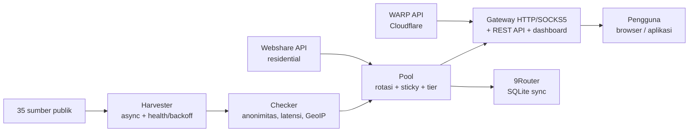

# Proxyz Architecture

This document explains how Proxyz works internally — for
contributors and users who want to understand why the tool is
built this way.

## Big picture

## Components

### Harvester (`proxyz/harvester.py`)

- Fetches proxy lists from 35 sources in `config/sources.json`
  (17 HTTP, 8 SOCKS4, 10 SOCKS5) — fresh sources are checked first.
- All sources count `Proxy` + `ProxySet` — strict dedup: one
  `ip:port` + protocol is counted only once.
- Each source's health score is stored in
  `output/.source_health.json`. A source that fails 3x in a row
  is rested for 1 hour (backoff).
- Fetching uses `aiohttp` with a threaded `urllib` fallback.
  `trust_env=True` so sandbox/corporate egress proxies still work.

### Checker (`proxyz/checker.py`)

- Async batch (default 100 workers, 5-second timeout).
- Scores: alive/dead status, anonymity (elite / anonymous /
  transparent), latency, and country/ISP.
- GeoIP is fetched in **batch** via `ip-api.com/batch` (100 IPs/request)
  — not one request per proxy like the original repo.
- The SOCKS4/5 handshake is hand-written (asyncio), with no extra
  library.
- Final score 0–100: a combination of latency, anonymity, and stability.

### Pool (`proxyz/pool.py`)

- Stores live proxies in memory + on disk (`output/`).
- Round-robin rotation; residential proxies are prioritized.
- Sticky session: the `X-Session-ID` header pins one proxy
  for `session_ttl` (default 600 seconds).
- Speed tiers: `cepat` (≤350 ms), `sedang` (≤800 ms),
  `lambat` (above that) — used by `panen --tier` and gateway
  profiles.

### Gateway (`proxyz/gateway.py`)

- One socket path for HTTP/SOCKS4/SOCKS5, with or without auth.
- Forwards GET/POST/PUT/DELETE/PATCH + CONNECT relay.
- Optional SOCKS5 listener (`--socks 1080`): CONNECT only;
  BIND/UDP rejected (0x07).
- Auto-healer: real HTTP probes every `healer_interval`
  (default 90 seconds); dead proxies are discarded, the pool is
  refilled when `min_healthy` is not reached.
- Security: binds `127.0.0.1` only; optional token
  (`PROXYZ_TOKEN`); rate limit 60/min per IP (429 +
  `Retry-After`); JSONL audit in `output/gateway-audit.jsonl`.
- REST API + dashboard + `/metrics` + PAC (see README).

### WARP (`proxyz/warp.py`)

- Registers with the official Cloudflare API
  (`api.cloudflareclient.com/v0a2158/reg`), keys generated with
  `cryptography` (fallback `wg genkey`).
- Generates WireGuard `.conf` + Sing-box JSON, file mode 0600.

### Residential (`proxyz/residential.py`)

- Fetches proxy lists via the official Webshare API
  (`proxy.webshare.io/api/v2/proxy/list/`) with
  `Authorization: Token <key>`.
- Multi-account: all keys are merged into one pool.
- Semi-automatic signup: opens a browser, creates a password, the
  user fills in the captcha once and pastes the API key — the key
  is validated live before being saved.
- Manual import from `output/proxy_manual.txt`.

### 9Router (`proxyz/router.py`)

- Writes the pool to the 9Router SQLite `proxyPools` table.
- Safe: backs up the DB first, insert-only by default, dedup
  by `proxyUrl`, `--ganti` only deletes rows tagged
  `Proxyz` (belonging to this tool itself).

### Supporting

| Module | Function |
|---|---|
| `bench.py` | Download-speed ranking (1 MB via Cloudflare) |
| `report.py` | Pool report (Markdown + JSON) |
| `scheduler.py` | `auto` mode: harvest → check → export periodically |
| `doctor.py` | Installation diagnostics |
| `updater.py` | Update via `pip` from GitHub Release (fallback tags) |
| `installer.py` | Creates service files (systemd + Windows Task) |
| `exporter.py` | TXT/JSON/CSV/Clash export, atomic + backup (max 5) |

## Design principles

1. **Never lie about data** — dead proxies are discarded,
   scores are computed from real measurements, not fake numbers.
2. **Never delete other people's data** — 9Router sync is
   insert-only; `--ganti` only touches rows belonging to the tool.
3. **Never turn off security for convenience** — TLS
   stays on, gateway binds localhost, the updater does not
   run commands from the server.
4. **One code path, not three** — the original repo had 3 checkers
   duplicating each other; Proxyz has one pipeline.
