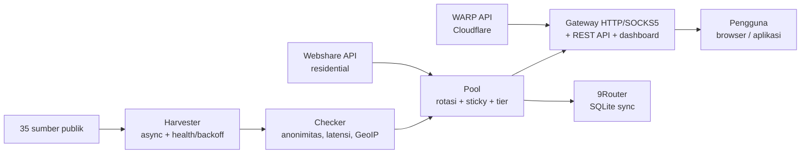

# Arsitektur Proxyz

Dokumen ini buat kontributor sama pengguna yang pengen paham cara
kerja bagian dalamnya — kenapa tool ini dibangun begini.

## Gambaran besar

## Komponen

### Harvester (`proxyz/harvester.py`)

Ngambil daftar proxy dari 35 sumber di `config/sources.json`
(17 HTTP, 8 SOCKS4, 10 SOCKS5) — sumber yang segar dicek duluan.
Dedup-nya ketat: satu `ip:port` + protokol cuma dihitung sekali.

Tiap sumber punya skor kesehatan, disimpen di
`output/.source_health.json`. Sumber yang gagal 3x beruntun
diistirahatkan 1 jam. Fetch-nya pakai `aiohttp` dengan fallback
`urllib` ber-thread, dan `trust_env=True` biar proxy egress
sandbox/korporat tetap jalan.

### Checker (`proxyz/checker.py`)

Async batch (default 100 worker, timeout 5 detik). Yang dinilai:
hidup/mati, anonimitas (elite / anonymous / transparent), latensi,
sama negara/ISP.

GeoIP diambil batch lewat `ip-api.com/batch` (100 IP/request) —
bukan satu request per proxy kayak repo asli. Handshake SOCKS4/5
ditulis tangan pakai asyncio, tanpa library tambahan. Skor akhir
0–100: kombinasi latensi, anonimitas, sama kestabilan.

### Pool (`proxyz/pool.py`)

Nyimpen proxy hidup di memori + di disk (`output/`). Rotasi
round-robin, residential diprioritaskan. Header `X-Session-ID`
ngunci satu proxy selama `session_ttl` (default 600 detik).
Tier kecepatan: `cepat` (≤350 ms), `sedang` (≤800 ms),
`lambat` (di atas itu).

### Gateway (`proxyz/gateway.py`)

Satu jalur socket buat HTTP/SOCKS4/SOCKS5, dengan/tanpa auth.
Forward GET/POST/PUT/DELETE/PATCH + CONNECT relay. Listener SOCKS5
opsional (`--socks 1080`): cuma CONNECT, BIND/UDP ditolak (0x07).

Auto-healer: probe HTTP beneran tiap `healer_interval` (default
90 detik). Proxy mati dibuang, pool diisi ulang kalau `min_healthy`
nggak tercapai.

Soal keamanan: bind `127.0.0.1` doang, token opsional
(`PROXYZ_TOKEN`), rate limit 60/menit per IP (429 +
`Retry-After`), audit JSONL di `output/gateway-audit.jsonl`.
REST API + dashboard + `/metrics` + PAC, lihat README.

### WARP (`proxyz/warp.py`)

Daftar ke API resmi Cloudflare
(`api.cloudflareclient.com/v0a2158/reg`), kunci dibikin pakai
`cryptography` (fallback `wg genkey`). Hasilnya `.conf` WireGuard
+ JSON Sing-box, file mode 0600.

### Residential (`proxyz/residential.py`)

Ngambil daftar proxy lewat API resmi Webshare
(`proxy.webshare.io/api/v2/proxy/list/`) pakai
`Authorization: Token <key>`. Multi-akun: semua key digabung ke
satu pool.

Signup semi-otomatis: buka browser, bikin password, pengguna isi
captcha sekali terus tempel API key — key divalidasi live sebelum
disimpen. Import manual dari `output/proxy_manual.txt`.

### 9Router (`proxyz/router.py`)

Nulis pool ke tabel `proxyPools` SQLite 9Router. Aman: backup DB
dulu, insert-only secara default, dedup berdasarkan `proxyUrl`,
`--ganti` cuma ngehapus baris yang ditandai `Proxyz`/`Proxyx`
(milik tool ini sendiri).

### Pendukung

- `bench.py` — ranking kecepatan unduh (1 MB via Cloudflare).
- `report.py` — laporan pool (Markdown + JSON).
- `scheduler.py` — mode `auto`: panen → cek → ekspor berkala.
- `doctor.py` — diagnosa instalasi.
- `updater.py` — update via `pip` dari Release GitHub (fallback tags).
- `installer.py` — bikin file service (systemd + Windows Task).
- `exporter.py` — ekspor TXT/JSON/CSV/Clash, atomik + backup (maks 5).

## Beberapa hal yang gue pegang selama nulis kode ini

Proxy mati dibuang, skor dihitung dari pengukuran nyata — jangan
pernah ngarang angka biar keliatan bagus. Sync 9Router insert-only,
`--ganti` cuma nyentuh baris milik tool — jangan pernah hapus data
orang lain. TLS tetap nyala, gateway bind localhost, updater nggak
ngejalanin perintah dari server — jangan pernah matiin keamanan
demi kemudahan. Dan repo asli punya tiga checker yang saling
duplikat; di sini satu pipeline aja.
