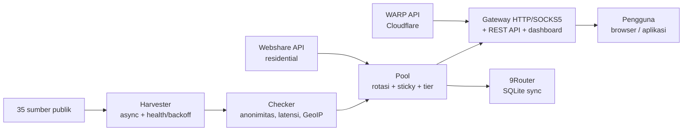

# Arsitektur Proxyz

Dokumen ini menjelaskan cara kerja bagian dalam Proxyz — untuk
kontributor dan pengguna yang ingin paham kenapa tool ini dibangun
begini.

## Gambaran besar

## Komponen

### Harvester (`proxyz/harvester.py`)

- Mengambil daftar proxy dari 35 sumber di `config/sources.json`
  (17 HTTP, 8 SOCKS4, 10 SOCKS5) — sumber segar dicek lebih dulu.
- Semua sumber dihitung `Proxy` + `ProxySet` — dedup ketat: satu
  `ip:port` + protokol hanya dihitung sekali.
- Skor kesehatan tiap sumber disimpan di
  `output/.source_health.json`. Sumber yang gagal 3x beruntun
  diistirahatkan 1 jam (backoff).
- Fetch memakai `aiohttp` dengan fallback `urllib` ber-thread.
  `trust_env=True` supaya proxy egress sandbox/korporat tetap jalan.

### Checker (`proxyz/checker.py`)

- Async batch (default 100 worker, timeout 5 detik).
- Menilai: status hidup/mati, anonimitas (elite / anonymous /
  transparent), latensi, dan negara/ISP.
- GeoIP diambil **batch** lewat `ip-api.com/batch` (100 IP/request)
  — bukan satu request per proxy seperti repo asli.
- Handshake SOCKS4/5 ditulis tangan (asyncio), tanpa library
  tambahan.
- Skor akhir 0–100: kombinasi latensi, anonimitas, dan kestabilan.

### Pool (`proxyz/pool.py`)

- Menyimpan proxy hidup dalam memori + di disk (`output/`).
- Rotasi round-robin; proxy residential diprioritaskan.
- Sticky session: header `X-Session-ID` mengunci satu proxy
  selama `session_ttl` (default 600 detik).
- Tier kecepatan: `cepat` (≤350 ms), `sedang` (≤800 ms),
  `lambat` (di atas itu) — dipakai `panen --tier` dan profil
  gateway.

### Gateway (`proxyz/gateway.py`)

- Satu jalur socket untuk HTTP/SOCKS4/SOCKS5, dengan/tanpa auth.
- Forward GET/POST/PUT/DELETE/PATCH + CONNECT relay.
- Listener SOCKS5 opsional (`--socks 1080`): hanya CONNECT;
  BIND/UDP ditolak (0x07).
- Auto-healer: probe HTTP beneran tiap `healer_interval`
  (default 90 detik); proxy mati dibuang, pool diisi ulang bila
  `min_healthy` tidak tercapai.
- Keamanan: bind `127.0.0.1` saja; token opsional
  (`PROXYZ_TOKEN`); rate limit 60/menit per IP (429 +
  `Retry-After`); audit JSONL di `output/gateway-audit.jsonl`.
- REST API + dashboard + `/metrics` + PAC (lihat README).

### WARP (`proxyz/warp.py`)

- Daftar ke API resmi Cloudflare
  (`api.cloudflareclient.com/v0a2158/reg`), kunci dibuat dengan
  `cryptography` (fallback `wg genkey`).
- Menghasilkan `.conf` WireGuard + JSON Sing-box, file mode 0600.

### Residential (`proxyz/residential.py`)

- Mengambil daftar proxy lewat API resmi Webshare
  (`proxy.webshare.io/api/v2/proxy/list/`) dengan
  `Authorization: Token <key>`.
- Multi-akun: semua key digabung ke satu pool.
- Signup semi-otomatis: buka browser, buat password, pengguna isi
  captcha sekali dan tempel API key — key divalidasi live sebelum
  disimpan.
- Import manual dari `output/proxy_manual.txt`.

### 9Router (`proxyz/router.py`)

- Menulis pool ke tabel `proxyPools` SQLite 9Router.
- Aman: backup DB dulu, insert-only secara default, dedup
  berdasarkan `proxyUrl`, `--ganti` hanya menghapus baris yang
  ditandai `Proxyz`/`Proxyx` (milik tool ini sendiri).

### Pendukung

| Modul | Fungsi |
|---|---|
| `bench.py` | Ranking kecepatan unduh (1 MB via Cloudflare) |
| `report.py` | Laporan pool (Markdown + JSON) |
| `scheduler.py` | Mode `auto`: panen → cek → ekspor berkala |
| `doctor.py` | Diagnosa instalasi |
| `updater.py` | Update via `pip` dari Release GitHub (fallback tags) |
| `installer.py` | Membuat file service (systemd + Windows Task) |
| `exporter.py` | Ekspor TXT/JSON/CSV/Clash, atomik + backup (maks 5) |

## Prinsip desain

1. **Jangan pernah bohong soal data** — proxy mati dibuang,
   skor dihitung dari pengukuran nyata, bukan angka palsu.
2. **Jangan pernah hapus data orang lain** — sync 9Router
   insert-only; `--ganti` hanya menyentuh baris milik tool.
3. **Jangan pernah matikan keamanan demi kemudahan** — TLS
   tetap nyala, gateway bind localhost, updater tidak
   menjalankan perintah dari server.
4. **Satu jalur kode, bukan tiga** — repo asli punya 3 checker
   yang saling duplikat; Proxyz punya satu pipeline.
