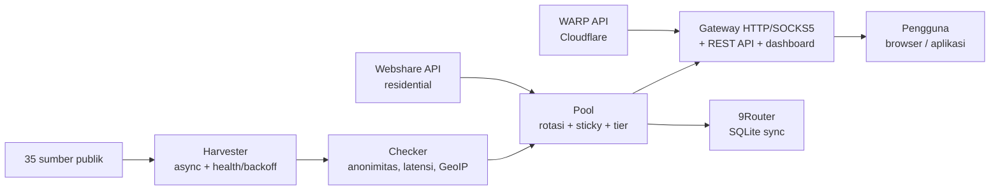

Hierdie is 'n vertaling van die [hoof-README](../../README.md) (Indonesies). Die Indonesiese weergawe is die geldende een.

<div align="center">

# ⚡ Proxyz

**Oes publieke proxies, roterende gateway, WARP & residential — vinnig, veilig, oopbron.**

[](https://github.com/Dvifnyz/Proxyz/releases)
[](https://github.com/Dvifnyz/Proxyz/actions/workflows/ci.yml)
[](../../LICENSE)
[](https://www.python.org/)
[](https://github.com/Dvifnyz/Proxyz/stargazers)
[](https://github.com/Dvifnyz/Proxyz/commits/main)
[](https://github.com/Dvifnyz/Proxyz/issues)
[](../../CONTRIBUTING.md)
[](#ontwikkeling)

[📖 Dokumentasie](../../docs/API.md) · [📋 Changelog](../../CHANGELOG.md) · [🤝 Dra by](../../CONTRIBUTING.md) · [🔒 Sekuriteit](../../SECURITY.md)

Lees hierdie README in 'n ander taal: [English](../../docs/translations/README.en.md) · [中文](../../docs/translations/README.zh-CN.md) · [한국어](../../docs/translations/README.ko.md) · [日本語](../../docs/translations/README.ja.md) · [Русский](../../docs/translations/README.ru.md) · [العربية](../../docs/translations/README.ar.md) · [Afrikaans](../../docs/translations/README.af.md) · [Español](../../docs/translations/README.es.md) · [Português](../../docs/translations/README.pt.md) · [Deutsch](../../docs/translations/README.de.md) · [Français](../../docs/translations/README.fr.md) · [हिन्दी](../../docs/translations/README.hi.md)

</div>

## Hoogtepunte

- 🌾 **Massaoes, een pyplyn** — 35 publieke bronne (HTTP, SOCKS4,
  SOCKS5), ~70 duisend kandidate binne sekondes.
- ✅ **Eerlike kontrole** — anonimiteit (elite/anonymous/transparent),
  latensie, land/ISP (GeoIP batch), telling 0–100. Dooies word weggegooi,
  nie weggesteek nie.
- 🔄 **Roterende gateway** — HTTP + SOCKS5, sticky session, roetering
  per land, auto-healer, token, rate limit, audit log.
- ☁️ **Gratis WARP** — WireGuard-profiel via die amptelike Cloudflare API.
- 🏠 **Residential** — Webshare via die amptelike API (multi-rekening),
  sonder rekeningboerdery en sonder captcha-oplosser.
- 📊 **Waarnembaarheid** — brongesondheid, spoedtoets, leak test,
  verslag, doctor, outomatiese scheduler.
- 🔒 **Veilig per ontwerp** — TLS bly aan, updater via pip (sonder
  afgeleë opdragte), gateway bind slegs localhost.

## Inhoudsopgawe

- [Installasie](#installasie)
- [Vinnige begin](#vinnige-begin)
- [Argitektuur](#argitektuur)
- [Kenmerke](#kenmerke)
- [Opdragte](#opdragte)
- [Gateway en API](#gateway-en-api)
- [Residensiële proxy](#residensiële-proxy)
- [Konfigurasie](#konfigurasie)
- [Projekstruktuur](#projekstruktuur)
- [FAQ](#faq)
- [Probleemoplossing](#probleemoplossing)
- [Padkaart](#padkaart)
- [Ontwikkeling](#ontwikkeling)
- [Sekuriteit](#sekuriteit)
- [Lisensie en dankie](#lisensie-en-dankie)

## Installasie

**Vereiste:** Python 3.9+.

### Met pip

```bash
pip install proxyz
```

### Met pipx (aanbeveel vir die CLI)

```bash
pipx install proxyz
```

### Vanaf bronkode

```bash
git clone https://github.com/Dvifnyz/Proxyz.git
cd Proxyz
pip install -e .
```

### Met Docker

```bash
docker build -t proxyz .
docker run -p 8888:8888 proxyz
```

Sien [docs/API.md](../../docs/API.md) vir die Python API.

## Vinnige begin

```bash
python -m proxyz panen --jumlah 20     # panen + cek 20 proxy hidup
python -m proxyz gateway               # gateway di http://127.0.0.1:8888
curl -x http://127.0.0.1:8888 http://api.ipify.org
```

Sonder argumente maak `python -m proxyz` die interaktiewe kieslys oop.

Voorbeeld van werklike uitvoer:

```
$ python -m proxyz sources

  SUMBER                                                HASIL  GAGAL  STATUS
  https://raw.githubusercontent.com/zevtyardt/proxy-   128468      0  aktif
  https://raw.githubusercontent.com/B4RC0DE-TM/proxy     6370      0  aktif
  https://raw.githubusercontent.com/TheSpeedX/PROXY-     5354      0  aktif
```

```
$ python -m proxyz doctor

  🩺 Proxyz Doctor
  ✅ Python: 3.12.3
  ✅ Config: port 8888, healer 90 dtk
  ✅ Sumber panen: 35 URL (http, socks4, socks5)
  ✅ Sehat (2 peringatan, 0 error).
```

## Argitektuur



Verduideliking van elke komponent: [docs/ARSITEKTUR.md](../../docs/ARSITEKTUR.md).

## Kenmerke

### Oes en kontroleer

- 35 bronne (17 HTTP, 8 SOCKS4, 10 SOCKS5), vars bronne word eerste
  gekontroleer.
- Gesondheidstelling per bron (`proxyz sources`); 'n bron wat 3x
  agtereenvolgens misluk, word 1 uur lank gerus.
- Filter: land (`--negara ID`), protokol, spoedvlak
  (`--tier cepat` ≤350 ms, `sedang` ≤800 ms).
- Blacklist (`proxyz blacklist add 1.2.3.4:8080`) — proxies op die
  blacklist slaag nooit die oes/kontrole nie.

### Gateway

- HTTP/HTTPS-deurstuur (CONNECT) + SOCKS5-luisteraar (`--socks 1080`).
- Round-robin-rotasie, residential kry prioriteit, sticky session
  van 10 minute (`X-Session-ID`), roetering per land (`X-Country: ID`).
- Auto-healer: werklike HTTP-probe elke 90 sekondes, gooi dooies weg,
  vul aan wanneer die pool min word.
- Opsionele token (`PROXYZ_TOKEN`), rate limit van 60/minuut per IP,
  audit log `output/gateway-audit.jsonl`.
- Web-dashboard: pool-tabel, leak test-knoppie & spoedtoets.

### Waarnembaarheid

- `proxyz bench` — ranglys van werklike aflaaispoed (1 MB via Cloudflare).
- `proxyz test` / `/api/leak-test` — werklike IP vs IP via gateway.
- `proxyz laporan` — pool-opsomming (Markdown + `/api/report`).
- `proxyz auto` — oes → kontroleer → uitvoer-siklus, periodiek.
- `proxyz doctor` — diagnose van die installasie.
- `proxyz update` — kontroleer GitHub-vrystellings, werk op via pip (veilig).

## Opdragte

| Opdrag | Funksie |
|---|---|
| `proxyz panen [--jumlah 20] [--negara ID] [--protokol all] [--tier cepat] [--geo]` | Oes + kontroleer lewende proxies, voer uit na `output/` |
| `proxyz cek <file> [--jumlah 20]` | Kontroleer proxylys vanaf 'n lêer |
| `proxyz gateway [--port 8888] [--profil scraper\|cepat\|hemat] [--socks 1080]` | Roterende gateway (HTTP + opsionele SOCKS5) |
| `proxyz warp [--jumlah 1]` | Skep WARP WireGuard-profiel (`.conf`, modus 0600) |
| `proxyz residential [--api-key KEY \| --signup]` | Webshare residential proxy (amptelike API) |
| `proxyz sources` | Gesondheidstabel van elke oesbron |
| `proxyz bench [--jumlah 10]` | Ranglys van aflaaispoed van elke HTTP-proxy |
| `proxyz test [--port 8888]` | Leak test: werklike IP vs IP via gateway |
| `proxyz laporan` | Pool-opsomming na `output/laporan.md` |
| `proxyz sync-9router [--db PATH] [--ganti]` | Sinkroniseer pool na 9Router SQLite DB |
| `proxyz blacklist add\|remove\|list [entri]` | Bestuur proxies wat nie gebruik mag word nie |
| `proxyz auto [--interval 60] [--sekali]` | Oes + kontroleer + uitvoer, periodiek |
| `proxyz install-service [--port 8888]` | Skep dienslêer (systemd + Windows Task) |
| `proxyz update [--yes]` | Kontroleer nuutste vrystelling, werk op via pip |
| `proxyz doctor [--no-gateway]` | Diagnose van installasie (config, bronne, pool, gateway) |

## Gateway en API

Die gateway luister op `127.0.0.1:8888` (slegs localhost — doelbewus
nie na die LAN blootgestel nie). Gebruik dit in die blaaier/toepassing
via `http://127.0.0.1:8888` as proxy, of via SOCKS5 op die poort wat
met `--socks` gespesifiseer is.

| Endpoint | Funksie |
|---|---|
| `GET /api/status` | Statistiek van pool & gateway |
| `GET /api/proxies` | Lys van proxies in die pool |
| `GET /api/random` | Een ewekansige proxy |
| `GET /api/rotate` | Forseer rotasie na die volgende proxy |
| `GET /api/refill` | Vul die pool in die agtergrond aan |
| `GET /api/leak-test` | Werklike IP vs IP via gateway (`zero_leak`) |
| `GET /api/bench?jumlah=5` | Ranglys van poolspoed |
| `GET /api/report` | Poolverslag (JSON) |
| `GET /api/clash.yaml` | Lewende Clash-intekening vanaf die pool |
| `GET /metrics` | Prometheus-metrieke |
| `GET /proxy.pac` | PAC-lêer vir die blaaier |
| `GET /dashboard` | Web-dashboard (pool-tabel, leak test, bench) |

**Verifikasie (opsioneel):** vul die `PROXYZ_TOKEN` env in, stuur dan
`Authorization: Bearer <token>` (of die `X-Proxyz-Token`-kop).

## Residensiële proxy

Het jy 'n residensiële IP nodig? Hier is die amptelike roete:

```bash
python -m proxyz residential --signup   # buka browser + siapkan password;
                                        # isi captcha sendiri sekali,
                                        # tempel API key -> divalidasi live
python -m proxyz residential --api-key KUNCIMU   # tambah akun lain
```

Multi-rekening word ondersteun — alle sleutels word in een pool
saamgevoeg. Of plak handmatige proxies (`proto://user:pass@ip:port`) in
`output/proxy_manual.txt`; die gateway gebruik hulle ook, en residential
kry prioriteit in die pool.

> Proxyz verskaf **nie** 'n outomatiese captcha-oplosser,
> massarekeningboerdery of anti-bot-omseiling nie. Geboerde rekeninge
> word vinnig geban en hulle IP's sterf — dis wat die tool 'n kort
> lewe gee.

## Konfigurasie

Alle instellings is in `config/proxyz.json` (plus env waar van
toepassing). Moenie die token in hierdie lêer skryf nie — gebruik
die `PROXYZ_TOKEN` env.

```json
{"gateway_port": 8888, "healer_interval": 90, "min_healthy": 5,
 "healer_target": 10, "check_timeout": 5.0, "check_workers": 100,
 "check_target": 20, "max_latency_ms": 1200, "session_ttl": 600,
 "rate_limit_per_min": 60, "audit_log": true,
 "schedule_interval_min": 60, "schedule_target": 20}
```

Gateway-profiel (`--profil`): `scraper` (aggressiewe rotasie, pool 30),
`cepat` (slegs proxies ≤350 ms), `hemat` (klein pool, 30-minute sessie).

## Projekstruktuur

```
Proxyz/
├── proxyz/              # paket utama
│   ├── cli.py           # CLI + menu interaktif
│   ├── harvester.py     # panen 35 sumber + skor kesehatan
│   ├── checker.py       # cek hidup, anonimitas, GeoIP batch
│   ├── pool.py          # rotasi, sticky session, tier
│   ├── gateway.py       # gateway HTTP/SOCKS5 + REST + dashboard
│   ├── warp.py          # WARP via API Cloudflare
│   ├── residential.py   # Webshare API resmi + signup semi-otomatis
│   ├── router.py        # sinkronisasi 9Router (SQLite)
│   ├── bench.py         # uji kecepatan unduh
│   ├── scheduler.py     # mode auto berkala
│   ├── report.py        # laporan pool
│   ├── doctor.py        # diagnosa instalasi
│   ├── updater.py       # update aman via pip
│   └── ...              # blacklist, tiers, config, installer
├── config/              # sources.json, proxyz.json, blacklist.txt
├── docs/                # API, ARSITEKTUR, STUDI, translations (12 bahasa)
├── tests/               # 97 tes (pytest)
├── Dockerfile           # gateway di Docker
└── README.md
```

## FAQ

**Is Proxyz wettig?**
Ja — hierdie tool gebruik slegs publieke proxybronne en amptelike
API's (Webshare, Cloudflare). Wat steeds die gebruiker se
verantwoordelikheid bly: moenie sensitiewe data deur 'n onbekende
publieke proxy stuur nie, en hou by die ToS van die diens wat jy gebruik.

**Hoekom kry `panen` 0 lewende proxies?**
Die meeste gratis proxies is dood — dis normaal. Probeer later weer,
verander van netwerk, of gebruik 'n ander `--negara`. Loop
`proxyz doctor` om te bevestig dat jou installasie gesond is.

**Hoekom moet residential handmatig geregistreer word?**
Omdat Webshare 10 gratis IP's per rekening gee, en rekeninge wat deur
bots geskep word (captcha outomaties opgelos) vinnig geban word —
hulle IP's sterf saam. Registreer een keer (30 sekondes), en Proxyz
gebruik die sleutel vir altyd.

**Kan Proxyz op Windows loop?**
Ja. Python 3.9+ en alle opdragte is dieselfde. Om outomaties te loop
by aanmelding, gebruik `proxyz install-service` (dit skep 'n Task Scheduler).

**Kan die gateway vanaf 'n foon / ander rekenaar bereik word?**
Nee — doelbewus slegs `127.0.0.1`. As jy dit vanaf die LAN moet
bereik, loop dit agter jou eie reverse proxy met 'n aktiewe token.

**Waar word my Webshare API-sleutel gestoor?**
In plaaslike `config/webshare.json` (modus 0600), nooit gecommit nie.
Verwyder die lêer as die sleutel lek, en skep dan 'n nuwe sleutel in
die Webshare-dashboard.

## Probleemoplossing

| Simptoom | Oorsaak & oplossing |
|---|---|
| `pool kosong — panen dulu` | Loop eers `proxyz panen`, of die gateway sal self oes wanneer dit begin |
| `502` saat browsing via gateway | Alle proxies in die pool is dood — die healer sal aanvul; of loop `proxyz panen` weer |
| `401 token dibutuhkan` | Vul `PROXYZ_TOKEN` in die env in en stuur `Authorization: Bearer <token>` |
| `429 rate limit` | Wag ~1 minuut, of verhoog `rate_limit_per_min` in die config |
| `proxyz update` 404 | Daar is nog geen Release op GitHub nie — die updater val outomaties terug na tags |
| Gateway tidak bisa diakses | Maak seker geen ander proses gebruik poort 8888 nie; kontroleer `proxyz doctor` |
| `0 hidup` terus-menerus | Die netwerk blokkeer direkte TCP na proxies (bv. sandbox) — probeer op 'n gewone skootrekenaar/PC |

Steeds vas? Loop `proxyz doctor` en heg die uitvoer by wanneer jy
'n issue oopmaak.

## Padkaart

- [ ] IPv6-ondersteuning vir checker & gateway
- [ ] Oesbronne vanaf die gemeenskap (PR's welkom)
- [ ] `proxyz serve`-modus — gateway + auto in een proses
- [ ] Surge / Shadowrocket-uitvoer
- [ ] Dashboard v3 — latensiegrafiek & poolgeskiedenis

Het jy ander idees? Maak 'n [kenmerkaanvraag](../../.github/ISSUE_TEMPLATE/feature_request.md) oop.

## Ontwikkeling

```bash
git clone https://github.com/Dvifnyz/Proxyz.git
cd Proxyz
python -m venv .venv && source .venv/bin/activate
pip install -e ".[dev]"
pytest -q            # 97 tes
python -m proxyz doctor
```

Sien [CONTRIBUTING.md](../../CONTRIBUTING.md) vir die bydraegids
(commit-styl, hoe om bronne by te voeg, hoe om opdragte by te voeg).

## Sekuriteit

Moenie kwesbaarhede via 'n publieke issue rapporteer nie — lees
[SECURITY.md](../../SECURITY.md). Kortliks: die gateway bind slegs localhost,
die token word nooit in die config-lêer geskryf nie, die Webshare
API-sleutel word plaaslik in modus 0600 gestoor, en die updater loop
nooit opdragte vanaf die bediener nie.

## Lisensie en dankie

Lisensie [MIT](../../LICENSE).

Dankie aan
[itzluthfi](https://github.com/itzluthfi) — skepper van
[petani-proxy](https://github.com/itzluthfi/petani-proxy), wat die
studiemateriaal en inspirasie vir hierdie tool was. Struktuurverwysings
vir hierdie README: [FastAPI](https://github.com/fastapi/fastapi) en
[uv](https://github.com/astral-sh/uv).

[](https://star-history.com/#Dvifnyz/Proxyz&Date)
