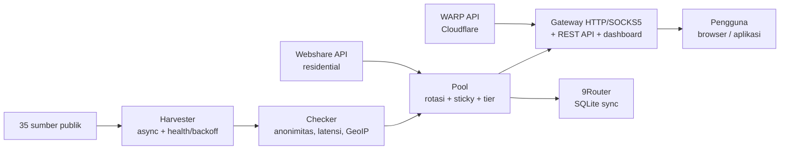

> هذه ترجمة [لملف README الرئيسي (باللغة الإندونيسية)](../../README.md). النسخة الإندونيسية هي المعتمدة.

<div align="center">

# ⚡ Proxyz

**جمع البروكسيات العامة، وبوابة دوّارة، وWARP وبروكسيات سكنية — سريع وآمن ومفتوح المصدر.**

[](https://github.com/Dvifnyz/Proxyz/releases)
[](https://github.com/Dvifnyz/Proxyz/actions/workflows/ci.yml)
[](../../LICENSE)
[](https://www.python.org/)
[](https://github.com/Dvifnyz/Proxyz/stargazers)
[](https://github.com/Dvifnyz/Proxyz/commits/main)
[](https://github.com/Dvifnyz/Proxyz/issues)
[](../../CONTRIBUTING.md)
[](#التطوير)

[📖 التوثيق](../../docs/API.md) · [📋 سجل التغييرات](../../CHANGELOG.md) · [🤝 المساهمة](../../CONTRIBUTING.md) · [🔒 الأمان](../../SECURITY.md)

اقرأ ملف README هذا بلغات أخرى: [English](../../docs/translations/README.en.md) · [中文](../../docs/translations/README.zh-CN.md) · [한국어](../../docs/translations/README.ko.md) · [日本語](../../docs/translations/README.ja.md) · [Русский](../../docs/translations/README.ru.md) · [العربية](../../docs/translations/README.ar.md) · [Afrikaans](../../docs/translations/README.af.md) · [Español](../../docs/translations/README.es.md) · [Português](../../docs/translations/README.pt.md) · [Deutsch](../../docs/translations/README.de.md) · [Français](../../docs/translations/README.fr.md) · [हिन्दी](../../docs/translations/README.hi.md)

</div>

## أبرز المزايا

- 🌾 **جمع جماعي عبر مسار واحد** — 35 مصدرًا عامًا (HTTP وSOCKS4 وSOCKS5)، ونحو 70 ألف مرشح في ثوانٍ معدودة.
- ✅ **فحص صادق** — إخفاء الهوية (elite/anonymous/transparent)، وزمن الاستجابة، والبلد ومزوّد الخدمة (GeoIP دُفعي)، ودرجة من 0 إلى 100. الميّت يُرمى ولا يُخفى.
- 🔄 **بوابة دوّارة** — HTTP + SOCKS5، وجلسات ثابتة، وتوجيه حسب البلد، وأداة إصلاح تلقائي، ورمز مميز، وحد للمعدل، وسجل تدقيق.
- ☁️ **WARP مجاني** — ملفات WireGuard عبر واجهة Cloudflare الرسمية.
- 🏠 **بروكسيات سكنية** — عبر واجهة Webshare الرسمية (حسابات متعددة)، دون مزارع حسابات ودون حلّال كابتشا.
- 📊 **قابلية الملاحظة** — صحة المصادر، واختبار السرعة، واختبار التسرب، والتقارير، وأداة doctor، والمجدول التلقائي.
- 🔒 **آمن بالتصميم** — TLS مفعّل دائمًا، والتحديث عبر pip (دون أوامر بعيدة)، والبوابة مرتبطة بـ localhost فقط.

## جدول المحتويات

- [التثبيت](#التثبيت)
- [البدء السريع](#البدء-السريع)
- [البنية](#البنية)
- [الميزات](#الميزات)
- [الأوامر](#الأوامر)
- [البوابة وواجهة برمجة التطبيقات](#البوابة-وواجهة-برمجة-التطبيقات)
- [البروكسيات السكنية](#البروكسيات-السكنية)
- [الإعدادات](#الإعدادات)
- [بنية المشروع](#بنية-المشروع)
- [الأسئلة الشائعة](#الأسئلة-الشائعة)
- [استكشاف الأخطاء وإصلاحها](#استكشاف-الأخطاء-وإصلاحها)
- [خارطة الطريق](#خارطة-الطريق)
- [التطوير](#التطوير)
- [الأمان](#الأمان)
- [الترخيص والشكر](#الترخيص-والشكر)

## التثبيت

**المتطلبات:** Python 3.9+.

### باستخدام pip

```bash
pip install proxyz
```

### باستخدام pipx (مُوصى به لواجهة سطر الأوامر)

```bash
pipx install proxyz
```

### من المصدر

```bash
git clone https://github.com/Dvifnyz/Proxyz.git
cd Proxyz
pip install -e .
```

### باستخدام Docker

```bash
docker build -t proxyz .
docker run -p 8888:8888 proxyz
```

اطّلع على [docs/API.md](../../docs/API.md) للاطلاع على واجهة Python البرمجية.

## البدء السريع

```bash
python -m proxyz panen --jumlah 20     # panen + cek 20 proxy hidup
python -m proxyz gateway               # gateway di http://127.0.0.1:8888
curl -x http://127.0.0.1:8888 http://api.ipify.org
```

بدون وسائط، يفتح `python -m proxyz` قائمة تفاعلية.

مثال على مخرجات حقيقية:

```
$ python -m proxyz sources

  SUMBER                                                HASIL  GAGAL  STATUS
  https://raw.githubusercontent.com/zevtyardt/proxy-   128468      0  aktif
  https://raw.githubusercontent.com/B4RC0DE-TM/proxy     6370      0  aktif
  https://raw.githubusercontent.com/TheSpeedX/PROXY-     5354      0  aktif
```

```
$ python -m proxyz doctor

  🩺 Proxyz Doctor
  ✅ Python: 3.12.3
  ✅ Config: port 8888, healer 90 dtk
  ✅ Sumber panen: 35 URL (http, socks4, socks5)
  ✅ Sehat (2 peringatan, 0 error).
```

## البنية



شرح كل مكون: [docs/ARSITEKTUR.md](../../docs/ARSITEKTUR.md).

## الميزات

### الجمع والفحص

- 35 مصدرًا (17 HTTP و8 SOCKS4 و10 SOCKS5)، وتُفحص المصادر الجديدة أولًا.
- درجة صحة لكل مصدر (`proxyz sources`)؛ والمصدر الذي يفشل 3 مرات متتالية يستريح ساعة واحدة.
- عوامل التصفية: البلد (`--negara ID`)، والبروتوكول، وفئة السرعة (`--tier cepat` ‏≤350 م.ث، و`sedang` ‏≤800 م.ث).
- القائمة السوداء (`proxyz blacklist add 1.2.3.4:8080`) — البروكسيات المدرجة في القائمة السوداء لا تنجح أبدًا في الجمع أو الفحص.

### البوابة

- إعادة توجيه HTTP/HTTPS (CONNECT) + مستمع SOCKS5 (`--socks 1080`).
- تدوير دائري، مع أولوية للبروكسيات السكنية، وجلسات ثابتة لمدة 10 دقائق (`X-Session-ID`)، وتوجيه حسب البلد (`X-Country: ID`).
- أداة إصلاح تلقائي: فحوصات HTTP حقيقية كل 90 ثانية، وإزالة الميّت، وإعادة الملء عند نقصان التجمع.
- رمز مميز اختياري (`PROXYZ_TOKEN`)، وحد 60 طلبًا في الدقيقة لكل IP، وسجل تدقيق `output/gateway-audit.jsonl`.
- لوحة ويب: جدول التجمع، وأزرار اختبار التسرب واختبار السرعة.

### قابلية الملاحظة

- `proxyz bench` — ترتيب سرعات التنزيل الحقيقية (1 م.ب عبر Cloudflare).
- `proxyz test` / `/api/leak-test` — عنوان IP الأصلي مقابل عنوان IP عبر البوابة.
- `proxyz laporan` — ملخص التجمع (Markdown + `/api/report`).
- `proxyz auto` — دورة دورية: جمع ← فحص ← تصدير.
- `proxyz doctor` — تشخيص التثبيت.
- `proxyz update` — التحقق من إصدارات GitHub، والتحديث الآمن عبر pip.

## الأوامر

| الأمر | الوظيفة |
|---|---|
| `proxyz panen [--jumlah 20] [--negara ID] [--protokol all] [--tier cepat] [--geo]` | جمع البروكسيات الحية وفحصها، والتصدير إلى `output/` |
| `proxyz cek <file> [--jumlah 20]` | فحص قائمة بروكسيات من ملف |
| `proxyz gateway [--port 8888] [--profil scraper\|cepat\|hemat] [--socks 1080]` | بوابة دوّارة (HTTP + SOCKS5 اختياري) |
| `proxyz warp [--jumlah 1]` | إنشاء ملفات WARP WireGuard (`.conf`، بالوضع 0600) |
| `proxyz residential [--api-key KEY \| --signup]` | بروكسيات Webshare السكنية (الواجهة الرسمية) |
| `proxyz sources` | جدول صحة كل مصدر جمع |
| `proxyz bench [--jumlah 10]` | ترتيب سرعات تنزيل كل بروكسي HTTP |
| `proxyz test [--port 8888]` | اختبار التسرب: عنوان IP الأصلي مقابل عنوان IP عبر البوابة |
| `proxyz laporan` | ملخص التجمع في `output/laporan.md` |
| `proxyz sync-9router [--db PATH] [--ganti]` | مزامنة التجمع مع قاعدة بيانات 9Router SQLite |
| `proxyz blacklist add\|remove\|list [entri]` | إدارة البروكسيات التي لا يجوز استخدامها |
| `proxyz auto [--interval 60] [--sekali]` | جمع وفحص وتصدير دوري |
| `proxyz install-service [--port 8888]` | إنشاء ملفات الخدمة (systemd + Windows Task) |
| `proxyz update [--yes]` | التحقق من أحدث إصدار، والتحديث عبر pip |
| `proxyz doctor [--no-gateway]` | تشخيص التثبيت (الإعدادات والمصادر والتجمع والبوابة) |

## البوابة وواجهة برمجة التطبيقات

تستمع البوابة على `127.0.0.1:8888` (localhost فقط — عمدًا لا تُعرض على الشبكة المحلية). استخدم `http://127.0.0.1:8888` كبروكسي في المتصفح أو التطبيق، أو استخدم SOCKS5 على المنفذ المحدد عبر `--socks`.

| نقطة النهاية | الوظيفة |
|---|---|
| `GET /api/status` | إحصاءات التجمع والبوابة |
| `GET /api/proxies` | قائمة البروكسيات في التجمع |
| `GET /api/random` | بروكسي عشوائي واحد |
| `GET /api/rotate` | تدوير قسري إلى البروكسي التالي |
| `GET /api/refill` | إعادة ملء التجمع في الخلفية |
| `GET /api/leak-test` | عنوان IP الأصلي مقابل عنوان IP عبر البوابة (`zero_leak`) |
| `GET /api/bench?jumlah=5` | ترتيب سرعة التجمع |
| `GET /api/report` | تقرير التجمع (JSON) |
| `GET /api/clash.yaml` | اشتراك Clash حي من التجمع |
| `GET /metrics` | مقاييس Prometheus |
| `GET /proxy.pac` | ملف PAC للمتصفح |
| `GET /dashboard` | لوحة الويب (جدول التجمع واختبار التسرب واختبار السرعة) |

**المصادقة (اختيارية):** املأ المتغير `PROXYZ_TOKEN`، ثم أرسل `Authorization: Bearer <token>` (أو الترويسة `X-Proxyz-Token`).

## البروكسيات السكنية

تحتاج إلى عناوين IP منزلية (سكنية)؟ الطريقة الرسمية:

```bash
python -m proxyz residential --signup   # buka browser + siapkan password;
                                        # isi captcha sendiri sekali,
                                        # tempel API key -> divalidasi live
python -m proxyz residential --api-key KUNCIMU   # tambah akun lain
```

الحسابات المتعددة مدعومة — تُدمج كل المفاتيح في تجمع واحد. أو الصق البروكسيات يدويًا (`proto://user:pass@ip:port`) في `output/proxy_manual.txt`؛ وستستخدمها البوابة أيضًا، مع أولوية للبروكسيات السكنية في التجمع.

> لا يوفّر Proxyz حلّال كابتشا تلقائيًا، ولا إنشاء حسابات جماعيًا، ولا تجاوزًا لمكافحة البوتات. فالحسابات الناتجة عن المزارع تُحظر بسرعة وتموت عناوين IP الخاصة بها — وهذا ما يقصّر عمر الأداة.

## الإعدادات

كل الإعدادات في `config/proxyz.json` (بالإضافة إلى متغيرات البيئة إن وجدت). **لا** تكتب الرمز المميز في هذا الملف — استخدم المتغير `PROXYZ_TOKEN`.

```json
{"gateway_port": 8888, "healer_interval": 90, "min_healthy": 5,
 "healer_target": 10, "check_timeout": 5.0, "check_workers": 100,
 "check_target": 20, "max_latency_ms": 1200, "session_ttl": 600,
 "rate_limit_per_min": 60, "audit_log": true,
 "schedule_interval_min": 60, "schedule_target": 20}
```

ملفات البوابة (`--profil`): `scraper` (تدوير نشط، تجمع 30)، و`cepat` (بروكسيات ≤350 م.ث فقط)، و`hemat` (تجمع صغير، وجلسة 30 دقيقة).

## بنية المشروع

```
Proxyz/
├── proxyz/              # paket utama
│   ├── cli.py           # CLI + menu interaktif
│   ├── harvester.py     # panen 35 sumber + skor kesehatan
│   ├── checker.py       # cek hidup, anonimitas, GeoIP batch
│   ├── pool.py          # rotasi, sticky session, tier
│   ├── gateway.py       # gateway HTTP/SOCKS5 + REST + dashboard
│   ├── warp.py          # WARP via API Cloudflare
│   ├── residential.py   # Webshare API resmi + signup semi-otomatis
│   ├── router.py        # sinkronisasi 9Router (SQLite)
│   ├── bench.py         # uji kecepatan unduh
│   ├── scheduler.py     # mode auto berkala
│   ├── report.py        # laporan pool
│   ├── doctor.py        # diagnosa instalasi
│   ├── updater.py       # update aman via pip
│   └── ...              # blacklist, tiers, config, installer
├── config/              # sources.json, proxyz.json, blacklist.txt
├── docs/                # API, ARSITEKTUR, STUDI, translations (12 bahasa)
├── tests/               # 97 tes (pytest)
├── Dockerfile           # gateway di Docker
└── README.md
```

## الأسئلة الشائعة

**هل Proxyz قانوني؟**
نعم — فهذه الأداة تستخدم مصادر البروكسيات العامة والواجهات الرسمية فقط (Webshare وCloudflare). وما يبقى من مسؤولية المستخدم: عدم إرسال بيانات حساسة عبر بروكسيات عامة غير معروفة، والالتزام بشروط الخدمة للخدمات المستخدمة.

**لماذا يعطي `panen` صفر بروكسي حي؟**
معظم البروكسيات المجانية ميتة — وهذا طبيعي. جرّب لاحقًا، أو غيّر الشبكة، أو استخدم بلدًا آخر (`--negara`). وشغّل `proxyz doctor` للتأكد من سلامة التثبيت.

**لماذا يتطلب التسجيل السكني تسجيلًا يدويًا؟**
لأن Webshare يمنح 10 عناوين IP مجانية لكل حساب، والحسابات التي تنشئها البوتات (مع حل الكابتشا تلقائيًا) تُحظر بسرعة — وتموت عناوين IP معها. سجّل مرة واحدة (30 ثانية)، وسيستخدم Proxyz المفتاح إلى الأبد.

**هل يعمل Proxyz على Windows؟**
نعم. يتطلب Python 3.9+ وكل الأوامر هي نفسها. وللتشغيل التلقائي عند تسجيل الدخول، استخدم `proxyz install-service` (ينشئ مهمة Task Scheduler).

**هل يمكن الوصول إلى البوابة من الهاتف أو حاسوب آخر؟**
لا — عمدًا `127.0.0.1` فقط. وإذا احتجت الوصول من الشبكة المحلية، فشغّلها خلف وكيل عكسي خاص بك مع تفعيل الرمز المميز.

**أين يُخزَّن مفتاح Webshare API الخاص بي؟**
في ملف `config/webshare.json` المحلي (بالوضع 0600)، ولا يُرسَل إلى المستودع أبدًا. وإذا تسرّب المفتاح، فاحذف الملف وأنشئ مفتاحًا جديدًا من لوحة Webshare.

## استكشاف الأخطاء وإصلاحها

| العَرَض | السبب والإصلاح |
|---|---|
| `pool kosong — panen dulu` | شغّل `proxyz panen` أولًا، أو ستجمع البوابة بنفسها عند البدء |
| `502` saat browsing via gateway | كل البروكسيات في التجمع ميتة — وستعيد أداة الإصلاح الملء؛ أو شغّل `proxyz panen` مجددًا |
| `401 token dibutuhkan` | املأ `PROXYZ_TOKEN` في البيئة وأرسل `Authorization: Bearer <token>` |
| `429 rate limit` | انتظر نحو دقيقة، أو ارفع `rate_limit_per_min` في الإعدادات |
| `proxyz update` 404 | لا يوجد إصدار بعد على GitHub — وسيعود المحدِّث تلقائيًا إلى الوسوم |
| Gateway tidak bisa diakses | تأكد من عدم وجود عملية أخرى على المنفذ 8888؛ وتحقق من `proxyz doctor` |
| `0 hidup` terus-menerus | الشبكة تحظر اتصالات TCP المباشرة إلى البروكسيات (مثل بيئة sandbox) — جرّب على حاسوب محمول أو حاسوب عادي |

ما زلت عالقًا؟ شغّل `proxyz doctor` وأرفق مخرجاته عند فتح issue.

## خارطة الطريق

- [ ] دعم IPv6 للفاحص والبوابة
- [ ] مصادر جمع من المجتمع (طلبات السحب مرحب بها)
- [ ] وضع `proxyz serve` — البوابة + الوضع التلقائي في عملية واحدة
- [ ] التصدير إلى Surge / Shadowrocket
- [ ] لوحة v3 — رسوم بيانية لزمن الاستجابة وسجل التجمع

هل لديك أفكار أخرى؟ افتح [issue لطلب ميزة](../../.github/ISSUE_TEMPLATE/feature_request.md).

## التطوير

```bash
git clone https://github.com/Dvifnyz/Proxyz.git
cd Proxyz
python -m venv .venv && source .venv/bin/activate
pip install -e ".[dev]"
pytest -q            # 97 tes
python -m proxyz doctor
```

اطّلع على [CONTRIBUTING.md](../../CONTRIBUTING.md) للحصول على إرشادات المساهمة (أسلوب الالتزام، وكيفية إضافة مصدر، وكيفية إضافة أمر).

## الأمان

لا تُبلِغ عن الثغرات عبر issue عام — اقرأ [SECURITY.md](../../SECURITY.md). باختصار: البوابة مرتبطة بـ localhost فقط، والرمز المميز لا يُكتب أبدًا في ملف الإعدادات، ومفتاح Webshare API يُخزَّن محليًا بالوضع 0600، والمحدِّث لا ينفّذ أبدًا أوامر من الخادم.

## الترخيص والشكر

الترخيص [MIT](../../LICENSE).

شكرًا لـ [itzluthfi](https://github.com/itzluthfi) — صانع [petani-proxy](https://github.com/itzluthfi/petani-proxy) الذي كان مادة الدراسة ومصدر إلهام هذه الأداة. والمرجع في بنية ملف README هذا: [FastAPI](https://github.com/fastapi/fastapi) و[uv](https://github.com/astral-sh/uv).

[](https://star-history.com/#Dvifnyz/Proxyz&Date)
