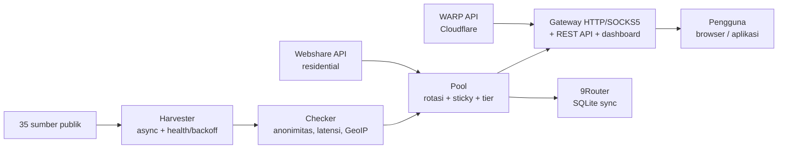

> Dies ist eine Übersetzung der [Haupt-README](../../README.md) (Bahasa Indonesia). Die indonesische Version ist maßgeblich.

<div align="center">

# ⚡ Proxyz

**Öffentliche Proxys ernten, rotierendes Gateway, WARP & Residential — schnell, sicher, Open Source.**

[](https://github.com/Dvifnyz/Proxyz/releases)
[](https://github.com/Dvifnyz/Proxyz/actions/workflows/ci.yml)
[](../../LICENSE)
[](https://www.python.org/)
[](https://github.com/Dvifnyz/Proxyz/stargazers)
[](https://github.com/Dvifnyz/Proxyz/commits/main)
[](https://github.com/Dvifnyz/Proxyz/issues)
[](../../CONTRIBUTING.md)
[](#entwicklung)

[📖 Dokumentation](../../docs/API.md) · [📋 Changelog](../../CHANGELOG.md) · [🤝 Mitwirken](../../CONTRIBUTING.md) · [🔒 Sicherheit](../../SECURITY.md)

Diese README in anderen Sprachen lesen: [English](../../docs/translations/README.en.md) · [中文](../../docs/translations/README.zh-CN.md) · [한국어](../../docs/translations/README.ko.md) · [日本語](../../docs/translations/README.ja.md) · [Русский](../../docs/translations/README.ru.md) · [العربية](../../docs/translations/README.ar.md) · [Afrikaans](../../docs/translations/README.af.md) · [Español](../../docs/translations/README.es.md) · [Português](../../docs/translations/README.pt.md) · [Deutsch](../../docs/translations/README.de.md) · [Français](../../docs/translations/README.fr.md) · [हिन्दी](../../docs/translations/README.hi.md)

</div>

## Highlights

- 🌾 **Massen-Ernten in einer Pipeline** — 35 öffentliche Quellen (HTTP, SOCKS4,
  SOCKS5), ~70.000 Kandidaten in wenigen Sekunden.
- ✅ **Ehrlicher Check** — Anonymität (elite/anonymous/transparent),
  Latenz, Land/ISP (GeoIP-Batch), Score 0–100. Tote Proxys werden
  aussortiert, nicht versteckt.
- 🔄 **Rotierendes Gateway** — HTTP + SOCKS5, Sticky Session, Länder-Routing,
  Auto-Healer, Token, Rate Limit, Audit-Log.
- ☁️ **Kostenloses WARP** — WireGuard-Profile über die offizielle Cloudflare-API.
- 🏠 **Residential** — Webshare über die offizielle API (mehrere Konten), ohne
  Account-Farming und ohne Captcha-Solver.
- 📊 **Beobachtbarkeit** — Quellen-Gesundheit, Geschwindigkeits-Bench, Leak-Test,
  Berichte, Doctor, automatischer Scheduler.
- 🔒 **Sicherheit von Anfang an** — TLS bleibt aktiviert, Updater via pip (ohne
  Remote-Befehle), Gateway bindet nur an localhost.

## Inhaltsverzeichnis

- [Installation](#installation)
- [Schnellstart](#schnellstart)
- [Architektur](#architektur)
- [Funktionen](#funktionen)
- [Befehle](#befehle)
- [Gateway & API](#gateway--api)
- [Residential-Proxys](#residential-proxys)
- [Konfiguration](#konfiguration)
- [Projektstruktur](#projektstruktur)
- [FAQ](#faq)
- [Fehlerbehebung](#fehlerbehebung)
- [Roadmap](#roadmap)
- [Entwicklung](#entwicklung)
- [Sicherheit](#sicherheit)
- [Lizenz & Danksagungen](#lizenz--danksagungen)

## Installation

**Voraussetzung:** Python 3.9+.

### Mit pip

```bash
pip install proxyz
```

### Mit pipx (empfohlen für die CLI)

```bash
pipx install proxyz
```

### Aus dem Quellcode

```bash
git clone https://github.com/Dvifnyz/Proxyz.git
cd Proxyz
pip install -e .
```

### Mit Docker

```bash
docker build -t proxyz .
docker run -p 8888:8888 proxyz
```

Siehe [docs/API.md](../../docs/API.md) für die Python-API.

## Schnellstart

```bash
python -m proxyz panen --jumlah 20     # panen + cek 20 proxy hidup
python -m proxyz gateway               # gateway di http://127.0.0.1:8888
curl -x http://127.0.0.1:8888 http://api.ipify.org
```

Ohne Argumente öffnet `python -m proxyz` das interaktive Menü.

Echte Beispielausgabe:

```
$ python -m proxyz sources

  SUMBER                                                HASIL  GAGAL  STATUS
  https://raw.githubusercontent.com/zevtyardt/proxy-   128468      0  aktif
  https://raw.githubusercontent.com/B4RC0DE-TM/proxy     6370      0  aktif
  https://raw.githubusercontent.com/TheSpeedX/PROXY-     5354      0  aktif
```

```
$ python -m proxyz doctor

  🩺 Proxyz Doctor
  ✅ Python: 3.12.3
  ✅ Config: port 8888, healer 90 dtk
  ✅ Sumber panen: 35 URL (http, socks4, socks5)
  ✅ Sehat (2 peringatan, 0 error).
```

## Architektur



Erklärung zu jeder Komponente: [docs/ARSITEKTUR.md](../../docs/ARSITEKTUR.md).

## Funktionen

### Ernten & Prüfen

- 35 Quellen (17 HTTP, 8 SOCKS4, 10 SOCKS5), frische Quellen werden zuerst geprüft.
- Gesundheits-Score pro Quelle (`proxyz sources`); Quellen, die
  3-mal in Folge fehlschlagen, werden 1 Stunde pausiert.
- Filter: Land (`--negara ID`), Protokoll, Geschwindigkeitsstufe
  (`--tier cepat` ≤350 ms, `sedang` ≤800 ms).
- Blacklist (`proxyz blacklist add 1.2.3.4:8080`) — Proxys auf der
  Blacklist bestehen Ernte/Prüfung nie.

### Gateway

- Weiterleitung von HTTP/HTTPS (CONNECT) + SOCKS5-Listener (`--socks 1080`).
- Round-Robin-Rotation, Residential wird bevorzugt, Sticky Session
  10 Minuten (`X-Session-ID`), Länder-Routing (`X-Country: ID`).
- Auto-Healer: echte HTTP-Probes alle 90 Sekunden, tote Proxys raus,
  Pool auffüllen, wenn er knapp wird.
- Optionales Token (`PROXYZ_TOKEN`), Rate Limit 60/Min. pro IP,
  Audit-Log `output/gateway-audit.jsonl`.
- Web-Dashboard: Pool-Tabelle, Leak-Test- und Geschwindigkeitstest-Buttons.

### Beobachtbarkeit

- `proxyz bench` — echtes Downloadgeschwindigkeits-Ranking (1 MB via Cloudflare).
- `proxyz test` / `/api/leak-test` — echte IP vs. IP über das Gateway.
- `proxyz laporan` — Pool-Zusammenfassung (Markdown + `/api/report`).
- `proxyz auto` — regelmäßiger Zyklus Ernten → Prüfen → Exportieren.
- `proxyz doctor` — Installationsdiagnose.
- `proxyz update` — GitHub-Releases prüfen, Update via pip (sicher).

## Befehle

| Befehl | Funktion |
|---|---|
| `proxyz panen [--jumlah 20] [--negara ID] [--protokol all] [--tier cepat] [--geo]` | Ernten + lebende Proxys prüfen, Export nach `output/` |
| `proxyz cek <file> [--jumlah 20]` | Proxyliste aus einer Datei prüfen |
| `proxyz gateway [--port 8888] [--profil scraper\|cepat\|hemat] [--socks 1080]` | Rotierendes Gateway (HTTP + optional SOCKS5) |
| `proxyz warp [--jumlah 1]` | WARP-WireGuard-Profil erstellen (`.conf`, Modus 0600) |
| `proxyz residential [--api-key KEY \| --signup]` | Webshare-Residential-Proxys (offizielle API) |
| `proxyz sources` | Tabelle zur Gesundheit der Ernte-Quellen |
| `proxyz bench [--jumlah 10]` | Downloadgeschwindigkeits-Ranking der HTTP-Proxys im Pool |
| `proxyz test [--port 8888]` | Leak-Test: echte IP vs. IP über das Gateway |
| `proxyz laporan` | Pool-Zusammenfassung nach `output/laporan.md` |
| `proxyz sync-9router [--db PATH] [--ganti]` | Pool mit der 9Router-SQLite-Datenbank synchronisieren |
| `proxyz blacklist add\|remove\|list [entri]` | Proxys verwalten, die nicht verwendet werden dürfen |
| `proxyz auto [--interval 60] [--sekali]` | Regelmäßiges Ernten + Prüfen + Exportieren |
| `proxyz install-service [--port 8888]` | Service-Dateien erstellen (systemd + Windows-Aufgabenplanung) |
| `proxyz update [--yes]` | Neuestes Release prüfen, Update via pip |
| `proxyz doctor [--no-gateway]` | Installationsdiagnose (Config, Quellen, Pool, Gateway) |

## Gateway & API

Das Gateway lauscht auf `127.0.0.1:8888` (nur localhost — absichtlich
nicht ins LAN freigegeben). Im Browser/in der App als Proxy
`http://127.0.0.1:8888` verwenden, oder via SOCKS5 auf dem mit
`--socks` angegebenen Port.

| Endpunkt | Funktion |
|---|---|
| `GET /api/status` | Pool- & Gateway-Statistiken |
| `GET /api/proxies` | Liste der Proxys im Pool |
| `GET /api/random` | Ein zufälliger Proxy |
| `GET /api/rotate` | Rotation zum nächsten Proxy erzwingen |
| `GET /api/refill` | Pool im Hintergrund auffüllen |
| `GET /api/leak-test` | Echte IP vs. IP über das Gateway (`zero_leak`) |
| `GET /api/bench?jumlah=5` | Geschwindigkeits-Ranking des Pools |
| `GET /api/report` | Pool-Bericht (JSON) |
| `GET /api/clash.yaml` | Live-Clash-Abo aus dem Pool |
| `GET /metrics` | Prometheus-Metriken |
| `GET /proxy.pac` | PAC-Datei für den Browser |
| `GET /dashboard` | Web-Dashboard (Pool-Tabelle, Leak-Test, Bench) |

**Authentifizierung (optional):** Env-Variable `PROXYZ_TOKEN` setzen,
dann `Authorization: Bearer <token>` senden (oder Header `X-Proxyz-Token`).

## Residential-Proxys

Residential-IPs nötig? Der offizielle Weg:

```bash
python -m proxyz residential --signup   # buka browser + siapkan password;
                                        # isi captcha sendiri sekali,
                                        # tempel API key -> divalidasi live
python -m proxyz residential --api-key KUNCIMU   # tambah akun lain
```

Mehrere Konten werden unterstützt — alle Keys werden in einem Pool
zusammengeführt. Oder manuelle Proxys (`proto://user:pass@ip:port`) in
`output/proxy_manual.txt` eintragen; das Gateway verwendet sie mit,
und Residential wird im Pool bevorzugt.

> Proxyz bietet **keinen** automatischen Captcha-Solver, kein
> massenhaftes Account-Farming und kein Anti-Bot-Bypassing. Gefarmte
> Accounts werden schnell gebannt und ihre IPs sterben — das verkürzt
> die Lebensdauer des Tools.

## Konfiguration

Alle Einstellungen stehen in `config/proxyz.json` (plus Env-Variablen,
falls vorhanden). Das Token **nicht** in diese Datei schreiben —
die Env-Variable `PROXYZ_TOKEN` verwenden.

```json
{"gateway_port": 8888, "healer_interval": 90, "min_healthy": 5,
 "healer_target": 10, "check_timeout": 5.0, "check_workers": 100,
 "check_target": 20, "max_latency_ms": 1200, "session_ttl": 600,
 "rate_limit_per_min": 60, "audit_log": true,
 "schedule_interval_min": 60, "schedule_target": 20}
```

Gateway-Profile (`--profil`): `scraper` (aggressive Rotation, Pool 30),
`cepat` (nur Proxys ≤350 ms), `hemat` (kleiner Pool, 30-Minuten-Sitzungen).

## Projektstruktur

```
Proxyz/
├── proxyz/              # paket utama
│   ├── cli.py           # CLI + menu interaktif
│   ├── harvester.py     # panen 35 sumber + skor kesehatan
│   ├── checker.py       # cek hidup, anonimitas, GeoIP batch
│   ├── pool.py          # rotasi, sticky session, tier
│   ├── gateway.py       # gateway HTTP/SOCKS5 + REST + dashboard
│   ├── warp.py          # WARP via API Cloudflare
│   ├── residential.py   # Webshare API resmi + signup semi-otomatis
│   ├── router.py        # sinkronisasi 9Router (SQLite)
│   ├── bench.py         # uji kecepatan unduh
│   ├── scheduler.py     # mode auto berkala
│   ├── report.py        # laporan pool
│   ├── doctor.py        # diagnosa instalasi
│   ├── updater.py       # update aman via pip
│   └── ...              # blacklist, tiers, config, installer
├── config/              # sources.json, proxyz.json, blacklist.txt
├── docs/                # API, ARSITEKTUR, STUDI, translations (12 bahasa)
├── tests/               # 97 tes (pytest)
├── Dockerfile           # gateway di Docker
└── README.md
```

## FAQ

**Ist Proxyz legal?**
Ja — das Tool nutzt nur öffentliche Proxy-Quellen und offizielle
APIs (Webshare, Cloudflare). In der Verantwortung der Nutzer bleibt:
keine sensiblen Daten über unbekannte öffentliche Proxys senden
und die Nutzungsbedingungen der verwendeten Dienste einhalten.

**Warum liefert `panen` 0 lebende Proxys?**
Die meisten kostenlosen Proxys sind tot — das ist normal. Später
erneut versuchen, das Netzwerk wechseln oder ein anderes
`--negara` verwenden. `proxyz doctor` ausführen, um sicherzustellen,
dass die Installation gesund ist.

**Warum muss man sich für Residential manuell registrieren?**
Weil Webshare 10 kostenlose IPs pro Konto gibt und automatisch
erstellte Konten (Captcha automatisch gelöst) schnell gebannt
werden — die IPs sterben mit. Einmal registrieren (30 Sekunden),
der Key wird danach für immer von Proxyz verwendet.

**Läuft Proxyz unter Windows?**
Ja. Python 3.9+ und alle Befehle sind gleich. Für den Autostart bei
der Anmeldung `proxyz install-service` verwenden (erstellt eine
Aufgabe in der Aufgabenplanung).

**Ist das Gateway vom Handy / einem anderen Computer erreichbar?**
Nein — absichtlich nur `127.0.0.1`. Wenn LAN-Zugriff nötig ist,
vor einen eigenen Reverse Proxy mit aktivem Token stellen.

**Wo wird mein Webshare-API-Key gespeichert?**
In der lokalen `config/webshare.json` (Modus 0600), nie committet.
Die Datei löschen, falls der Key leakt, dann im Webshare-Dashboard
einen neuen Key erstellen.

## Fehlerbehebung

| Symptom | Ursache & Abhilfe |
|---|---|
| `pool kosong — panen dulu` | `proxyz panen` zuerst ausführen, oder das Gateway erntet beim Start selbst |
| `502` saat browsing via gateway | Alle Proxys im Pool sind tot — der Healer füllt auf; oder `proxyz panen` erneut ausführen |
| `401 token dibutuhkan` | `PROXYZ_TOKEN` in der Env setzen und `Authorization: Bearer <token>` senden |
| `429 rate limit` | Etwa 1 Minute warten oder `rate_limit_per_min` in der Config erhöhen |
| `proxyz update` 404 | Noch kein Release auf GitHub — der Updater fällt automatisch auf Tags zurück |
| Gateway tidak bisa diakses | Sicherstellen, dass kein anderer Prozess Port 8888 belegt; `proxyz doctor` prüfen |
| `0 hidup` terus-menerus | Das Netzwerk blockiert direkte TCP-Verbindungen zu Proxys (z. B. Sandbox) — auf einem normalen Laptop/PC versuchen |

Noch nicht weitergekommen? `proxyz doctor` ausführen und die Ausgabe
beim Erstellen eines Issues beifügen.

## Roadmap

- [ ] IPv6-Unterstützung für Checker & Gateway
- [ ] Ernte-Quellen aus der Community (PRs willkommen)
- [ ] Modus `proxyz serve` — Gateway + Auto in einem Prozess
- [ ] Surge-/Shadowrocket-Export
- [ ] Dashboard v3 — Latenz-Diagramme & Pool-Verlauf

Andere Ideen? [Feature-Issue erstellen](../../.github/ISSUE_TEMPLATE/feature_request.md).

## Entwicklung

```bash
git clone https://github.com/Dvifnyz/Proxyz.git
cd Proxyz
python -m venv .venv && source .venv/bin/activate
pip install -e ".[dev]"
pytest -q            # 97 tes
python -m proxyz doctor
```

Siehe [CONTRIBUTING.md](../../CONTRIBUTING.md) für den Beitrags-Leitfaden
(Commit-Stil, Quellen hinzufügen, Befehle hinzufügen).

## Sicherheit

Schwachstellen nicht über öffentliche Issues melden — [SECURITY.md](../../SECURITY.md)
lesen. Kurz gesagt: Gateway bindet nur an localhost, Token werden nie
in Config-Dateien geschrieben, Webshare-API-Keys werden lokal mit Modus
0600 gespeichert, und der Updater führt nie Befehle vom Server aus.

## Lizenz & Danksagungen

Lizenz [MIT](../../LICENSE).

Danke an
[itzluthfi](https://github.com/itzluthfi) — Ersteller von
[petani-proxy](https://github.com/itzluthfi/petani-proxy), das als
Studienmaterial und Inspiration für dieses Tool diente. Struktur-Referenzen
für diese README: [FastAPI](https://github.com/fastapi/fastapi) und
[uv](https://github.com/astral-sh/uv).

[](https://star-history.com/#Dvifnyz/Proxyz&Date)
