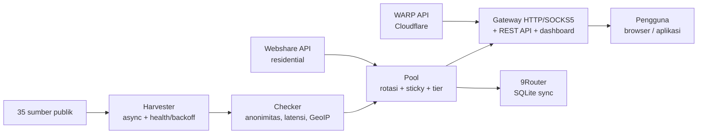

> This is a translation of the main README (English). The [English version](../../README.md) is authoritative.

<div align="center">

# ⚡ Proxyz

**Harvest public proxies, rotating gateway, WARP & residential — fast, secure, open source.**

[](https://github.com/Dvifnyz/Proxyz/releases)
[](https://github.com/Dvifnyz/Proxyz/actions/workflows/ci.yml)
[](../../LICENSE)
[](https://www.python.org/)
[](https://github.com/Dvifnyz/Proxyz/stargazers)
[](https://github.com/Dvifnyz/Proxyz/commits/main)
[](https://github.com/Dvifnyz/Proxyz/issues)
[](../../CONTRIBUTING.md)
[](#development)

[📖 Documentation](../../docs/API.md) · [📋 Changelog](../../CHANGELOG.md) · [🤝 Contributing](../../CONTRIBUTING.md) · [🔒 Security](../../SECURITY.md)

Read this README in other languages: [English](../../README.md) · [Bahasa Indonesia](README.id.md) · [中文](README.zh-CN.md) · [한국어](README.ko.md) · [日本語](README.ja.md) · [Русский](README.ru.md) · [العربية](README.ar.md) · [Afrikaans](README.af.md) · [Español](README.es.md) · [Português](README.pt.md) · [Deutsch](README.de.md) · [Français](README.fr.md) · [हिन्दी](README.hi.md)

</div>

## Highlights

- 🌾 **Bulk harvest, one pipeline** — 35 public sources (HTTP, SOCKS4,
  SOCKS5), ~70 thousand candidates in seconds.
- ✅ **Honest checks** — anonymity (elite/anonymous/transparent),
  latency, country/ISP (batched GeoIP), score 0–100. Dead ones are
  dropped, not hidden.
- 🔄 **Rotating gateway** — HTTP + SOCKS5, sticky sessions, per-country
  routing, auto-healer, token, rate limit, audit log.
- ☁️ **Free WARP** — WireGuard profiles via the official Cloudflare API.
- 🏠 **Residential** — Webshare via the official API (multi-account),
  no account farming and no captcha solvers.
- 📊 **Observability** — source health, speed benchmarks, leak tests,
  reports, doctor, automatic scheduler.
- 🔒 **Secure by design** — TLS stays on, updater via pip (no remote
  commands), gateway binds localhost only.

## Table of contents

- [Installation](#installation)
- [Quick start](#quick-start)
- [Architecture](#architecture)
- [Features](#features)
- [Commands](#commands)
- [Gateway & API](#gateway--api)
- [Residential proxies](#residential-proxies)
- [Configuration](#configuration)
- [Project structure](#project-structure)
- [FAQ](#faq)
- [Troubleshooting](#troubleshooting)
- [Roadmap](#roadmap)
- [Development](#development)
- [Security](#security)
- [License](#license)

## Installation

**Requirements:** Python 3.9+.

### With pip

```bash
pip install proxyz
```

### With pipx (recommended for CLI)

```bash
pipx install proxyz
```

### From source

```bash
git clone https://github.com/Dvifnyz/Proxyz.git
cd Proxyz
pip install -e .
```

### With Docker

```bash
docker build -t proxyz .
docker run -p 8888:8888 proxyz
```

See [docs/API.md](../../docs/API.md) for the Python API.

## Quick start

```bash
python -m proxyz panen --jumlah 20     # panen + cek 20 proxy hidup
python -m proxyz gateway               # gateway di http://127.0.0.1:8888
curl -x http://127.0.0.1:8888 http://api.ipify.org
```

Without arguments, `python -m proxyz` opens the interactive menu.

Real example output:

```
$ python -m proxyz sources

  SUMBER                                                HASIL  GAGAL  STATUS
  https://raw.githubusercontent.com/zevtyardt/proxy-   128468      0  aktif
  https://raw.githubusercontent.com/B4RC0DE-TM/proxy     6370      0  aktif
  https://raw.githubusercontent.com/TheSpeedX/PROXY-     5354      0  aktif
```

```
$ python -m proxyz doctor

  🩺 Proxyz Doctor
  ✅ Python: 3.12.3
  ✅ Config: port 8888, healer 90 dtk
  ✅ Sumber panen: 35 URL (http, socks4, socks5)
  ✅ Sehat (2 peringatan, 0 error).
```

## Architecture



Each component explained: [docs/ARSITEKTUR.md](../../docs/ARSITEKTUR.md).

## Features

### Harvest & check

- 35 sources (17 HTTP, 8 SOCKS4, 10 SOCKS5); fresh sources are checked first.
- Health score per source (`proxyz sources`); sources that fail
  3 times in a row are rested for 1 hour.
- Filters: country (`--negara ID`), protocol, speed tier
  (`--tier cepat` ≤350 ms, `sedang` ≤800 ms).
- Blacklist (`proxyz blacklist add 1.2.3.4:8080`) — blacklisted
  proxies never pass harvest/check.

### Gateway

- Forward HTTP/HTTPS (CONNECT) + SOCKS5 listener (`--socks 1080`).
- Round-robin rotation, residential prioritized, sticky sessions
  10 minutes (`X-Session-ID`), per-country routing (`X-Country: ID`).
- Auto-healer: real HTTP probes every 90 seconds, drops dead ones,
  refills when the pool runs low.
- Optional token (`PROXYZ_TOKEN`), rate limit 60/min per IP,
  audit log `output/gateway-audit.jsonl`.
- Web dashboard: pool table, leak test & speed test buttons.

### Observability

- `proxyz bench` — real download-speed ranking (1 MB via Cloudflare).
- `proxyz test` / `/api/leak-test` — real IP vs IP via gateway.
- `proxyz laporan` — pool summary (Markdown + `/api/report`).
- `proxyz auto` — periodic harvest → check → export cycles.
- `proxyz doctor` — installation diagnostics.
- `proxyz update` — check GitHub releases, update via pip (safe).

## Commands

| Command | Purpose |
|---|---|
| `proxyz panen [--jumlah 20] [--negara ID] [--protokol all] [--tier cepat] [--geo]` | Harvest + check live proxies, export to `output/` |
| `proxyz cek <file> [--jumlah 20]` | Check a proxy list from a file |
| `proxyz gateway [--port 8888] [--profil scraper\|cepat\|hemat] [--socks 1080]` | Rotating gateway (HTTP + optional SOCKS5) |
| `proxyz warp [--jumlah 1]` | Create WARP WireGuard profiles (`.conf`, mode 0600) |
| `proxyz residential [--api-key KEY \| --signup]` | Webshare residential proxies (official API) |
| `proxyz sources` | Health table for each harvest source |
| `proxyz bench [--jumlah 10]` | Download-speed ranking for each HTTP proxy |
| `proxyz test [--port 8888]` | Leak test: real IP vs IP via gateway |
| `proxyz laporan` | Pool summary to `output/laporan.md` |
| `proxyz sync-9router [--db PATH] [--ganti]` | Sync pool to 9Router SQLite DB |
| `proxyz blacklist add\|remove\|list [entri]` | Manage proxies that must not be used |
| `proxyz auto [--interval 60] [--sekali]` | Periodic harvest + check + export |
| `proxyz install-service [--port 8888]` | Create service files (systemd + Windows Task) |
| `proxyz update [--yes]` | Check latest release, update via pip |
| `proxyz doctor [--no-gateway]` | Diagnose installation (config, sources, pool, gateway) |

## Gateway & API

The gateway listens on `127.0.0.1:8888` (localhost only — intentionally
not exposed to the LAN). Use it in your browser/app via
`http://127.0.0.1:8888` as a proxy, or via SOCKS5 on the port given
with `--socks`.

| Endpoint | Purpose |
|---|---|
| `GET /api/status` | Pool & gateway statistics |
| `GET /api/proxies` | List of proxies in the pool |
| `GET /api/random` | One random proxy |
| `GET /api/rotate` | Force rotation to the next proxy |
| `GET /api/refill` | Refill the pool in the background |
| `GET /api/leak-test` | Real IP vs IP via gateway (`zero_leak`) |
| `GET /api/bench?jumlah=5` | Pool speed ranking |
| `GET /api/report` | Pool report (JSON) |
| `GET /api/clash.yaml` | Live Clash subscription from the pool |
| `GET /metrics` | Prometheus metrics |
| `GET /proxy.pac` | PAC file for browsers |
| `GET /dashboard` | Web dashboard (pool table, leak test, bench) |

**Authentication (optional):** fill in the `PROXYZ_TOKEN` env var, then send
`Authorization: Bearer <token>` (or the `X-Proxyz-Token` header).

## Residential proxies

Need residential IPs? Here's the official way:

```bash
python -m proxyz residential --signup   # buka browser + siapkan password;
                                        # isi captcha sendiri sekali,
                                        # tempel API key -> divalidasi live
python -m proxyz residential --api-key KUNCIMU   # tambah akun lain
```

Multi-account is supported — all keys are merged into one pool. Or paste
manual proxies (`proto://user:pass@ip:port`) into
`output/proxy_manual.txt`; the gateway uses them too and residential
is prioritized in the pool.

> Proxyz does **not** provide automatic captcha solvers, mass account
> farming, or anti-bot bypasses. Farmed accounts get banned quickly and
> their IPs die — that's what makes a tool short-lived.

## Configuration

All settings live in `config/proxyz.json` (plus env vars if set).
**Never** write the token in this file — use the `PROXYZ_TOKEN` env var.

```json
{"gateway_port": 8888, "healer_interval": 90, "min_healthy": 5,
 "healer_target": 10, "check_timeout": 5.0, "check_workers": 100,
 "check_target": 20, "max_latency_ms": 1200, "session_ttl": 600,
 "rate_limit_per_min": 60, "audit_log": true,
 "schedule_interval_min": 60, "schedule_target": 20}
```

Gateway profiles (`--profil`): `scraper` (aggressive rotation, pool of 30),
`cepat` (only proxies ≤350 ms), `hemat` (small pool, 30-minute sessions).

## Project structure

```
Proxyz/
├── proxyz/              # paket utama
│   ├── cli.py           # CLI + menu interaktif
│   ├── harvester.py     # panen 35 sumber + skor kesehatan
│   ├── checker.py       # cek hidup, anonimitas, GeoIP batch
│   ├── pool.py          # rotasi, sticky session, tier
│   ├── gateway.py       # gateway HTTP/SOCKS5 + REST + dashboard
│   ├── warp.py          # WARP via API Cloudflare
│   ├── residential.py   # Webshare API resmi + signup semi-otomatis
│   ├── router.py        # sinkronisasi 9Router (SQLite)
│   ├── bench.py         # uji kecepatan unduh
│   ├── scheduler.py     # mode auto berkala
│   ├── report.py        # laporan pool
│   ├── doctor.py        # diagnosa instalasi
│   ├── updater.py       # update aman via pip
│   └── ...              # blacklist, tiers, config, installer
├── config/              # sources.json, proxyz.json, blacklist.txt
├── docs/                # API, ARSITEKTUR, translations (13 languages)
├── tests/               # 97 tes (pytest)
├── Dockerfile           # gateway di Docker
└── README.md
```

## FAQ

**Is Proxyz legal?**
Yes — this tool only uses public proxy sources and official APIs
(Webshare, Cloudflare). What remains the user's responsibility:
don't send sensitive data through public proxies you don't know,
and follow the ToS of the services you use.

**Why does `panen` find 0 live proxies?**
Most free proxies are dead — that's normal. Try again later, change
networks, or use a different `--negara`. Run `proxyz doctor` to make
sure your installation is healthy.

**Why is residential signup manual?**
Because Webshare gives 10 free IPs per account, and bot-created
accounts (captcha solved automatically) get banned quickly — their
IPs die with them. Sign up once (30 seconds); Proxyz uses the key
forever.

**Does Proxyz run on Windows?**
Yes. Python 3.9+ and all commands are the same. For auto-start at
login, use `proxyz install-service` (creates a Task Scheduler entry).

**Can the gateway be accessed from a phone / another computer?**
No — intentionally only `127.0.0.1`. If you need LAN access, run it
behind your own reverse proxy with the token enabled.

**Where is my Webshare API key stored?**
In local `config/webshare.json` (mode 0600), never committed.
If a key leaks, delete that file and create a new key in the Webshare
dashboard.

## Troubleshooting

| Symptom | Cause & fix |
|---|---|
| `pool kosong — panen dulu` | Run `proxyz panen` first, or the gateway will harvest on its own at startup |
| `502` saat browsing via gateway | All proxies in the pool are dead — the healer will refill; or run `proxyz panen` again |
| `401 token dibutuhkan` | Set `PROXYZ_TOKEN` in env and send `Authorization: Bearer <token>` |
| `429 rate limit` | Wait ~1 minute, or raise `rate_limit_per_min` in config |
| `proxyz update` 404 | No Release on GitHub yet — the updater automatically falls back to tags |
| Gateway tidak bisa diakses | Make sure no other process is on port 8888; check `proxyz doctor` |
| `0 hidup` terus-menerus | The network blocks direct TCP to proxies (e.g. sandbox) — try on a regular laptop/PC |

Still stuck? Run `proxyz doctor` and include its output when
opening an issue.

## Roadmap

- [ ] IPv6 support for checker & gateway
- [ ] Community harvest sources (PRs welcome)
- [ ] `proxyz serve` mode — gateway + auto in one process
- [ ] Surge / Shadowrocket export
- [ ] Dashboard v3 — latency graphs & pool history

Have another idea? Open a [feature issue](../../.github/ISSUE_TEMPLATE/feature_request.md).

## Development

```bash
git clone https://github.com/Dvifnyz/Proxyz.git
cd Proxyz
python -m venv .venv && source .venv/bin/activate
pip install -e ".[dev]"
pytest -q            # 97 tes
python -m proxyz doctor
```

See [CONTRIBUTING.md](../../CONTRIBUTING.md) for the contribution guide
(commit style, adding sources, adding commands).

## Security

Don't report vulnerabilities via public issues — read
[SECURITY.md](../../SECURITY.md). In short: the gateway only binds localhost,
the token is never written to the config file, the Webshare API key is stored
locally with mode 0600, and the updater never runs commands from a server.

## License

License [MIT](../../LICENSE).

[](https://star-history.com/#Dvifnyz/Proxyz&Date)
