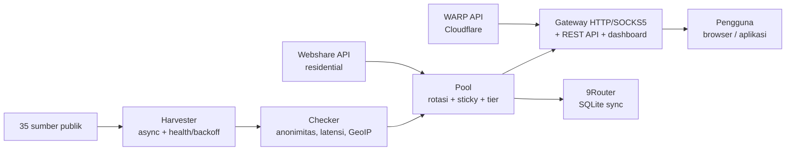

Esta es una traducción del [README principal](../../README.md) (inglés). La versión en inglés es la vigente.

<div align="center">

# ⚡ Proxyz

**Cosecha de proxies públicos, gateway rotativo, WARP y residential — rápido, seguro, de código abierto.**

[](https://github.com/Dvifnyz/Proxyz/releases)
[](https://github.com/Dvifnyz/Proxyz/actions/workflows/ci.yml)
[](../../LICENSE)
[](https://www.python.org/)
[](https://github.com/Dvifnyz/Proxyz/stargazers)
[](https://github.com/Dvifnyz/Proxyz/commits/main)
[](https://github.com/Dvifnyz/Proxyz/issues)
[](../../CONTRIBUTING.md)
[](#desarrollo)

[📖 Documentación](../../docs/API.md) · [📋 Changelog](../../CHANGELOG.md) · [🤝 Contribuir](../../CONTRIBUTING.md) · [🔒 Seguridad](../../SECURITY.md)

Lee este README en otro idioma: [English](../../README.md) · [中文](../../docs/translations/README.zh-CN.md) · [한국어](../../docs/translations/README.ko.md) · [日本語](../../docs/translations/README.ja.md) · [Русский](../../docs/translations/README.ru.md) · [العربية](../../docs/translations/README.ar.md) · [Afrikaans](../../docs/translations/README.af.md) · [Español](../../docs/translations/README.es.md) · [Português](../../docs/translations/README.pt.md) · [Deutsch](../../docs/translations/README.de.md) · [Français](../../docs/translations/README.fr.md) · [हिन्दी](../../docs/translations/README.hi.md) · [Bahasa Indonesia](../../docs/translations/README.id.md)

</div>

## Aspectos destacados

- 🌾 **Cosecha masiva, un solo pipeline** — 35 fuentes públicas (HTTP,
  SOCKS4, SOCKS5), ~70 mil candidatos en cuestión de segundos.
- ✅ **Comprobación honesta** — anonimato (elite/anonymous/transparent),
  latencia, país/ISP (GeoIP batch), puntuación 0–100. Los muertos se
  descartan, no se ocultan.
- 🔄 **Gateway rotativo** — HTTP + SOCKS5, sticky session, enrutamiento
  por país, auto-healer, token, rate limit, audit log.
- ☁️ **WARP gratis** — perfil WireGuard a través de la API oficial
  de Cloudflare.
- 🏠 **Residential** — Webshare a través de la API oficial
  (multicuenta), sin granjas de cuentas ni solucionadores de captcha.
- 📊 **Observabilidad** — salud de las fuentes, prueba de velocidad,
  leak test, informe, doctor, scheduler automático.
- 🔒 **Seguro por diseño** — TLS siempre activado, actualizador vía pip
  (sin comandos remotos), gateway enlazado solo a localhost.

## Índice

- [Instalación](#instalación)
- [Inicio rápido](#inicio-rápido)
- [Arquitectura](#arquitectura)
- [Funcionalidades](#funcionalidades)
- [Comandos](#comandos)
- [Gateway y API](#gateway-y-api)
- [Proxy residencial](#proxy-residencial)
- [Configuración](#configuración)
- [Estructura del proyecto](#estructura-del-proyecto)
- [FAQ](#faq)
- [Solución de problemas](#solución-de-problemas)
- [Hoja de ruta](#hoja-de-ruta)
- [Desarrollo](#desarrollo)
- [Seguridad](#seguridad)
- [Licencia](#licencia)

## Instalación

**Requisito:** Python 3.9+.

### Con pip

```bash
pip install proxyz
```

### Con pipx (recomendado para la CLI)

```bash
pipx install proxyz
```

### Desde el código fuente

```bash
git clone https://github.com/Dvifnyz/Proxyz.git
cd Proxyz
pip install -e .
```

### Con Docker

```bash
docker build -t proxyz .
docker run -p 8888:8888 proxyz
```

Consulta [docs/API.md](../../docs/API.md) para ver la API de Python.

## Inicio rápido

```bash
python -m proxyz panen --jumlah 20     # panen + cek 20 proxy hidup
python -m proxyz gateway               # gateway di http://127.0.0.1:8888
curl -x http://127.0.0.1:8888 http://api.ipify.org
```

Sin argumentos, `python -m proxyz` abre el menú interactivo.

Ejemplo de salida real:

```
$ python -m proxyz sources

  SUMBER                                                HASIL  GAGAL  STATUS
  https://raw.githubusercontent.com/zevtyardt/proxy-   128468      0  aktif
  https://raw.githubusercontent.com/B4RC0DE-TM/proxy     6370      0  aktif
  https://raw.githubusercontent.com/TheSpeedX/PROXY-     5354      0  aktif
```

```
$ python -m proxyz doctor

  🩺 Proxyz Doctor
  ✅ Python: 3.12.3
  ✅ Config: port 8888, healer 90 dtk
  ✅ Sumber panen: 35 URL (http, socks4, socks5)
  ✅ Sehat (2 peringatan, 0 error).
```

## Arquitectura



Explicación de cada componente: [docs/ARSITEKTUR.md](../../docs/ARSITEKTUR.md).

## Funcionalidades

### Cosecha y comprobación

- 35 fuentes (17 HTTP, 8 SOCKS4, 10 SOCKS5); las fuentes nuevas se
  comprueban primero.
- Puntuación de salud por fuente (`proxyz sources`); una fuente que
  falla 3 veces seguidas descansa 1 hora.
- Filtros: país (`--negara ID`), protocolo, nivel de velocidad
  (`--tier cepat` ≤350 ms, `sedang` ≤800 ms).
- Blacklist (`proxyz blacklist add 1.2.3.4:8080`): los proxies en la
  blacklist nunca superan la cosecha ni la comprobación.

### Gateway

- Reenvío HTTP/HTTPS (CONNECT) + listener SOCKS5 (`--socks 1080`).
- Rotación round-robin, residential con prioridad, sticky session
  de 10 minutos (`X-Session-ID`), enrutamiento por país (`X-Country: ID`).
- Auto-healer: sondeo HTTP real cada 90 segundos, descarta los muertos
  y rellena el pool cuando se agota.
- Token opcional (`PROXYZ_TOKEN`), rate limit de 60/min por IP,
  audit log `output/gateway-audit.jsonl`.
- Dashboard web: tabla del pool, botón de leak test y prueba de velocidad.

### Observabilidad

- `proxyz bench`: clasificación de velocidad de descarga real (1 MB vía Cloudflare).
- `proxyz test` / `/api/leak-test`: IP real frente a IP vía gateway.
- `proxyz laporan`: resumen del pool (Markdown + `/api/report`).
- `proxyz auto`: ciclo cosecha → comprobación → exportación periódica.
- `proxyz doctor`: diagnóstico de la instalación.
- `proxyz update`: comprueba los lanzamientos de GitHub y actualiza vía pip (seguro).

## Comandos

| Comando | Función |
|---|---|
| `proxyz panen [--jumlah 20] [--negara ID] [--protokol all] [--tier cepat] [--geo]` | Cosecha + comprobación de proxies activos, exporta a `output/` |
| `proxyz cek <file> [--jumlah 20]` | Comprueba una lista de proxies desde un archivo |
| `proxyz gateway [--port 8888] [--profil scraper\|cepat\|hemat] [--socks 1080]` | Gateway rotativo (HTTP + SOCKS5 opcional) |
| `proxyz warp [--jumlah 1]` | Crea un perfil WARP de WireGuard (`.conf`, modo 0600) |
| `proxyz residential [--api-key KEY \| --signup]` | Proxy residential de Webshare (API oficial) |
| `proxyz sources` | Tabla de salud de cada fuente de cosecha |
| `proxyz bench [--jumlah 10]` | Clasificación de velocidad de descarga de cada proxy HTTP |
| `proxyz test [--port 8888]` | Leak test: IP real frente a IP vía gateway |
| `proxyz laporan` | Resumen del pool en `output/laporan.md` |
| `proxyz sync-9router [--db PATH] [--ganti]` | Sincroniza el pool con la BD SQLite de 9Router |
| `proxyz blacklist add\|remove\|list [entri]` | Gestiona los proxies que no deben usarse |
| `proxyz auto [--interval 60] [--sekali]` | Cosecha + comprobación + exportación periódicas |
| `proxyz install-service [--port 8888]` | Crea el archivo de servicio (systemd + Windows Task) |
| `proxyz update [--yes]` | Comprueba el lanzamiento más reciente y actualiza vía pip |
| `proxyz doctor [--no-gateway]` | Diagnóstico de la instalación (config, fuentes, pool, gateway) |

## Gateway y API

El gateway escucha en `127.0.0.1:8888` (solo localhost, deliberadamente
no se expone a la LAN). Úsalo en el navegador o la aplicación a través
de `http://127.0.0.1:8888` como proxy, o vía SOCKS5 en el puerto
indicado con `--socks`.

| Endpoint | Función |
|---|---|
| `GET /api/status` | Estadísticas del pool y del gateway |
| `GET /api/proxies` | Lista de proxies del pool |
| `GET /api/random` | Un proxy aleatorio |
| `GET /api/rotate` | Fuerza la rotación al siguiente proxy |
| `GET /api/refill` | Rellena el pool en segundo plano |
| `GET /api/leak-test` | IP real frente a IP vía gateway (`zero_leak`) |
| `GET /api/bench?jumlah=5` | Clasificación de velocidad del pool |
| `GET /api/report` | Informe del pool (JSON) |
| `GET /api/clash.yaml` | Suscripción Clash en vivo desde el pool |
| `GET /metrics` | Métricas de Prometheus |
| `GET /proxy.pac` | Archivo PAC para el navegador |
| `GET /dashboard` | Dashboard web (tabla del pool, leak test, bench) |

**Autenticación (opcional):** rellena el env `PROXYZ_TOKEN` y envía
`Authorization: Bearer <token>` (o el encabezado `X-Proxyz-Token`).

## Proxy residencial

¿Necesitas una IP residencial? Esta es la vía oficial:

```bash
python -m proxyz residential --signup   # buka browser + siapkan password;
                                        # isi captcha sendiri sekali,
                                        # tempel API key -> divalidasi live
python -m proxyz residential --api-key KUNCIMU   # tambah akun lain
```

Multicuentas admitidas: todas las claves se combinan en un solo pool.
O pega proxies manuales (`proto://user:pass@ip:port`) en
`output/proxy_manual.txt`; el gateway también los usa y residential
tiene prioridad en el pool.

> Proxyz **no** ofrece solucionador automático de captcha, granjas de
> cuentas masivas ni evasión de anti-bot. Las cuentas de granja se
> banean rápido y sus IP mueren: eso es lo que hace que una
> herramienta dure poco.

## Configuración

Todos los ajustes están en `config/proxyz.json` (más env si los hay).
**No** escribas el token en este archivo: usa el env `PROXYZ_TOKEN`.

```json
{"gateway_port": 8888, "healer_interval": 90, "min_healthy": 5,
 "healer_target": 10, "check_timeout": 5.0, "check_workers": 100,
 "check_target": 20, "max_latency_ms": 1200, "session_ttl": 600,
 "rate_limit_per_min": 60, "audit_log": true,
 "schedule_interval_min": 60, "schedule_target": 20}
```

Perfil de gateway (`--profil`): `scraper` (rotación agresiva, pool 30),
`cepat` (solo proxies ≤350 ms), `hemat` (pool pequeño, sesión de
30 minutos).

## Estructura del proyecto

```
Proxyz/
├── proxyz/              # paket utama
│   ├── cli.py           # CLI + menu interaktif
│   ├── harvester.py     # panen 35 sumber + skor kesehatan
│   ├── checker.py       # cek hidup, anonimitas, GeoIP batch
│   ├── pool.py          # rotasi, sticky session, tier
│   ├── gateway.py       # gateway HTTP/SOCKS5 + REST + dashboard
│   ├── warp.py          # WARP via API Cloudflare
│   ├── residential.py   # Webshare API resmi + signup semi-otomatis
│   ├── router.py        # sinkronisasi 9Router (SQLite)
│   ├── bench.py         # uji kecepatan unduh
│   ├── scheduler.py     # mode auto berkala
│   ├── report.py        # laporan pool
│   ├── doctor.py        # diagnosa instalasi
│   ├── updater.py       # update aman via pip
│   └── ...              # blacklist, tiers, config, installer
├── config/              # sources.json, proxyz.json, blacklist.txt
├── docs/                # API, ARSITEKTUR, translations (13 languages)
├── tests/               # 97 tes (pytest)
├── Dockerfile           # gateway di Docker
└── README.md
```

## FAQ

**¿Es legal Proxyz?**
Sí: esta herramienta solo usa fuentes públicas de proxies y las API
oficiales (Webshare, Cloudflare). Lo que sigue siendo responsabilidad
del usuario: no enviar datos sensibles a través de un proxy público
desconocido y respetar los ToS del servicio utilizado.

**¿Por qué `panen` obtiene 0 proxies activos?**
La mayoría de los proxies gratuitos están muertos: es normal.
Inténtalo de nuevo más tarde, cambia de red o usa otro `--negara`.
Ejecuta `proxyz doctor` para comprobar que tu instalación está sana.

**¿Por qué residential exige registro manual?**
Porque Webshare da 10 IP gratis por cuenta, y las cuentas creadas por
bots (captcha resuelto automáticamente) se banean rápido: sus IP
mueren con ellas. Regístrate una vez (30 segundos) y Proxyz usará
la clave para siempre.

**¿Funciona Proxyz en Windows?**
Sí. Python 3.9+ y los mismos comandos. Para que se ejecute solo al
iniciar sesión, usa `proxyz install-service` (crea un Task Scheduler).

**¿Se puede acceder al gateway desde el móvil u otro ordenador?**
No: deliberadamente solo `127.0.0.1`. Si necesitas acceso desde la
LAN, ejecútalo detrás de tu propio reverse proxy con el token activo.

**¿Dónde se guarda mi clave API de Webshare?**
En el `config/webshare.json` local (modo 0600), nunca se sube al
repositorio. Si la clave se filtra, borra ese archivo y crea una
clave nueva en el panel de Webshare.

## Solución de problemas

| Síntoma | Causa y solución |
|---|---|
| `pool kosong — panen dulu` | Ejecuta primero `proxyz panen`, o el gateway cosechará solo al arrancar |
| `502` saat browsing via gateway | Todos los proxies del pool están muertos: el healer lo rellenará; o ejecuta `proxyz panen` de nuevo |
| `401 token dibutuhkan` | Rellena `PROXYZ_TOKEN` en el env y envía `Authorization: Bearer <token>` |
| `429 rate limit` | Espera ~1 minuto o sube `rate_limit_per_min` en la config |
| `proxyz update` 404 | Aún no hay Release en GitHub: el actualizador recurre automáticamente a los tags |
| Gateway tidak bisa diakses | Asegúrate de que ningún otro proceso use el puerto 8888; comprueba `proxyz doctor` |
| `0 hidup` terus-menerus | La red bloquea el TCP directo a los proxies (p. ej., sandbox): prueba en un portátil/PC normal |

¿Sigues atascado? Ejecuta `proxyz doctor` e incluye su salida al
abrir un issue.

## Hoja de ruta

- [ ] Soporte IPv6 para el checker y el gateway
- [ ] Fuentes de cosecha de la comunidad (PR bienvenidos)
- [ ] Modo `proxyz serve`: gateway + auto en un solo proceso
- [ ] Exportación a Surge / Shadowrocket
- [ ] Dashboard v3: gráfico de latencia e historial del pool

¿Tienes otra idea? Abre una [solicitud de función](../../.github/ISSUE_TEMPLATE/feature_request.md).

## Desarrollo

```bash
git clone https://github.com/Dvifnyz/Proxyz.git
cd Proxyz
python -m venv .venv && source .venv/bin/activate
pip install -e ".[dev]"
pytest -q            # 97 tes
python -m proxyz doctor
```

Consulta [CONTRIBUTING.md](../../CONTRIBUTING.md) para ver la guía de
contribución (estilo de commits, cómo añadir fuentes, cómo añadir
comandos).

## Seguridad

No informes vulnerabilidades mediante un issue público: lee
[SECURITY.md](../../SECURITY.md). En resumen: el gateway solo se enlaza a
localhost, el token nunca se escribe en el archivo de config, la clave
API de Webshare se guarda localmente en modo 0600 y el actualizador
nunca ejecuta comandos del servidor.

## Licencia

Licencia [MIT](../../LICENSE).

[](https://star-history.com/#Dvifnyz/Proxyz&Date)
