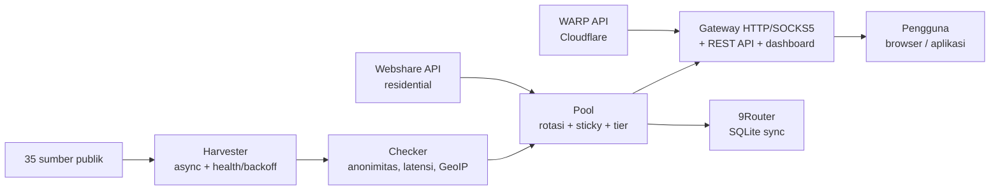

> Ceci est une traduction du [README principal](../../README.md) (anglais). La version anglaise fait foi.

<div align="center">

# ⚡ Proxyz

**Récolter des proxys publics, passerelle rotative, WARP et résidentiel — rapide, sûr, open source.**

[](https://github.com/Dvifnyz/Proxyz/releases)
[](https://github.com/Dvifnyz/Proxyz/actions/workflows/ci.yml)
[](../../LICENSE)
[](https://www.python.org/)
[](https://github.com/Dvifnyz/Proxyz/stargazers)
[](https://github.com/Dvifnyz/Proxyz/commits/main)
[](https://github.com/Dvifnyz/Proxyz/issues)
[](../../CONTRIBUTING.md)
[](#développement)

[📖 Documentation](../../docs/API.md) · [📋 Journal des modifications](../../CHANGELOG.md) · [🤝 Contribuer](../../CONTRIBUTING.md) · [🔒 Sécurité](../../SECURITY.md)

Lire ce README dans d'autres langues : [English](../../README.md) · [中文](../../docs/translations/README.zh-CN.md) · [한국어](../../docs/translations/README.ko.md) · [日本語](../../docs/translations/README.ja.md) · [Русский](../../docs/translations/README.ru.md) · [العربية](../../docs/translations/README.ar.md) · [Afrikaans](../../docs/translations/README.af.md) · [Español](../../docs/translations/README.es.md) · [Português](../../docs/translations/README.pt.md) · [Deutsch](../../docs/translations/README.de.md) · [Français](../../docs/translations/README.fr.md) · [हिन्दी](../../docs/translations/README.hi.md) · [Bahasa Indonesia](../../docs/translations/README.id.md)

</div>

## Points forts

- 🌾 **Récolte massive, un seul pipeline** — 35 sources publiques (HTTP, SOCKS4,
  SOCKS5), ~70 000 candidats en quelques secondes.
- ✅ **Vérification honnête** — anonymat (elite/anonymous/transparent),
  latence, pays/FAI (GeoIP par lots), score de 0 à 100. Les proxys morts sont
  écartés, pas cachés.
- 🔄 **Passerelle rotative** — HTTP + SOCKS5, session persistante, routage
  par pays, auto-guérison, jeton, limite de débit, journal d'audit.
- ☁️ **WARP gratuit** — profils WireGuard via l'API officielle Cloudflare.
- 🏠 **Résidentiel** — Webshare via l'API officielle (multi-comptes), sans
  création massive de comptes ni résolution automatique de captcha.
- 📊 **Observabilité** — santé des sources, test de vitesse, test de fuite,
  rapports, doctor, planificateur automatique.
- 🔒 **Sécurisé dès la conception** — TLS toujours activé, mises à jour via pip (sans
  commande distante), passerelle liée à localhost uniquement.

## Sommaire

- [Installation](#installation)
- [Démarrage rapide](#démarrage-rapide)
- [Architecture](#architecture)
- [Fonctionnalités](#fonctionnalités)
- [Commandes](#commandes)
- [Passerelle et API](#passerelle-et-api)
- [Proxys résidentiels](#proxys-résidentiels)
- [Configuration](#configuration)
- [Structure du projet](#structure-du-projet)
- [FAQ](#faq)
- [Dépannage](#dépannage)
- [Feuille de route](#feuille-de-route)
- [Développement](#développement)
- [Sécurité](#sécurité)
- [Licence](#licence)

## Installation

**Prérequis :** Python 3.9+.

### Avec pip

```bash
pip install proxyz
```

### Avec pipx (recommandé pour la CLI)

```bash
pipx install proxyz
```

### À partir des sources

```bash
git clone https://github.com/Dvifnyz/Proxyz.git
cd Proxyz
pip install -e .
```

### Avec Docker

```bash
docker build -t proxyz .
docker run -p 8888:8888 proxyz
```

Voir [docs/API.md](../../docs/API.md) pour l'API Python.

## Démarrage rapide

```bash
python -m proxyz panen --jumlah 20     # panen + cek 20 proxy hidup
python -m proxyz gateway               # gateway di http://127.0.0.1:8888
curl -x http://127.0.0.1:8888 http://api.ipify.org
```

Sans argument, `python -m proxyz` ouvre le menu interactif.

Exemple de sortie réelle :

```
$ python -m proxyz sources

  SUMBER                                                HASIL  GAGAL  STATUS
  https://raw.githubusercontent.com/zevtyardt/proxy-   128468      0  aktif
  https://raw.githubusercontent.com/B4RC0DE-TM/proxy     6370      0  aktif
  https://raw.githubusercontent.com/TheSpeedX/PROXY-     5354      0  aktif
```

```
$ python -m proxyz doctor

  🩺 Proxyz Doctor
  ✅ Python: 3.12.3
  ✅ Config: port 8888, healer 90 dtk
  ✅ Sumber panen: 35 URL (http, socks4, socks5)
  ✅ Sehat (2 peringatan, 0 error).
```

## Architecture



Explication de chaque composant : [docs/ARSITEKTUR.md](../../docs/ARSITEKTUR.md).

## Fonctionnalités

### Récolte et vérification

- 35 sources (17 HTTP, 8 SOCKS4, 10 SOCKS5), les sources fraîches sont vérifiées en premier.
- Score de santé par source (`proxyz sources`) ; une source qui
  échoue 3 fois de suite est mise en pause pendant 1 heure.
- Filtres : pays (`--negara ID`), protocole, niveau de vitesse
  (`--tier cepat` ≤350 ms, `sedang` ≤800 ms).
- Liste noire (`proxyz blacklist add 1.2.3.4:8080`) — les proxys
  bloqués ne passent jamais la récolte ni la vérification.

### Passerelle

- Transfert HTTP/HTTPS (CONNECT) + écouteur SOCKS5 (`--socks 1080`).
- Rotation round-robin, résidentiel prioritaire, session persistante
  10 minutes (`X-Session-ID`), routage par pays (`X-Country: ID`).
- Auto-guérison : vraies sondes HTTP toutes les 90 secondes,
  suppression des morts, remplissage quand le pool s'épuise.
- Jeton optionnel (`PROXYZ_TOKEN`), limite de 60/min par IP,
  journal d'audit `output/gateway-audit.jsonl`.
- Tableau de bord web : table du pool, boutons de test de fuite
  et de vitesse.

### Observabilité

- `proxyz bench` — classement de vitesse de téléchargement réelle (1 Mo via Cloudflare).
- `proxyz test` / `/api/leak-test` — IP réelle contre IP via la passerelle.
- `proxyz laporan` — résumé du pool (Markdown + `/api/report`).
- `proxyz auto` — cycle régulier récolte → vérification → export.
- `proxyz doctor` — diagnostic d'installation.
- `proxyz update` — vérification des releases GitHub, mise à jour via pip (sûr).

## Commandes

| Commande | Fonction |
|---|---|
| `proxyz panen [--jumlah 20] [--negara ID] [--protokol all] [--tier cepat] [--geo]` | Récolter + vérifier les proxys actifs, exporter vers `output/` |
| `proxyz cek <file> [--jumlah 20]` | Vérifier une liste de proxys depuis un fichier |
| `proxyz gateway [--port 8888] [--profil scraper\|cepat\|hemat] [--socks 1080]` | Passerelle rotative (HTTP + SOCKS5 en option) |
| `proxyz warp [--jumlah 1]` | Créer un profil WARP WireGuard (`.conf`, mode 0600) |
| `proxyz residential [--api-key KEY \| --signup]` | Proxys résidentiels Webshare (API officielle) |
| `proxyz sources` | Table de santé de chaque source de récolte |
| `proxyz bench [--jumlah 10]` | Classement de vitesse de téléchargement de chaque proxy HTTP |
| `proxyz test [--port 8888]` | Test de fuite : IP réelle contre IP via la passerelle |
| `proxyz laporan` | Résumé du pool vers `output/laporan.md` |
| `proxyz sync-9router [--db PATH] [--ganti]` | Synchroniser le pool avec la base SQLite 9Router |
| `proxyz blacklist add\|remove\|list [entri]` | Gérer les proxys interdits d'utilisation |
| `proxyz auto [--interval 60] [--sekali]` | Récolte + vérification + export périodiques |
| `proxyz install-service [--port 8888]` | Créer des fichiers de service (systemd + Tâches Windows) |
| `proxyz update [--yes]` | Vérifier la dernière release, mettre à jour via pip |
| `proxyz doctor [--no-gateway]` | Diagnostic d'installation (config, sources, pool, passerelle) |

## Passerelle et API

La passerelle écoute sur `127.0.0.1:8888` (localhost uniquement —
volontairement non exposée au LAN). À utiliser dans le navigateur
ou l'application via `http://127.0.0.1:8888` comme proxy, ou via
SOCKS5 sur le port indiqué par `--socks`.

| Point de terminaison | Fonction |
|---|---|
| `GET /api/status` | Statistiques du pool et de la passerelle |
| `GET /api/proxies` | Liste des proxys du pool |
| `GET /api/random` | Un proxy aléatoire |
| `GET /api/rotate` | Forcer la rotation vers le proxy suivant |
| `GET /api/refill` | Remplir le pool en arrière-plan |
| `GET /api/leak-test` | IP réelle contre IP via la passerelle (`zero_leak`) |
| `GET /api/bench?jumlah=5` | Classement de vitesse du pool |
| `GET /api/report` | Rapport du pool (JSON) |
| `GET /api/clash.yaml` | Abonnement Clash en direct depuis le pool |
| `GET /metrics` | Métriques Prometheus |
| `GET /proxy.pac` | Fichier PAC pour le navigateur |
| `GET /dashboard` | Tableau de bord web (table du pool, test de fuite, bench) |

**Authentification (facultative) :** renseigner la variable
d'environnement `PROXYZ_TOKEN`, puis envoyer
`Authorization: Bearer <token>` (ou l'en-tête `X-Proxyz-Token`).

## Proxys résidentiels

Besoin d'une IP résidentielle ? Voici la voie officielle :

```bash
python -m proxyz residential --signup   # buka browser + siapkan password;
                                        # isi captcha sendiri sekali,
                                        # tempel API key -> divalidasi live
python -m proxyz residential --api-key KUNCIMU   # tambah akun lain
```

Le multi-compte est pris en charge — toutes les clés sont fusionnées
dans un seul pool. Ou collez des proxys manuels
(`proto://user:pass@ip:port`) dans `output/proxy_manual.txt` ;
la passerelle les utilise aussi et le résidentiel est prioritaire
dans le pool.

> Proxyz **ne** fournit pas de résolution automatique de captcha,
> de création massive de comptes, ni de contournement anti-bot.
> Les comptes créés en masse sont vite bannis et leurs IP meurent —
> c'est ce qui raccourcit la vie d'un outil.

## Configuration

Tous les réglages sont dans `config/proxyz.json` (plus les variables
d'environnement le cas échéant). Le jeton ne doit **jamais** être
écrit dans ce fichier — utilisez la variable d'environnement
`PROXYZ_TOKEN`.

```json
{"gateway_port": 8888, "healer_interval": 90, "min_healthy": 5,
 "healer_target": 10, "check_timeout": 5.0, "check_workers": 100,
 "check_target": 20, "max_latency_ms": 1200, "session_ttl": 600,
 "rate_limit_per_min": 60, "audit_log": true,
 "schedule_interval_min": 60, "schedule_target": 20}
```

Profils de passerelle (`--profil`) : `scraper` (rotation agressive,
pool de 30), `cepat` (proxys ≤350 ms uniquement), `hemat` (petit pool,
sessions de 30 minutes).

## Structure du projet

```
Proxyz/
├── proxyz/              # paket utama
│   ├── cli.py           # CLI + menu interaktif
│   ├── harvester.py     # panen 35 sumber + skor kesehatan
│   ├── checker.py       # cek hidup, anonimitas, GeoIP batch
│   ├── pool.py          # rotasi, sticky session, tier
│   ├── gateway.py       # gateway HTTP/SOCKS5 + REST + dashboard
│   ├── warp.py          # WARP via API Cloudflare
│   ├── residential.py   # Webshare API resmi + signup semi-otomatis
│   ├── router.py        # sinkronisasi 9Router (SQLite)
│   ├── bench.py         # uji kecepatan unduh
│   ├── scheduler.py     # mode auto berkala
│   ├── report.py        # laporan pool
│   ├── doctor.py        # diagnosa instalasi
│   ├── updater.py       # update aman via pip
│   └── ...              # blacklist, tiers, config, installer
├── config/              # sources.json, proxyz.json, blacklist.txt
├── docs/                # API, ARSITEKTUR, translations (13 languages)
├── tests/               # 97 tes (pytest)
├── Dockerfile           # gateway di Docker
└── README.md
```

## FAQ

**Proxyz est-il légal ?**
Oui — l'outil n'utilise que des sources de proxys publiques et
des API officielles (Webshare, Cloudflare). Il reste de la
responsabilité de l'utilisateur : ne pas envoyer de données
sensibles via des proxys publics inconnus, et respecter les
conditions d'utilisation des services employés.

**Pourquoi `panen` donne 0 proxy actif ?**
La plupart des proxys gratuits sont morts — c'est normal. Réessayez
plus tard, changez de réseau, ou utilisez un autre `--negara`.
Lancez `proxyz doctor` pour vérifier que votre installation est saine.

**Pourquoi l'inscription résidentielle est-elle manuelle ?**
Parce que Webshare offre 10 IP gratuites par compte, et les comptes
créés par des bots (captcha résolu automatiquement) sont vite bannis —
leurs IP meurent avec eux. Inscrivez-vous une fois (30 secondes),
la clé est ensuite utilisée pour toujours par Proxyz.

**Proxyz fonctionne-t-il sous Windows ?**
Oui. Python 3.9+ et toutes les commandes sont identiques. Pour un
lancement automatique à la connexion, utilisez
`proxyz install-service` (crée une tâche planifiée).

**La passerelle est-elle accessible depuis un téléphone / un autre ordinateur ?**
Non — volontairement limitée à `127.0.0.1`. Si un accès LAN est
nécessaire, placez-la derrière votre propre reverse proxy avec
un jeton actif.

**Où ma clé API Webshare est-elle stockée ?**
Dans le fichier local `config/webshare.json` (mode 0600), jamais
commitée. Supprimez ce fichier en cas de fuite de la clé, puis
créez une nouvelle clé dans le tableau de bord Webshare.

## Dépannage

| Symptôme | Cause et solution |
|---|---|
| `pool kosong — panen dulu` | Lancez d'abord `proxyz panen`, ou la passerelle récoltera elle-même au démarrage |
| `502` saat browsing via gateway | Tous les proxys du pool sont morts — l'auto-guérison va remplir ; ou relancez `proxyz panen` |
| `401 token dibutuhkan` | Renseignez `PROXYZ_TOKEN` dans l'environnement et envoyez `Authorization: Bearer <token>` |
| `429 rate limit` | Attendez ~1 minute, ou augmentez `rate_limit_per_min` dans la config |
| `proxyz update` 404 | Pas encore de Release sur GitHub — le programme de mise à jour retombe automatiquement sur les tags |
| Gateway tidak bisa diakses | Vérifiez qu'aucun autre processus n'utilise le port 8888 ; lancez `proxyz doctor` |
| `0 hidup` terus-menerus | Le réseau bloque les connexions TCP directes vers les proxys (par ex. sandbox) — essayez sur un ordinateur portable/PC classique |

Toujours bloqué ? Lancez `proxyz doctor` et joignez sa sortie
lors de l'ouverture d'une issue.

## Feuille de route

- [ ] Prise en charge d'IPv6 pour le vérificateur et la passerelle
- [ ] Sources de récolte de la communauté (PR bienvenues)
- [ ] Mode `proxyz serve` — passerelle + auto dans un seul processus
- [ ] Export Surge / Shadowrocket
- [ ] Tableau de bord v3 — graphiques de latence et historique du pool

Une autre idée ? Ouvrez une [demande de fonctionnalité](../../.github/ISSUE_TEMPLATE/feature_request.md).

## Développement

```bash
git clone https://github.com/Dvifnyz/Proxyz.git
cd Proxyz
python -m venv .venv && source .venv/bin/activate
pip install -e ".[dev]"
pytest -q            # 97 tes
python -m proxyz doctor
```

Voir [CONTRIBUTING.md](../../CONTRIBUTING.md) pour le guide de contribution
(style de commit, ajout de sources, ajout de commandes).

## Sécurité

Ne signalez pas les vulnérabilités via des issues publiques — lisez
[SECURITY.md](../../SECURITY.md). En résumé : la passerelle ne se lie qu'à
localhost, le jeton n'est jamais écrit dans un fichier de configuration,
la clé API Webshare est stockée localement en mode 0600, et le
programme de mise à jour n'exécute jamais de commande venant du serveur.

## Licence

Licence [MIT](../../LICENSE).

[](https://star-history.com/#Dvifnyz/Proxyz&Date)
