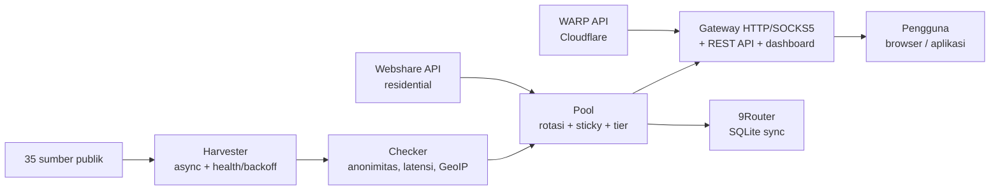

> यह [मुख्य README](../../README.md) का इंडोनेशियाई (Bahasa Indonesia) से अनुवाद है। मूल इंडोनेशियाई संस्करण ही मान्य है।

<div align="center">

# ⚡ Proxyz

**सार्वजनिक प्रॉक्सी इकट्ठा करें, रोटेटिंग गेटवे, WARP और रेज़िडेंशियल — तेज़, सुरक्षित, ओपन सोर्स।**

[](https://github.com/Dvifnyz/Proxyz/releases)
[](https://github.com/Dvifnyz/Proxyz/actions/workflows/ci.yml)
[](../../LICENSE)
[](https://www.python.org/)
[](https://github.com/Dvifnyz/Proxyz/stargazers)
[](https://github.com/Dvifnyz/Proxyz/commits/main)
[](https://github.com/Dvifnyz/Proxyz/issues)
[](../../CONTRIBUTING.md)
[](#विकास)

[📖 दस्तावेज़](../../docs/API.md) · [📋 बदलाव-लॉग](../../CHANGELOG.md) · [🤝 योगदान करें](../../CONTRIBUTING.md) · [🔒 सुरक्षा](../../SECURITY.md)

इस README को अन्य भाषाओं में पढ़ें: [English](../../docs/translations/README.en.md) · [中文](../../docs/translations/README.zh-CN.md) · [한국어](../../docs/translations/README.ko.md) · [日本語](../../docs/translations/README.ja.md) · [Русский](../../docs/translations/README.ru.md) · [العربية](../../docs/translations/README.ar.md) · [Afrikaans](../../docs/translations/README.af.md) · [Español](../../docs/translations/README.es.md) · [Português](../../docs/translations/README.pt.md) · [Deutsch](../../docs/translations/README.de.md) · [Français](../../docs/translations/README.fr.md) · [हिन्दी](../../docs/translations/README.hi.md)

</div>

## मुख्य विशेषताएँ

- 🌾 **एक ही पाइपलाइन में बड़े पैमाने पर हार्वेस्ट** — 35 सार्वजनिक स्रोत (HTTP,
  SOCKS4, SOCKS5), कुछ ही सेकंड में ~70 हज़ार उम्मीदवार।
- ✅ **ईमानदार जाँच** — गुमनामी (elite/anonymous/transparent), लेटेंसी,
  देश/ISP (बैच GeoIP), स्कोर 0–100। मरे हुए प्रॉक्सी हटाए जाते हैं,
  छिपाए नहीं जाते।
- 🔄 **रोटेटिंग गेटवे** — HTTP + SOCKS5, स्टिकी सेशन, देश के अनुसार रूटिंग,
  ऑटो-हीलर, टोकन, रेट लिमिट, ऑडिट लॉग।
- ☁️ **मुफ़्त WARP** — Cloudflare की आधिकारिक API से WireGuard प्रोफ़ाइल।
- 🏠 **रेज़िडेंशियल** — आधिकारिक API से Webshare (कई अकाउंट), बिना
  अकाउंट फ़ार्मिंग और बिना कैप्चा सॉल्वर।
- 📊 **ऑब्ज़र्वेबिलिटी** — स्रोतों की सेहत, स्पीड बेंच, लीक टेस्ट,
  रिपोर्ट, doctor, ऑटोमैटिक शेड्यूलर।
- 🔒 **डिज़ाइन से ही सुरक्षित** — TLS चालू रहता है, pip से अपडेट (बिना
  रिमोट कमांड), गेटवे सिर्फ़ localhost पर बाइंड होता है।

## विषय-सूची

- [इंस्टॉलेशन](#इंस्टॉलेशन)
- [त्वरित शुरुआत](#त्वरित-शुरुआत)
- [आर्किटेक्चर](#आर्किटेक्चर)
- [सुविधाएँ](#सुविधाएँ)
- [कमांड](#कमांड)
- [गेटवे और API](#गेटवे-और-api)
- [रेज़िडेंशियल प्रॉक्सी](#रेज़िडेंशियल-प्रॉक्सी)
- [कॉन्फ़िगरेशन](#कॉन्फ़िगरेशन)
- [प्रोजेक्ट संरचना](#प्रोजेक्ट-संरचना)
- [FAQ](#faq)
- [समस्या निवारण](#समस्या-निवारण)
- [रोडमैप](#रोडमैप)
- [विकास](#विकास)
- [सुरक्षा](#सुरक्षा)
- [लाइसेंस और धन्यवाद](#लाइसेंस-और-धन्यवाद)

## इंस्टॉलेशन

**आवश्यकता:** Python 3.9+।

### pip से

```bash
pip install proxyz
```

### pipx से (CLI के लिए सुझाव)

```bash
pipx install proxyz
```

### सोर्स से

```bash
git clone https://github.com/Dvifnyz/Proxyz.git
cd Proxyz
pip install -e .
```

### Docker से

```bash
docker build -t proxyz .
docker run -p 8888:8888 proxyz
```

Python API के लिए [docs/API.md](../../docs/API.md) देखें।

## त्वरित शुरुआत

```bash
python -m proxyz panen --jumlah 20     # panen + cek 20 proxy hidup
python -m proxyz gateway               # gateway di http://127.0.0.1:8888
curl -x http://127.0.0.1:8888 http://api.ipify.org
```

बिना किसी आर्ग्युमेंट के, `python -m proxyz` इंटरैक्टिव मेनू खोलता है।

वास्तविक आउटपुट का उदाहरण:

```
$ python -m proxyz sources

  SUMBER                                                HASIL  GAGAL  STATUS
  https://raw.githubusercontent.com/zevtyardt/proxy-   128468      0  aktif
  https://raw.githubusercontent.com/B4RC0DE-TM/proxy     6370      0  aktif
  https://raw.githubusercontent.com/TheSpeedX/PROXY-     5354      0  aktif
```

```
$ python -m proxyz doctor

  🩺 Proxyz Doctor
  ✅ Python: 3.12.3
  ✅ Config: port 8888, healer 90 dtk
  ✅ Sumber panen: 35 URL (http, socks4, socks5)
  ✅ Sehat (2 peringatan, 0 error).
```

## आर्किटेक्चर



हर कंपोनेंट की व्याख्या: [docs/ARSITEKTUR.md](../../docs/ARSITEKTUR.md)।

## सुविधाएँ

### हार्वेस्ट और जाँच

- 35 स्रोत (17 HTTP, 8 SOCKS4, 10 SOCKS5), ताज़ा स्रोत पहले जाँचे जाते हैं।
- हर स्रोत का हेल्थ स्कोर (`proxyz sources`); जो स्रोत लगातार
  3 बार फ़ेल हो, उसे 1 घंटे के लिए आराम दिया जाता है।
- फ़िल्टर: देश (`--negara ID`), प्रोटोकॉल, स्पीड टियर
  (`--tier cepat` ≤350 ms, `sedang` ≤800 ms)।
- ब्लैकलिस्ट (`proxyz blacklist add 1.2.3.4:8080`) — ब्लैकलिस्ट किए
  गए प्रॉक्सी हार्वेस्ट/जाँच में कभी पास नहीं होते।

### गेटवे

- HTTP/HTTPS फ़ॉरवर्ड (CONNECT) + SOCKS5 लिसनर (`--socks 1080`)।
- राउंड-रॉबिन रोटेशन, रेज़िडेंशियल को प्राथमिकता, 10 मिनट का
  स्टिकी सेशन (`X-Session-ID`), देश के अनुसार रूटिंग (`X-Country: ID`)।
- ऑटो-हीलर: हर 90 सेकंड में असली HTTP प्रोब, मरे हुए हटाए जाते हैं,
  पूल कम होने पर भरा जाता है।
- वैकल्पिक टोकन (`PROXYZ_TOKEN`), प्रति IP 60/मिनट रेट लिमिट,
  ऑडिट लॉग `output/gateway-audit.jsonl`।
- वेब डैशबोर्ड: पूल टेबल, लीक टेस्ट और स्पीड टेस्ट बटन।

### ऑब्ज़र्वेबिलिटी

- `proxyz bench` — असली डाउनलोड स्पीड रैंकिंग (Cloudflare से 1 MB)।
- `proxyz test` / `/api/leak-test` — असली IP बनाम गेटवे से IP।
- `proxyz laporan` — पूल का सारांश (Markdown + `/api/report`)।
- `proxyz auto` — नियमित चक्र: हार्वेस्ट → जाँच → एक्सपोर्ट।
- `proxyz doctor` — इंस्टॉलेशन की जाँच।
- `proxyz update` — GitHub रिलीज़ जाँचें, pip से अपडेट (सुरक्षित)।

## कमांड

| कमांड | काम |
|---|---|
| `proxyz panen [--jumlah 20] [--negara ID] [--protokol all] [--tier cepat] [--geo]` | लाइव प्रॉक्सी हार्वेस्ट + जाँच करें, `output/` में एक्सपोर्ट करें |
| `proxyz cek <file> [--jumlah 20]` | फ़ाइल से प्रॉक्सी सूची जाँचें |
| `proxyz gateway [--port 8888] [--profil scraper\|cepat\|hemat] [--socks 1080]` | रोटेटिंग गेटवे (HTTP + वैकल्पिक SOCKS5) |
| `proxyz warp [--jumlah 1]` | WARP WireGuard प्रोफ़ाइल बनाएँ (`.conf`, मोड 0600) |
| `proxyz residential [--api-key KEY \| --signup]` | Webshare रेज़िडेंशियल प्रॉक्सी (आधिकारिक API) |
| `proxyz sources` | हर हार्वेस्ट स्रोत की हेल्थ टेबल |
| `proxyz bench [--jumlah 10]` | पूल के हर HTTP प्रॉक्सी की डाउनलोड स्पीड रैंकिंग |
| `proxyz test [--port 8888]` | लीक टेस्ट: असली IP बनाम गेटवे से IP |
| `proxyz laporan` | पूल का सारांश `output/laporan.md` में |
| `proxyz sync-9router [--db PATH] [--ganti]` | पूल को 9Router SQLite DB से सिंक करें |
| `proxyz blacklist add\|remove\|list [entri]` | इस्तेमाल न किए जाने वाले प्रॉक्सी प्रबंधित करें |
| `proxyz auto [--interval 60] [--sekali]` | नियमित हार्वेस्ट + जाँच + एक्सपोर्ट |
| `proxyz install-service [--port 8888]` | सर्विस फ़ाइलें बनाएँ (systemd + Windows Task) |
| `proxyz update [--yes]` | नया रिलीज़ जाँचें, pip से अपडेट करें |
| `proxyz doctor [--no-gateway]` | इंस्टॉलेशन जाँचें (config, स्रोत, पूल, गेटवे) |

## गेटवे और API

गेटवे `127.0.0.1:8888` पर सुनता है (सिर्फ़ localhost — जानबूझकर
LAN पर एक्सपोज़ नहीं किया गया)। ब्राउज़र/ऐप में प्रॉक्सी के रूप में
`http://127.0.0.1:8888` इस्तेमाल करें, या `--socks` से बताए गए
पोर्ट पर SOCKS5।

| एंडपॉइंट | काम |
|---|---|
| `GET /api/status` | पूल और गेटवे के आँकड़े |
| `GET /api/proxies` | पूल में प्रॉक्सी की सूची |
| `GET /api/random` | एक रैंडम प्रॉक्सी |
| `GET /api/rotate` | अगले प्रॉक्सी पर रोटेशन मजबूर करें |
| `GET /api/refill` | बैकग्राउंड में पूल भरें |
| `GET /api/leak-test` | असली IP बनाम गेटवे से IP (`zero_leak`) |
| `GET /api/bench?jumlah=5` | पूल की स्पीड रैंकिंग |
| `GET /api/report` | पूल रिपोर्ट (JSON) |
| `GET /api/clash.yaml` | पूल से लाइव Clash सब्सक्रिप्शन |
| `GET /metrics` | Prometheus मेट्रिक्स |
| `GET /proxy.pac` | ब्राउज़र के लिए PAC फ़ाइल |
| `GET /dashboard` | वेब डैशबोर्ड (पूल टेबल, लीक टेस्ट, बेंच) |

**ऑथेंटिकेशन (वैकल्पिक):** env `PROXYZ_TOKEN` भरें, फिर
`Authorization: Bearer <token>` भेजें (या हेडर `X-Proxyz-Token`)।

## रेज़िडेंशियल प्रॉक्सी

रेज़िडेंशियल IP चाहिए? आधिकारिक तरीका:

```bash
python -m proxyz residential --signup   # buka browser + siapkan password;
                                        # isi captcha sendiri sekali,
                                        # tempel API key -> divalidasi live
python -m proxyz residential --api-key KUNCIMU   # tambah akun lain
```

कई अकाउंट समर्थित हैं — सभी key एक ही पूल में मिल जाती हैं। या
मैन्युअल प्रॉक्सी (`proto://user:pass@ip:port`)
`output/proxy_manual.txt` में डालें; गेटवे उन्हें भी इस्तेमाल करता
है और पूल में रेज़िडेंशियल को प्राथमिकता मिलती है।

> Proxyz **कोई** ऑटोमैटिक कैप्चा सॉल्वर, बड़े पैमाने पर अकाउंट
> फ़ार्मिंग, या एंटी-बॉट बायपास नहीं देता। फ़ार्म किए गए अकाउंट
> जल्दी बैन हो जाते हैं और उनके IP मर जाते हैं — यही टूल की उम्र
> छोटी कर देता है।

## कॉन्फ़िगरेशन

सभी सेटिंग `config/proxyz.json` में हैं (साथ में env, अगर हो)।
टोकन इस फ़ाइल में **कभी न** लिखें — env `PROXYZ_TOKEN` इस्तेमाल करें।

```json
{"gateway_port": 8888, "healer_interval": 90, "min_healthy": 5,
 "healer_target": 10, "check_timeout": 5.0, "check_workers": 100,
 "check_target": 20, "max_latency_ms": 1200, "session_ttl": 600,
 "rate_limit_per_min": 60, "audit_log": true,
 "schedule_interval_min": 60, "schedule_target": 20}
```

गेटवे प्रोफ़ाइल (`--profil`): `scraper` (आक्रामक रोटेशन, पूल 30),
`cepat` (सिर्फ़ ≤350 ms वाले प्रॉक्सी), `hemat` (छोटा पूल,
30 मिनट के सेशन)।

## प्रोजेक्ट संरचना

```
Proxyz/
├── proxyz/              # paket utama
│   ├── cli.py           # CLI + menu interaktif
│   ├── harvester.py     # panen 35 sumber + skor kesehatan
│   ├── checker.py       # cek hidup, anonimitas, GeoIP batch
│   ├── pool.py          # rotasi, sticky session, tier
│   ├── gateway.py       # gateway HTTP/SOCKS5 + REST + dashboard
│   ├── warp.py          # WARP via API Cloudflare
│   ├── residential.py   # Webshare API resmi + signup semi-otomatis
│   ├── router.py        # sinkronisasi 9Router (SQLite)
│   ├── bench.py         # uji kecepatan unduh
│   ├── scheduler.py     # mode auto berkala
│   ├── report.py        # laporan pool
│   ├── doctor.py        # diagnosa instalasi
│   ├── updater.py       # update aman via pip
│   └── ...              # blacklist, tiers, config, installer
├── config/              # sources.json, proxyz.json, blacklist.txt
├── docs/                # API, ARSITEKTUR, STUDI, translations (12 bahasa)
├── tests/               # 97 tes (pytest)
├── Dockerfile           # gateway di Docker
└── README.md
```

## FAQ

**क्या Proxyz कानूनी है?**
हाँ — यह टूल सिर्फ़ सार्वजनिक प्रॉक्सी स्रोत और आधिकारिक API
(Webshare, Cloudflare) इस्तेमाल करता है। उपयोगकर्ता की ज़िम्मेदारी
बनी रहती है: अनजान सार्वजनिक प्रॉक्सी से संवेदनशील डेटा न भेजें,
और इस्तेमाल की जाने वाली सेवाओं की ToS का पालन करें।

**`panen` से 0 लाइव प्रॉक्सी क्यों मिलते हैं?**
ज़्यादातर मुफ़्त प्रॉक्सी मरे हुए होते हैं — यह सामान्य है। बाद में
फिर कोशिश करें, नेटवर्क बदलें, या कोई और `--negara` इस्तेमाल करें।
इंस्टॉलेशन सही है या नहीं, यह देखने के लिए `proxyz doctor` चलाएँ।

**रेज़िडेंशियल के लिए मैन्युअल रजिस्ट्रेशन क्यों?**
क्योंकि Webshare हर अकाउंट पर 10 मुफ़्त IP देता है, और बॉट से बनाए
गए अकाउंट (कैप्चा ऑटोमैटिक हल किया गया) जल्दी बैन हो जाते हैं —
उनके IP भी मर जाते हैं। एक बार रजिस्टर करें (30 सेकंड), key फिर
हमेशा के लिए Proxyz इस्तेमाल करता है।

**क्या Proxyz Windows पर चलता है?**
हाँ। Python 3.9+ और सभी कमांड एक जैसे हैं। लॉगिन पर ऑटो-स्टार्ट
के लिए `proxyz install-service` इस्तेमाल करें (Task Scheduler
बनाता है)।

**क्या गेटवे फ़ोन / दूसरे कंप्यूटर से खुल सकता है?**
नहीं — जानबूझकर सिर्फ़ `127.0.0.1`। अगर LAN से एक्सेस चाहिए, तो
अपने खुद के reverse proxy के पीछे सक्रिय टोकन के साथ चलाएँ।

**मेरी Webshare API key कहाँ रखी जाती है?**
स्थानीय `config/webshare.json` में (मोड 0600), कभी कमिट नहीं की
जाती। key लीक हो जाए तो वह फ़ाइल हटाएँ, फिर Webshare डैशबोर्ड से
नई key बनाएँ।

## समस्या निवारण

| लक्षण | कारण और समाधान |
|---|---|
| `pool kosong — panen dulu` | पहले `proxyz panen` चलाएँ, या गेटवे स्टार्ट होते ही खुद हार्वेस्ट करेगा |
| `502` saat browsing via gateway | पूल के सभी प्रॉक्सी मर चुके हैं — हीलर भर देगा; या `proxyz panen` दोबारा चलाएँ |
| `401 token dibutuhkan` | env में `PROXYZ_TOKEN` भरें और `Authorization: Bearer <token>` भेजें |
| `429 rate limit` | ~1 मिनट रुकें, या config में `rate_limit_per_min` बढ़ाएँ |
| `proxyz update` 404 | GitHub पर अभी कोई Release नहीं है — अपडेटर अपने आप tags पर वापस चला जाता है |
| Gateway tidak bisa diakses | पक्का करें कि पोर्ट 8888 पर कोई और प्रोसेस नहीं है; `proxyz doctor` जाँचें |
| `0 hidup` terus-menerus | नेटवर्क प्रॉक्सी तक सीधे TCP ब्लॉक करता है (जैसे sandbox) — सामान्य लैपटॉप/PC पर कोशिश करें |

अभी भी अटके हैं? `proxyz doctor` चलाएँ और issue खोलते समय उसका
आउटपुट साथ लगाएँ।

## रोडमैप

- [ ] चेकर और गेटवे के लिए IPv6 सपोर्ट
- [ ] कम्युनिटी से हार्वेस्ट स्रोत (PR स्वागत है)
- [ ] `proxyz serve` मोड — गेटवे + auto एक ही प्रोसेस में
- [ ] Surge / Shadowrocket एक्सपोर्ट
- [ ] डैशबोर्ड v3 — लेटेंसी ग्राफ़ और पूल इतिहास

कोई और आइडिया? [फ़ीचर issue खोलें](../../.github/ISSUE_TEMPLATE/feature_request.md)।

## विकास

```bash
git clone https://github.com/Dvifnyz/Proxyz.git
cd Proxyz
python -m venv .venv && source .venv/bin/activate
pip install -e ".[dev]"
pytest -q            # 97 tes
python -m proxyz doctor
```

योगदान गाइड [CONTRIBUTING.md](../../CONTRIBUTING.md) में देखें
(कमिट स्टाइल, स्रोत जोड़ना, कमांड जोड़ना)।

## सुरक्षा

कमज़ोरियों की रिपोर्ट सार्वजनिक issue से न करें —
[SECURITY.md](../../SECURITY.md) पढ़ें। संक्षेप में: गेटवे सिर्फ़ localhost
पर बाइंड होता है, टोकन कभी config फ़ाइल में नहीं लिखा जाता,
Webshare API key स्थानीय रूप से मोड 0600 में रखी जाती है, और
अपडेटर कभी सर्वर से कमांड नहीं चलाता।

## लाइसेंस और धन्यवाद

लाइसेंस [MIT](../../LICENSE)।

[itzluthfi](https://github.com/itzluthfi) को धन्यवाद —
[petani-proxy](https://github.com/itzluthfi/petani-proxy) के निर्माता,
जो इस टूल के अध्ययन और प्रेरणा का स्रोत रहा। इस README की संरचना
के संदर्भ: [FastAPI](https://github.com/fastapi/fastapi) और
[uv](https://github.com/astral-sh/uv)।

[](https://star-history.com/#Dvifnyz/Proxyz&Date)
