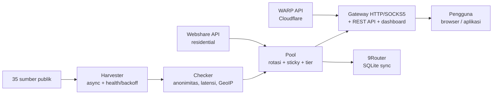

> Ini adalah terjemahan dari [README utama](../../README.md) berbahasa Inggris. Versi Inggris yang berlaku.

<div align="center">

# ⚡ Proxyz

**Panen proxy publik, gateway rotating, WARP & residential — cepat, aman, open source.**

[](https://github.com/Dvifnyz/Proxyz/releases)
[](https://github.com/Dvifnyz/Proxyz/actions/workflows/ci.yml)
[](../../LICENSE)
[](https://www.python.org/)
[](https://github.com/Dvifnyz/Proxyz/stargazers)
[](https://github.com/Dvifnyz/Proxyz/commits/main)
[](https://github.com/Dvifnyz/Proxyz/issues)
[](../../CONTRIBUTING.md)
[](#pengembangan)

[📖 Dokumentasi](../../docs/API.md) · [📋 Changelog](../../CHANGELOG.md) · [🤝 Berkontribusi](../../CONTRIBUTING.md) · [🔒 Keamanan](../../SECURITY.md)

Baca README ini dalam bahasa lain: [English](../../README.md) · [中文](README.zh-CN.md) · [한국어](README.ko.md) · [日本語](README.ja.md) · [Русский](README.ru.md) · [العربية](README.ar.md) · [Afrikaans](README.af.md) · [Español](README.es.md) · [Português](README.pt.md) · [Deutsch](README.de.md) · [Français](README.fr.md) · [हिन्दी](README.hi.md) · [Bahasa Indonesia](README.id.md)

</div>

## Highlights

- 🌾 **Panen massal, satu pipeline** — 35 sumber publik (HTTP, SOCKS4,
  SOCKS5), ~70 ribu kandidat dalam hitungan detik.
- ✅ **Cek yang jujur** — anonimitas (elite/anonymous/transparent),
  latensi, negara/ISP (GeoIP batch), skor 0–100. Yang mati dibuang,
  bukan disembunyikan.
- 🔄 **Gateway rotating** — HTTP + SOCKS5, sticky session, routing
  per negara, auto-healer, token, rate limit, audit log.
- ☁️ **WARP gratis** — profil WireGuard via API resmi Cloudflare.
- 🏠 **Residential** — Webshare via API resmi (multi-akun), tanpa
  farm akun dan tanpa solver captcha.
- 📊 **Observabilitas** — kesehatan sumber, bench kecepatan, leak
  test, laporan, doctor, scheduler otomatis.
- 🔒 **Aman dari desain** — TLS tetap nyala, updater via pip (tanpa
  perintah remote), gateway bind localhost saja.

## Daftar isi

- [Instalasi](#instalasi)
- [Mulai cepat](#mulai-cepat)
- [Arsitektur](#arsitektur)
- [Fitur](#fitur)
- [Perintah](#perintah)
- [Gateway & API](#gateway--api)
- [Proxy residential](#proxy-residential)
- [Konfigurasi](#konfigurasi)
- [Struktur proyek](#struktur-proyek)
- [FAQ](#faq)
- [Troubleshooting](#troubleshooting)
- [Roadmap](#roadmap)
- [Pengembangan](#pengembangan)
- [Keamanan](#keamanan)
- [Lisensi](#lisensi)

## Instalasi

**Syarat:** Python 3.9+.

### Dengan pip

```bash
pip install proxyz
```

### Dengan pipx (disarankan untuk CLI)

```bash
pipx install proxyz
```

### Dari source

```bash
git clone https://github.com/Dvifnyz/Proxyz.git
cd Proxyz
pip install -e .
```

### Dengan Docker

```bash
docker build -t proxyz .
docker run -p 8888:8888 proxyz
```

Lihat [docs/API.md](../../docs/API.md) untuk API Python-nya.

## Mulai cepat

```bash
python -m proxyz panen --jumlah 20     # panen + cek 20 proxy hidup
python -m proxyz gateway               # gateway di http://127.0.0.1:8888
curl -x http://127.0.0.1:8888 http://api.ipify.org
```

Tanpa argumen, `python -m proxyz` membuka menu interaktif.

Contoh output nyata:

```
$ python -m proxyz sources

  SUMBER                                                HASIL  GAGAL  STATUS
  https://raw.githubusercontent.com/zevtyardt/proxy-   128468      0  aktif
  https://raw.githubusercontent.com/B4RC0DE-TM/proxy     6370      0  aktif
  https://raw.githubusercontent.com/TheSpeedX/PROXY-     5354      0  aktif
```

```
$ python -m proxyz doctor

  🩺 Proxyz Doctor
  ✅ Python: 3.12.3
  ✅ Config: port 8888, healer 90 dtk
  ✅ Sumber panen: 35 URL (http, socks4, socks5)
  ✅ Sehat (2 peringatan, 0 error).
```

## Arsitektur



Penjelasan tiap komponen: [docs/ARSITEKTUR.md](../../docs/ARSITEKTUR.md).

## Fitur

### Panen & cek

- 35 sumber (17 HTTP, 8 SOCKS4, 10 SOCKS5), sumber segar dicek dulu.
- Skor kesehatan per sumber (`proxyz sources`); sumber yang gagal
  3x beruntun diistirahatkan 1 jam.
- Filter: negara (`--negara ID`), protokol, tier kecepatan
  (`--tier cepat` ≤350 ms, `sedang` ≤800 ms).
- Blacklist (`proxyz blacklist add 1.2.3.4:8080`) — proxy yang
  diblacklist tidak pernah lolos panen/cek.

### Gateway

- Forward HTTP/HTTPS (CONNECT) + SOCKS5 listener (`--socks 1080`).
- Rotasi round-robin, residential diprioritaskan, sticky session
  10 menit (`X-Session-ID`), routing negara (`X-Country: ID`).
- Auto-healer: probe HTTP beneran tiap 90 detik, buang yang mati,
  isi ulang bila pool menipis.
- Token opsional (`PROXYZ_TOKEN`), rate limit 60/menit per IP,
  audit log `output/gateway-audit.jsonl`.
- Dashboard web: tabel pool, tombol leak test & uji kecepatan.

### Observabilitas

- `proxyz bench` — ranking kecepatan unduh nyata (1 MB via Cloudflare).
- `proxyz test` / `/api/leak-test` — IP asli vs IP via gateway.
- `proxyz laporan` — ringkasan pool (Markdown + `/api/report`).
- `proxyz auto` — siklus panen → cek → ekspor berkala.
- `proxyz doctor` — diagnosa instalasi.
- `proxyz update` — cek rilis GitHub, update via pip (aman).

## Perintah

| Perintah | Fungsi |
|---|---|
| `proxyz panen [--jumlah 20] [--negara ID] [--protokol all] [--tier cepat] [--geo]` | Panen + cek proxy hidup, ekspor ke `output/` |
| `proxyz cek <file> [--jumlah 20]` | Cek daftar proxy dari file |
| `proxyz gateway [--port 8888] [--profil scraper\|cepat\|hemat] [--socks 1080]` | Gateway rotating (HTTP + SOCKS5 opsional) |
| `proxyz warp [--jumlah 1]` | Buat profil WARP WireGuard (`.conf`, mode 0600) |
| `proxyz residential [--api-key KEY \| --signup]` | Proxy residential Webshare (API resmi) |
| `proxyz sources` | Tabel kesehatan tiap sumber panen |
| `proxyz bench [--jumlah 10]` | Ranking kecepatan unduh tiap proxy HTTP |
| `proxyz test [--port 8888]` | Leak test: IP asli vs IP via gateway |
| `proxyz laporan` | Ringkasan pool ke `output/laporan.md` |
| `proxyz sync-9router [--db PATH] [--ganti]` | Sinkronkan pool ke DB SQLite 9Router |
| `proxyz blacklist add\|remove\|list [entri]` | Kelola proxy yang tidak boleh dipakai |
| `proxyz auto [--interval 60] [--sekali]` | Panen + cek + ekspor berkala |
| `proxyz install-service [--port 8888]` | Buat file service (systemd + Windows Task) |
| `proxyz update [--yes]` | Cek rilis terbaru, update via pip |
| `proxyz doctor [--no-gateway]` | Diagnosa instalasi (config, sumber, pool, gateway) |

## Gateway & API

Gateway mendengarkan di `127.0.0.1:8888` (localhost saja — sengaja
tidak di-expose ke LAN). Pakai di browser/aplikasi lewat
`http://127.0.0.1:8888` sebagai proxy, atau lewat SOCKS5 di port yang
ditentukan `--socks`.

| Endpoint | Fungsi |
|---|---|
| `GET /api/status` | Statistik pool & gateway |
| `GET /api/proxies` | Daftar proxy di pool |
| `GET /api/random` | Satu proxy acak |
| `GET /api/rotate` | Paksa rotasi ke proxy berikut |
| `GET /api/refill` | Isi ulang pool di background |
| `GET /api/leak-test` | IP asli vs IP via gateway (`zero_leak`) |
| `GET /api/bench?jumlah=5` | Ranking kecepatan pool |
| `GET /api/report` | Laporan pool (JSON) |
| `GET /api/clash.yaml` | Langganan Clash live dari pool |
| `GET /metrics` | Metrik Prometheus |
| `GET /proxy.pac` | File PAC untuk browser |
| `GET /dashboard` | Dashboard web (tabel pool, leak test, bench) |

**Autentikasi (opsional):** isi env `PROXYZ_TOKEN`, lalu kirim
`Authorization: Bearer <token>` (atau header `X-Proxyz-Token`).

## Proxy residential

Butuh IP rumahan (residential)? Jalur resminya:

```bash
python -m proxyz residential --signup   # buka browser + siapkan password;
                                        # isi captcha sendiri sekali,
                                        # tempel API key -> divalidasi live
python -m proxyz residential --api-key KUNCIMU   # tambah akun lain
```

Multi-akun didukung — semua key digabung ke satu pool. Atau tempel
proxy manual (`proto://user:pass@ip:port`) ke
`output/proxy_manual.txt`; gateway ikut memakainya dan residential
diprioritaskan di pool.

> Proxyz **tidak** menyediakan pemecah captcha otomatis, farm akun
> massal, atau bypass anti-bot. Akun hasil farm cepat di-banned dan
> IP-nya mati — itu yang membuat tool berumur pendek.

## Konfigurasi

Semua setting di `config/proxyz.json` (ditambah env bila ada).
Token **jangan** ditulis di file ini — pakai env `PROXYZ_TOKEN`.

```json
{"gateway_port": 8888, "healer_interval": 90, "min_healthy": 5,
 "healer_target": 10, "check_timeout": 5.0, "check_workers": 100,
 "check_target": 20, "max_latency_ms": 1200, "session_ttl": 600,
 "rate_limit_per_min": 60, "audit_log": true,
 "schedule_interval_min": 60, "schedule_target": 20}
```

Profil gateway (`--profil`): `scraper` (rotasi agresif, pool 30),
`cepat` (hanya proxy ≤350 ms), `hemat` (pool kecil, sesi 30 menit).

## Struktur proyek

```
Proxyz/
├── proxyz/              # paket utama
│   ├── cli.py           # CLI + menu interaktif
│   ├── harvester.py     # panen 35 sumber + skor kesehatan
│   ├── checker.py       # cek hidup, anonimitas, GeoIP batch
│   ├── pool.py          # rotasi, sticky session, tier
│   ├── gateway.py       # gateway HTTP/SOCKS5 + REST + dashboard
│   ├── warp.py          # WARP via API Cloudflare
│   ├── residential.py   # Webshare API resmi + signup semi-otomatis
│   ├── router.py        # sinkronisasi 9Router (SQLite)
│   ├── bench.py         # uji kecepatan unduh
│   ├── scheduler.py     # mode auto berkala
│   ├── report.py        # laporan pool
│   ├── doctor.py        # diagnosa instalasi
│   ├── updater.py       # update aman via pip
│   └── ...              # blacklist, tiers, config, installer
├── config/              # sources.json, proxyz.json, blacklist.txt
├── docs/                # API, ARSITEKTUR, translations (13 languages)
├── tests/               # 97 tes (pytest)
├── Dockerfile           # gateway di Docker
└── README.md
```

## FAQ

**Apakah Proxyz legal?**
Ya — tool ini hanya memakai sumber proxy publik dan API resmi
(Webshare, Cloudflare). Yang tetap menjadi tanggung jawab pengguna:
jangan kirim data sensitif lewat proxy publik yang tidak dikenal,
dan patuhi ToS layanan yang dipakai.

**Kenapa `panen` dapat 0 proxy hidup?**
Proxy gratisan mayoritas mati — itu normal. Coba lagi nanti, ganti
jaringan, atau pakai `--negara` lain. Jalankan `proxyz doctor` untuk
memastikan instalasi kamu sehat.

**Kenapa residential harus daftar manual?**
Karena Webshare memberi 10 IP gratis per akun, dan akun yang dibuat
bot (captcha dipecah otomatis) cepat di-banned — IP-nya ikut mati.
Daftar sekali (30 detik), key-nya dipakai selamanya oleh Proxyz.

**Apakah Proxyz bisa jalan di Windows?**
Ya. Python 3.9+ dan semua perintah sama. Untuk auto-jalan saat
login, pakai `proxyz install-service` (membuat Task Scheduler).

**Apakah gateway bisa diakses dari HP / komputer lain?**
Tidak — sengaja hanya `127.0.0.1`. Kalau butuh diakses dari LAN,
jalankan di depan reverse proxy kamu sendiri dengan token aktif.

**Di mana API key Webshare saya disimpan?**
Di `config/webshare.json` lokal (mode 0600), tidak pernah di-commit.
Hapus file itu bila key bocor, lalu buat key baru di dashboard
Webshare.

## Troubleshooting

| Gejala | Penyebab & perbaikan |
|---|---|
| `pool kosong — panen dulu` | Jalankan `proxyz panen` dulu, atau gateway akan panen sendiri saat start |
| `502` saat browsing via gateway | Semua proxy di pool mati — healer akan isi ulang; atau `proxyz panen` ulang |
| `401 token dibutuhkan` | Isi `PROXYZ_TOKEN` di env dan kirim `Authorization: Bearer <token>` |
| `429 rate limit` | Tunggu ~1 menit, atau naikkan `rate_limit_per_min` di config |
| `proxyz update` 404 | Belum ada Release di GitHub — updater otomatis fallback ke tags |
| Gateway tidak bisa diakses | Pastikan tidak ada proses lain di port 8888; cek `proxyz doctor` |
| `0 hidup` terus-menerus | Jaringan memblokir TCP langsung ke proxy (mis. sandbox) — coba di laptop/PC biasa |

Masih buntu? Jalankan `proxyz doctor` dan sertakan output-nya saat
membuka issue.

## Roadmap

- [ ] Dukungan IPv6 untuk checker & gateway
- [ ] Sumber panen dari komunitas (PR dipersilakan)
- [ ] Mode `proxyz serve` — gateway + auto dalam satu proses
- [ ] Ekspor Surge / Shadowrocket
- [ ] Dashboard v3 — grafik latensi & riwayat pool

Punya ide lain? Buka [issue fitur](../../.github/ISSUE_TEMPLATE/feature_request.md).

## Pengembangan

```bash
git clone https://github.com/Dvifnyz/Proxyz.git
cd Proxyz
python -m venv .venv && source .venv/bin/activate
pip install -e ".[dev]"
pytest -q            # 97 tes
python -m proxyz doctor
```

Lihat [CONTRIBUTING.md](../../CONTRIBUTING.md) untuk panduan kontribusi
(gaya commit, cara menambah sumber, cara menambah perintah).

## Keamanan

Jangan laporkan kerentanan lewat issue publik — baca
[SECURITY.md](../../SECURITY.md). Ringkasnya: gateway hanya bind localhost,
token tidak pernah ditulis ke file config, API key Webshare disimpan
lokal mode 0600, dan updater tidak pernah menjalankan perintah dari
server.

## Lisensi

Lisensi [MIT](../../LICENSE).

[](https://star-history.com/#Dvifnyz/Proxyz&Date)
