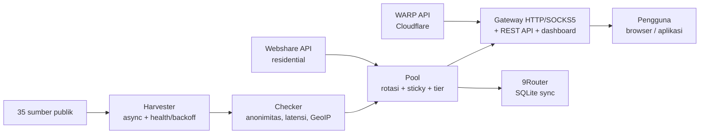

> このファイルは[メイン README（英語）](../../README.md)の翻訳です。正式なのは英語版です。

<div align="center">

# ⚡ Proxyz

**パブリックプロキシの収集、ローテーティングゲートウェイ、WARP & レジデンシャル — 高速、安全、オープンソース。**

[](https://github.com/Dvifnyz/Proxyz/releases)
[](https://github.com/Dvifnyz/Proxyz/actions/workflows/ci.yml)
[](../../LICENSE)
[](https://www.python.org/)
[](https://github.com/Dvifnyz/Proxyz/stargazers)
[](https://github.com/Dvifnyz/Proxyz/commits/main)
[](https://github.com/Dvifnyz/Proxyz/issues)
[](../../CONTRIBUTING.md)
[](#開発)

[📖 ドキュメント](../../docs/API.md) · [📋 変更履歴](../../CHANGELOG.md) · [🤝 コントリビューション](../../CONTRIBUTING.md) · [🔒 セキュリティ](../../SECURITY.md)

この README を他の言語で読む: [English](../../README.md) · [Bahasa Indonesia](README.id.md) · [中文](README.zh-CN.md) · [한국어](README.ko.md) · [日本語](README.ja.md) · [Русский](README.ru.md) · [العربية](README.ar.md) · [Afrikaans](README.af.md) · [Español](README.es.md) · [Português](README.pt.md) · [Deutsch](README.de.md) · [Français](README.fr.md) · [हिन्दी](README.hi.md)

</div>

## ハイライト

- 🌾 **大量収集、単一パイプライン** — 35 のパブリックソース（HTTP、SOCKS4、SOCKS5）、数秒で約 7 万件の候補。
- ✅ **正直なチェック** — 匿名性（elite/anonymous/transparent）、レイテンシ、国・ISP（GeoIP バッチ）、スコア 0–100。死んだものは捨て、隠さない。
- 🔄 **ローテーティングゲートウェイ** — HTTP + SOCKS5、スティッキーセッション、国別ルーティング、オートヒーラー、トークン、レート制限、監査ログ。
- ☁️ **無料の WARP** — Cloudflare 公式 API 経由の WireGuard プロファイル。
- 🏠 **レジデンシャル** — 公式 Webshare API 経由（マルチアカウント）、アカウントファームもキャプチャソルバーもなし。
- 📊 **可観測性** — ソースのヘルス、速度ベンチ、リークテスト、レポート、doctor、自動スケジューラ。
- 🔒 **設計から安全に** — TLS は常に有効、pip 経由のアップデーター（リモートコマンドなし）、ゲートウェイは localhost のみにバインド。

## 目次

- [インストール](#インストール)
- [クイックスタート](#クイックスタート)
- [アーキテクチャ](#アーキテクチャ)
- [機能](#機能)
- [コマンド](#コマンド)
- [ゲートウェイと API](#ゲートウェイと-api)
- [レジデンシャルプロキシ](#レジデンシャルプロキシ)
- [設定](#設定)
- [プロジェクト構成](#プロジェクト構成)
- [FAQ](#faq)
- [トラブルシューティング](#トラブルシューティング)
- [ロードマップ](#ロードマップ)
- [開発](#開発)
- [セキュリティ](#セキュリティ)
- [ライセンス](#ライセンス)

## インストール

**要件:** Python 3.9+。

### pip を使う場合

```bash
pip install proxyz
```

### pipx を使う場合（CLI におすすめ）

```bash
pipx install proxyz
```

### ソースから

```bash
git clone https://github.com/Dvifnyz/Proxyz.git
cd Proxyz
pip install -e .
```

### Docker を使う場合

```bash
docker build -t proxyz .
docker run -p 8888:8888 proxyz
```

Python API については [docs/API.md](../../docs/API.md) を参照してください。

## クイックスタート

```bash
python -m proxyz panen --jumlah 20     # panen + cek 20 proxy hidup
python -m proxyz gateway               # gateway di http://127.0.0.1:8888
curl -x http://127.0.0.1:8888 http://api.ipify.org
```

引数を指定しない場合、`python -m proxyz` はインタラクティブメニューを開きます。

実際の出力例:

```
$ python -m proxyz sources

  SUMBER                                                HASIL  GAGAL  STATUS
  https://raw.githubusercontent.com/zevtyardt/proxy-   128468      0  aktif
  https://raw.githubusercontent.com/B4RC0DE-TM/proxy     6370      0  aktif
  https://raw.githubusercontent.com/TheSpeedX/PROXY-     5354      0  aktif
```

```
$ python -m proxyz doctor

  🩺 Proxyz Doctor
  ✅ Python: 3.12.3
  ✅ Config: port 8888, healer 90 dtk
  ✅ Sumber panen: 35 URL (http, socks4, socks5)
  ✅ Sehat (2 peringatan, 0 error).
```

## アーキテクチャ



各コンポーネントの詳細は [docs/ARSITEKTUR.md](../../docs/ARSITEKTUR.md) を参照してください。

## 機能

### 収集とチェック

- 35 のソース（HTTP 17 件、SOCKS4 8 件、SOCKS5 10 件）。新しいソースから先にチェックします。
- ソースごとのヘルススコア（`proxyz sources`）。3 回連続で失敗したソースは 1 時間休止します。
- フィルター: 国（`--negara ID`）、プロトコル、速度ティア（`--tier cepat` は ≤350 ms、`sedang` は ≤800 ms）。
- ブラックリスト（`proxyz blacklist add 1.2.3.4:8080`）— ブラックリストに入ったプロキシは収集・チェックを決して通過しません。

### ゲートウェイ

- HTTP/HTTPS 転送（CONNECT）+ SOCKS5 リスナー（`--socks 1080`）。
- ラウンドロビンローテーション、レジデンシャル優先、スティッキーセッション 10 分（`X-Session-ID`）、国別ルーティング（`X-Country: ID`）。
- オートヒーラー: 90 秒ごとに実際の HTTP プローブを実行し、死んだものを除去し、プールが減ったら補充します。
- オプションのトークン（`PROXYZ_TOKEN`）、IP あたり 60 リクエスト/分のレート制限、監査ログ `output/gateway-audit.jsonl`。
- Web ダッシュボード: プール一覧、リークテストと速度テストのボタン。

### 可観測性

- `proxyz bench` — 実際のダウンロード速度ランキング（Cloudflare 経由で 1 MB）。
- `proxyz test` / `/api/leak-test` — 本来の IP とゲートウェイ経由の IP の比較。
- `proxyz laporan` — プールの概要（Markdown + `/api/report`）。
- `proxyz auto` — 収集 → チェック → エクスポートの定期サイクル。
- `proxyz doctor` — インストールの診断。
- `proxyz update` — GitHub のリリースを確認し、pip で安全に更新。

## コマンド

| コマンド | 機能 |
|---|---|
| `proxyz panen [--jumlah 20] [--negara ID] [--protokol all] [--tier cepat] [--geo]` | 有効なプロキシの収集 + チェック、`output/` にエクスポート |
| `proxyz cek <file> [--jumlah 20]` | ファイルからプロキシ一覧をチェック |
| `proxyz gateway [--port 8888] [--profil scraper\|cepat\|hemat] [--socks 1080]` | ローテーティングゲートウェイ（HTTP + オプションの SOCKS5） |
| `proxyz warp [--jumlah 1]` | WARP WireGuard プロファイルを作成（`.conf`、モード 0600） |
| `proxyz residential [--api-key KEY \| --signup]` | Webshare レジデンシャルプロキシ（公式 API） |
| `proxyz sources` | 収集ソースごとのヘルス一覧 |
| `proxyz bench [--jumlah 10]` | 各 HTTP プロキシのダウンロード速度ランキング |
| `proxyz test [--port 8888]` | リークテスト: 本来の IP とゲートウェイ経由の IP |
| `proxyz laporan` | プールの概要を `output/laporan.md` に出力 |
| `proxyz sync-9router [--db PATH] [--ganti]` | プールを 9Router の SQLite DB に同期 |
| `proxyz blacklist add\|remove\|list [entri]` | 使用してはいけないプロキシを管理 |
| `proxyz auto [--interval 60] [--sekali]` | 定期的な収集 + チェック + エクスポート |
| `proxyz install-service [--port 8888]` | サービスファイルを作成（systemd + Windows Task） |
| `proxyz update [--yes]` | 最新リリースを確認し、pip で更新 |
| `proxyz doctor [--no-gateway]` | インストールの診断（設定、ソース、プール、ゲートウェイ） |

## ゲートウェイと API

ゲートウェイは `127.0.0.1:8888` で待ち受けます（localhost のみ — 意図的に LAN には公開していません）。ブラウザやアプリでは `http://127.0.0.1:8888` をプロキシとして使うか、`--socks` で指定したポートの SOCKS5 を使います。

| エンドポイント | 機能 |
|---|---|
| `GET /api/status` | プールとゲートウェイの統計 |
| `GET /api/proxies` | プール内のプロキシ一覧 |
| `GET /api/random` | ランダムなプロキシを 1 つ取得 |
| `GET /api/rotate` | 次のプロキシへ強制ローテーション |
| `GET /api/refill` | バックグラウンドでプールを補充 |
| `GET /api/leak-test` | 本来の IP とゲートウェイ経由の IP（`zero_leak`） |
| `GET /api/bench?jumlah=5` | プールの速度ランキング |
| `GET /api/report` | プールのレポート（JSON） |
| `GET /api/clash.yaml` | プールから生成されるライブの Clash サブスクリプション |
| `GET /metrics` | Prometheus メトリクス |
| `GET /proxy.pac` | ブラウザ用の PAC ファイル |
| `GET /dashboard` | Web ダッシュボード（プール一覧、リークテスト、ベンチ） |

**認証（オプション）:** 環境変数 `PROXYZ_TOKEN` を設定し、`Authorization: Bearer <token>`（またはヘッダー `X-Proxyz-Token`）を送信します。

## レジデンシャルプロキシ

自宅回線の IP（レジデンシャル）が必要ですか？公式の方法はこちらです:

```bash
python -m proxyz residential --signup   # buka browser + siapkan password;
                                        # isi captcha sendiri sekali,
                                        # tempel API key -> divalidasi live
python -m proxyz residential --api-key KUNCIMU   # tambah akun lain
```

マルチアカウント対応 — すべてのキーが 1 つのプールにまとめられます。または、手動プロキシ（`proto://user:pass@ip:port`）を `output/proxy_manual.txt` に貼り付けてください。ゲートウェイもそれを使い、レジデンシャルがプール内で優先されます。

> Proxyz **は**自動キャプチャソルバー、アカウントの大量作成、anti-bot 回避を提供しません。ファームで作られたアカウントはすぐに BAN され、IP も死にます — それがツールの寿命を縮める原因です。

## 設定

すべての設定は `config/proxyz.json` にあります（環境変数で上書き可能）。トークンはこのファイルに**書かないでください** — 環境変数 `PROXYZ_TOKEN` を使ってください。

```json
{"gateway_port": 8888, "healer_interval": 90, "min_healthy": 5,
 "healer_target": 10, "check_timeout": 5.0, "check_workers": 100,
 "check_target": 20, "max_latency_ms": 1200, "session_ttl": 600,
 "rate_limit_per_min": 60, "audit_log": true,
 "schedule_interval_min": 60, "schedule_target": 20}
```

ゲートウェイプロファイル（`--profil`）: `scraper`（積極的なローテーション、プール 30）、`cepat`（≤350 ms のプロキシのみ）、`hemat`（小さなプール、セッション 30 分）。

## プロジェクト構成

```
Proxyz/
├── proxyz/              # paket utama
│   ├── cli.py           # CLI + menu interaktif
│   ├── harvester.py     # panen 35 sumber + skor kesehatan
│   ├── checker.py       # cek hidup, anonimitas, GeoIP batch
│   ├── pool.py          # rotasi, sticky session, tier
│   ├── gateway.py       # gateway HTTP/SOCKS5 + REST + dashboard
│   ├── warp.py          # WARP via API Cloudflare
│   ├── residential.py   # Webshare API resmi + signup semi-otomatis
│   ├── router.py        # sinkronisasi 9Router (SQLite)
│   ├── bench.py         # uji kecepatan unduh
│   ├── scheduler.py     # mode auto berkala
│   ├── report.py        # laporan pool
│   ├── doctor.py        # diagnosa instalasi
│   ├── updater.py       # update aman via pip
│   └── ...              # blacklist, tiers, config, installer
├── config/              # sources.json, proxyz.json, blacklist.txt
├── docs/                # API, ARSITEKTUR, translations (13 languages)
├── tests/               # 97 tes (pytest)
├── Dockerfile           # gateway di Docker
└── README.md
```

## FAQ

**Proxyz は合法ですか？**
はい — このツールはパブリックプロキシソースと公式 API（Webshare、Cloudflare）のみを使います。ユーザーの責任として残るのは、見知らぬパブリックプロキシ経由で機密データを送らないことと、利用するサービスの ToS を守ることです。

**`panen` で有効なプロキシが 0 件になるのはなぜですか？**
無料プロキシの大部分は死んでいます — それが普通です。後でもう一度試すか、ネットワークを変えるか、別の `--negara` を使ってください。インストールが正常か確認するには `proxyz doctor` を実行してください。

**レジデンシャルはなぜ手動登録が必要なのですか？**
Webshare はアカウントごとに 10 個の無料 IP を提供しており、ボットが作成したアカウント（キャプチャが自動で解かれたもの）はすぐに BAN され、IP も一緒に死ぬからです。一度だけ登録すれば（30 秒）、そのキーを Proxyz がずっと使います。

**Proxyz は Windows で動きますか？**
はい。Python 3.9+ で、コマンドはすべて同じです。ログイン時に自動起動するには、`proxyz install-service` を使ってください（Task Scheduler を作成します）。

**ゲートウェイにはスマホや他のコンピューターからアクセスできますか？**
いいえ — 意図的に `127.0.0.1` のみです。LAN からアクセスする必要がある場合は、トークンを有効にした上で、自分のリバースプロキシの後ろで実行してください。

**Webshare の API キーはどこに保存されますか？**
ローカルの `config/webshare.json`（モード 0600）に保存され、コミットされることはありません。キーが漏れた場合はそのファイルを削除し、Webshare ダッシュボードで新しいキーを作成してください。

## トラブルシューティング

| 症状 | 原因と対処法 |
|---|---|
| `pool kosong — panen dulu` | まず `proxyz panen` を実行してください。または、起動時にゲートウェイが自分で収集します |
| `502` saat browsing via gateway | プール内のプロキシがすべて死んでいます — ヒーラーが補充します。または `proxyz panen` をもう一度実行してください |
| `401 token dibutuhkan` | 環境変数に `PROXYZ_TOKEN` を設定し、`Authorization: Bearer <token>` を送信してください |
| `429 rate limit` | 約 1 分待つか、設定の `rate_limit_per_min` を上げてください |
| `proxyz update` 404 | GitHub に Release がまだありません — アップデーターは自動的に tags にフォールバックします |
| Gateway tidak bisa diakses | ポート 8888 を他のプロセスが使っていないか確認してください。`proxyz doctor` を確認してください |
| `0 hidup` terus-menerus | ネットワークがプロキシへの直接 TCP をブロックしています（サンドボックスなど）— 普通のラップトップや PC で試してください |

まだ解決しませんか？`proxyz doctor` を実行し、その出力を添えて issue を開いてください。

## ロードマップ

- [ ] checker とゲートウェイの IPv6 対応
- [ ] コミュニティからの収集ソース（PR 歓迎）
- [ ] `proxyz serve` モード — ゲートウェイ + auto を 1 つのプロセスに
- [ ] Surge / Shadowrocket へのエクスポート
- [ ] ダッシュボード v3 — レイテンシグラフとプール履歴

他にアイデアがありますか？[機能要望の issue](../../.github/ISSUE_TEMPLATE/feature_request.md) を開いてください。

## 開発

```bash
git clone https://github.com/Dvifnyz/Proxyz.git
cd Proxyz
python -m venv .venv && source .venv/bin/activate
pip install -e ".[dev]"
pytest -q            # 97 tes
python -m proxyz doctor
```

コントリビューションのガイドは [CONTRIBUTING.md](../../CONTRIBUTING.md) を参照してください（コミットスタイル、ソースの追加方法、コマンドの追加方法）。

## セキュリティ

脆弱性を公開 issue で報告しないでください — [SECURITY.md](../../SECURITY.md) を読んでください。要するに、ゲートウェイは localhost のみにバインドされ、トークンが設定ファイルに書き込まれることは決してなく、Webshare の API キーはローカルにモード 0600 で保存され、アップデーターがサーバーからコマンドを実行することは決してありません。

## ライセンス

ライセンス [MIT](../../LICENSE)。

[](https://star-history.com/#Dvifnyz/Proxyz&Date)
