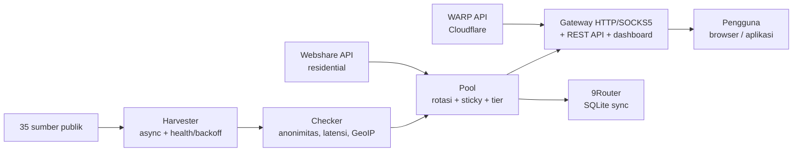

> 이 문서는 메인 README(인도네시아어)의 번역본입니다. [인도네시아어 버전](../../README.md)이 기준이 됩니다.

<div align="center">

# ⚡ Proxyz

**공개 프록시 수집, 로테이팅 게이트웨이, WARP 및 레지덴셜 프록시 — 빠르고, 안전하고, 오픈 소스.**

[](https://github.com/Dvifnyz/Proxyz/releases)
[](https://github.com/Dvifnyz/Proxyz/actions/workflows/ci.yml)
[](../../LICENSE)
[](https://www.python.org/)
[](https://github.com/Dvifnyz/Proxyz/stargazers)
[](https://github.com/Dvifnyz/Proxyz/commits/main)
[](https://github.com/Dvifnyz/Proxyz/issues)
[](../../CONTRIBUTING.md)
[](#개발)

[📖 문서](../../docs/API.md) · [📋 변경 로그](../../CHANGELOG.md) · [🤝 기여하기](../../CONTRIBUTING.md) · [🔒 보안](../../SECURITY.md)

이 README를 다른 언어로 읽기: [English](README.en.md) · [中文](README.zh-CN.md) · [한국어](README.ko.md) · [日本語](README.ja.md) · [Русский](README.ru.md) · [العربية](README.ar.md) · [Afrikaans](README.af.md) · [Español](README.es.md) · [Português](README.pt.md) · [Deutsch](README.de.md) · [Français](README.fr.md) · [हिन्दी](README.hi.md)

</div>

## 하이라이트

- 🌾 **대량 수집, 단일 파이프라인** — 35개 공개 소스(HTTP, SOCKS4,
  SOCKS5), 수 초 만에 약 7만 개의 후보 확보.
- ✅ **정직한 검사** — 익명성(elite/anonymous/transparent),
  지연 시간, 국가/ISP(배치 GeoIP), 0–100점. 죽은 프록시는 숨기지
  않고 버립니다.
- 🔄 **로테이팅 게이트웨이** — HTTP + SOCKS5, 스티키 세션, 국가별
  라우팅, 자동 복구, 토큰, 속도 제한, 감사 로그.
- ☁️ **무료 WARP** — Cloudflare 공식 API로 WireGuard 프로필 생성.
- 🏠 **레지덴셜** — Webshare 공식 API(멀티 계정 지원), 계정 팜도
  캡차 솔버도 없습니다.
- 📊 **관측 가능성** — 소스 상태, 속도 벤치마크, 누수 테스트,
  리포트, doctor, 자동 스케줄러.
- 🔒 **설계부터 안전하게** — TLS는 계속 켜져 있고, pip으로 업데이트
  (원격 명령 실행 없음), 게이트웨이는 localhost에만 바인딩.

## 목차

- [설치](#설치)
- [빠른 시작](#빠른-시작)
- [아키텍처](#아키텍처)
- [기능](#기능)
- [명령어](#명령어)
- [게이트웨이 및 API](#게이트웨이-및-api)
- [레지덴셜 프록시](#레지덴셜-프록시)
- [설정](#설정)
- [프로젝트 구조](#프로젝트-구조)
- [FAQ](#faq)
- [문제 해결](#문제-해결)
- [로드맵](#로드맵)
- [개발](#개발)
- [보안](#보안)
- [라이선스 및 감사의 말](#라이선스-및-감사의-말)

## 설치

**요구 사항:** Python 3.9+.

### pip으로 설치

```bash
pip install proxyz
```

### pipx로 설치(CLI에 권장)

```bash
pipx install proxyz
```

### 소스에서 설치

```bash
git clone https://github.com/Dvifnyz/Proxyz.git
cd Proxyz
pip install -e .
```

### Docker로 설치

```bash
docker build -t proxyz .
docker run -p 8888:8888 proxyz
```

Python API는 [docs/API.md](../../docs/API.md)를 참고하세요.

## 빠른 시작

```bash
python -m proxyz panen --jumlah 20     # panen + cek 20 proxy hidup
python -m proxyz gateway               # gateway di http://127.0.0.1:8888
curl -x http://127.0.0.1:8888 http://api.ipify.org
```

인자 없이 실행하면 `python -m proxyz`가 대화형 메뉴를 엽니다.

실제 출력 예시:

```
$ python -m proxyz sources

  SUMBER                                                HASIL  GAGAL  STATUS
  https://raw.githubusercontent.com/zevtyardt/proxy-   128468      0  aktif
  https://raw.githubusercontent.com/B4RC0DE-TM/proxy     6370      0  aktif
  https://raw.githubusercontent.com/TheSpeedX/PROXY-     5354      0  aktif
```

```
$ python -m proxyz doctor

  🩺 Proxyz Doctor
  ✅ Python: 3.12.3
  ✅ Config: port 8888, healer 90 dtk
  ✅ Sumber panen: 35 URL (http, socks4, socks5)
  ✅ Sehat (2 peringatan, 0 error).
```

## 아키텍처



각 컴포넌트 설명: [docs/ARSITEKTUR.md](../../docs/ARSITEKTUR.md).

## 기능

### 수집 및 검사

- 35개 소스(17개 HTTP, 8개 SOCKS4, 10개 SOCKS5), 최신 소스부터 먼저 검사합니다.
- 소스별 상태 점수(`proxyz sources`); 3회 연속 실패한 소스는
  1시간 동안 쉽니다.
- 필터: 국가(`--negara ID`), 프로토콜, 속도 등급
  (`--tier cepat` ≤350ms, `sedang` ≤800ms).
- 블랙리스트(`proxyz blacklist add 1.2.3.4:8080`) — 블랙리스트에
  오른 프록시는 수집/검사를 절대 통과하지 못합니다.

### 게이트웨이

- HTTP/HTTPS 포워딩(CONNECT) + SOCKS5 리스너(`--socks 1080`).
- 라운드 로빈 로테이션, 레지덴셜 우선, 스티키 세션
  10분(`X-Session-ID`), 국가별 라우팅(`X-Country: ID`).
- 자동 복구: 90초마다 실제 HTTP 프로브로 죽은 프록시를 제거하고,
  풀이 부족하면 채워 넣습니다.
- 선택적 토큰(`PROXYZ_TOKEN`), IP당 분당 60회 속도 제한,
  감사 로그 `output/gateway-audit.jsonl`.
- 웹 대시보드: 풀 테이블, 누수 테스트 및 속도 테스트 버튼.

### 관측 가능성

- `proxyz bench` — 실제 다운로드 속도 순위(Cloudflare 경유 1 MB).
- `proxyz test` / `/api/leak-test` — 실제 IP와 게이트웨이를 거친 IP 비교.
- `proxyz laporan` — 풀 요약(Markdown + `/api/report`).
- `proxyz auto` — 수집 → 검사 → 내보내기 주기적 실행.
- `proxyz doctor` — 설치 진단.
- `proxyz update` — GitHub 릴리스 확인, pip으로 업데이트(안전).

## 명령어

| 명령어 | 기능 |
|---|---|
| `proxyz panen [--jumlah 20] [--negara ID] [--protokol all] [--tier cepat] [--geo]` | live 프록시 수집 + 검사, `output/`로 내보내기 |
| `proxyz cek <file> [--jumlah 20]` | 파일에서 프록시 목록 검사 |
| `proxyz gateway [--port 8888] [--profil scraper\|cepat\|hemat] [--socks 1080]` | 로테이팅 게이트웨이(HTTP + 선택적 SOCKS5) |
| `proxyz warp [--jumlah 1]` | WARP WireGuard 프로필 생성(`.conf`, 모드 0600) |
| `proxyz residential [--api-key KEY \| --signup]` | Webshare 레지덴셜 프록시(공식 API) |
| `proxyz sources` | 각 수집 소스의 상태 테이블 |
| `proxyz bench [--jumlah 10]` | 각 HTTP 프록시의 다운로드 속도 순위 |
| `proxyz test [--port 8888]` | 누수 테스트: 실제 IP와 게이트웨이를 거친 IP 비교 |
| `proxyz laporan` | 풀 요약을 `output/laporan.md`로 저장 |
| `proxyz sync-9router [--db PATH] [--ganti]` | 풀을 9Router SQLite DB에 동기화 |
| `proxyz blacklist add\|remove\|list [entri]` | 사용해서는 안 되는 프록시 관리 |
| `proxyz auto [--interval 60] [--sekali]` | 주기적 수집 + 검사 + 내보내기 |
| `proxyz install-service [--port 8888]` | 서비스 파일 생성(systemd + Windows 작업) |
| `proxyz update [--yes]` | 최신 릴리스 확인, pip으로 업데이트 |
| `proxyz doctor [--no-gateway]` | 설치 진단(설정, 소스, 풀, 게이트웨이) |

## 게이트웨이 및 API

게이트웨이는 `127.0.0.1:8888`에서 수신 대기합니다(localhost 전용 —
의도적으로 LAN에 노출하지 않습니다). 브라우저/앱에서
`http://127.0.0.1:8888`을 프록시로 지정하거나, `--socks`로 지정한
포트로 SOCKS5를 사용하세요.

| 엔드포인트 | 기능 |
|---|---|
| `GET /api/status` | 풀 및 게이트웨이 통계 |
| `GET /api/proxies` | 풀에 있는 프록시 목록 |
| `GET /api/random` | 무작위 프록시 하나 |
| `GET /api/rotate` | 다음 프록시로 강제 로테이션 |
| `GET /api/refill` | 백그라운드에서 풀 채우기 |
| `GET /api/leak-test` | 실제 IP와 게이트웨이를 거친 IP 비교(`zero_leak`) |
| `GET /api/bench?jumlah=5` | 풀 속도 순위 |
| `GET /api/report` | 풀 리포트(JSON) |
| `GET /api/clash.yaml` | 풀 기반 실시간 Clash 구독 |
| `GET /metrics` | Prometheus 메트릭 |
| `GET /proxy.pac` | 브라우저용 PAC 파일 |
| `GET /dashboard` | 웹 대시보드(풀 테이블, 누수 테스트, 벤치마크) |

**인증(선택 사항):** `PROXYZ_TOKEN` 환경 변수를 채운 뒤
`Authorization: Bearer <token>`(또는 `X-Proxyz-Token` 헤더)을 보내세요.

## 레지덴셜 프록시

레지덴셜 IP가 필요하신가요? 공식 경로는 다음과 같습니다.

```bash
python -m proxyz residential --signup   # buka browser + siapkan password;
                                        # isi captcha sendiri sekali,
                                        # tempel API key -> divalidasi live
python -m proxyz residential --api-key KUNCIMU   # tambah akun lain
```

멀티 계정을 지원합니다 — 모든 키가 하나의 풀로 합쳐집니다. 또는
수동 프록시(`proto://user:pass@ip:port`)를
`output/proxy_manual.txt`에 붙여넣으면 게이트웨이가 함께 사용하고,
풀에서는 레지덴셜이 우선됩니다.

> Proxyz는 자동 캡차 솔버, 대량 계정 생성, 안티봇 우회를
> **제공하지 않습니다**. 팜으로 만든 계정은 금방 차단되고 IP도 함께
> 죽습니다 — 그게 도구를 단명하게 만드는 원인입니다.

## 설정

모든 설정은 `config/proxyz.json`에 있습니다(환경 변수가 있으면
덮어씁니다). 토큰은 이 파일에 **절대** 쓰지 마세요 —
`PROXYZ_TOKEN` 환경 변수를 사용하세요.

```json
{"gateway_port": 8888, "healer_interval": 90, "min_healthy": 5,
 "healer_target": 10, "check_timeout": 5.0, "check_workers": 100,
 "check_target": 20, "max_latency_ms": 1200, "session_ttl": 600,
 "rate_limit_per_min": 60, "audit_log": true,
 "schedule_interval_min": 60, "schedule_target": 20}
```

게이트웨이 프로필(`--profil`): `scraper`(공격적 로테이션, 풀 30개),
`cepat`(≤350ms 프록시만), `hemat`(작은 풀, 30분 세션).

## 프로젝트 구조

```
Proxyz/
├── proxyz/              # paket utama
│   ├── cli.py           # CLI + menu interaktif
│   ├── harvester.py     # panen 35 sumber + skor kesehatan
│   ├── checker.py       # cek hidup, anonimitas, GeoIP batch
│   ├── pool.py          # rotasi, sticky session, tier
│   ├── gateway.py       # gateway HTTP/SOCKS5 + REST + dashboard
│   ├── warp.py          # WARP via API Cloudflare
│   ├── residential.py   # Webshare API resmi + signup semi-otomatis
│   ├── router.py        # sinkronisasi 9Router (SQLite)
│   ├── bench.py         # uji kecepatan unduh
│   ├── scheduler.py     # mode auto berkala
│   ├── report.py        # laporan pool
│   ├── doctor.py        # diagnosa instalasi
│   ├── updater.py       # update aman via pip
│   └── ...              # blacklist, tiers, config, installer
├── config/              # sources.json, proxyz.json, blacklist.txt
├── docs/                # API, ARSITEKTUR, STUDI, translations (12 bahasa)
├── tests/               # 97 tes (pytest)
├── Dockerfile           # gateway di Docker
└── README.md
```

## FAQ

**Proxyz는 합법인가요?**
네 — 이 도구는 공개 프록시 소스와 공식 API(Webshare, Cloudflare)만
사용합니다. 다만 사용자의 책임이 남습니다. 모르는 공개 프록시로는
민감한 데이터를 보내지 마시고, 사용하는 서비스의 이용 약관을
지켜주세요.

**`panen`에서 live 프록시가 0개 나오는 이유는?**
무료 프록시는 대부분 죽어 있습니다 — 정상입니다. 나중에 다시
시도하거나, 네트워크를 바꾸거나, 다른 `--negara`를 사용해 보세요.
`proxyz doctor`를 실행해 설치가 정상인지 확인하세요.

**레지덴셜은 왜 직접 가입해야 하나요?**
Webshare는 계정당 무료 IP 10개를 제공하고, 봇으로 만든 계정(캡차
자동 풀이)은 금방 차단되어 IP도 함께 죽기 때문입니다. 한 번만
가입하면(30초) Proxyz가 그 키를 계속 사용합니다.

**Proxyz는 Windows에서 실행되나요?**
네. Python 3.9 이상이 필요하고 모든 명령어가 동일합니다. 로그인 시
자동 실행하려면 `proxyz install-service`를 사용하세요(작업 스케줄러 생성).

**게이트웨이에 휴대폰/다른 컴퓨터에서 접속할 수 있나요?**
아니요 — 의도적으로 `127.0.0.1`만 허용합니다. LAN에서 접속해야
한다면 토큰을 활성화한 뒤 직접 리버스 프록시 앞에 두고 실행하세요.

**제 Webshare API 키는 어디에 저장되나요?**
로컬 `config/webshare.json`(모드 0600)에 저장되며 절대 커밋되지
않습니다. 키가 유출되면 해당 파일을 삭제하고 Webshare 대시보드에서
새 키를 만드세요.

## 문제 해결

| 증상 | 원인 및 해결 방법 |
|---|---|
| `pool kosong — panen dulu` | 먼저 `proxyz panen`을 실행하세요. 게이트웨이가 시작할 때 직접 수집하기도 합니다 |
| `502` saat browsing via gateway | 풀의 프록시가 전부 죽었습니다 — 자동 복구가 채워 넣습니다. 또는 `proxyz panen`을 다시 실행하세요 |
| `401 token dibutuhkan` | 환경 변수에 `PROXYZ_TOKEN`을 채우고 `Authorization: Bearer <token>`을 보내세요 |
| `429 rate limit` | 약 1분 기다리거나 설정에서 `rate_limit_per_min`을 높이세요 |
| `proxyz update` 404 | GitHub에 아직 Release가 없습니다 — 업데이터가 자동으로 태그로 대체합니다 |
| Gateway tidak bisa diakses | 8888 포트에 다른 프로세스가 없는지 확인하고 `proxyz doctor`를 실행하세요 |
| `0 hidup` terus-menerus | 네트워크가 프록시로의 직접 TCP를 차단하고 있습니다(예: 샌드박스) — 일반 노트북/PC에서 시도해 보세요 |

여전히 안 되나요? `proxyz doctor`를 실행하고 이슈를 열 때 출력을
함께 첨부하세요.

## 로드맵

- [ ] 검사기 및 게이트웨이 IPv6 지원
- [ ] 커뮤니티 수집 소스(PR 환영)
- [ ] `proxyz serve` 모드 — 게이트웨이 + 자동 실행을 하나의 프로세스로
- [ ] Surge / Shadowrocket 내보내기
- [ ] 대시보드 v3 — 지연 시간 그래프 및 풀 기록

다른 아이디어가 있으신가요? [기능 제안](../../.github/ISSUE_TEMPLATE/feature_request.md)을 열어주세요.

## 개발

```bash
git clone https://github.com/Dvifnyz/Proxyz.git
cd Proxyz
python -m venv .venv && source .venv/bin/activate
pip install -e ".[dev]"
pytest -q            # 97 tes
python -m proxyz doctor
```

기여 가이드(커밋 스타일, 소스 추가, 명령어 추가)는
[CONTRIBUTING.md](../../CONTRIBUTING.md)를 참고하세요.

## 보안

취약점은 공개 이슈로 보고하지 마세요 —
[SECURITY.md](../../SECURITY.md)를 읽어주세요. 요약하면 게이트웨이는
localhost에만 바인딩되고, 토큰은 설정 파일에 절대 기록되지 않으며,
Webshare API 키는 모드 0600으로 로컬에 저장되고, 업데이터는 서버에서
오는 명령을 절대 실행하지 않습니다.

## 라이선스 및 감사의 말

라이선스 [MIT](../../LICENSE).

[itzluthfi](https://github.com/itzluthfi)님께 감사드립니다 —
[petani-proxy](https://github.com/itzluthfi/petani-proxy)의 제작자로,
이 도구의 학습 자료이자 영감이 되었습니다. 이 README의 구조는
[FastAPI](https://github.com/fastapi/fastapi)와
[uv](https://github.com/astral-sh/uv)를 참고했습니다.

[](https://star-history.com/#Dvifnyz/Proxyz&Date)
