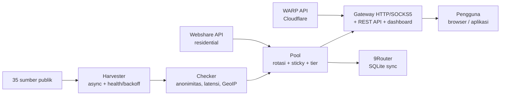

Esta é uma tradução do [README principal](../../README.md) (indonésio). A versão em indonésio é a vigente.

<div align="center">

# ⚡ Proxyz

**Colheita de proxies públicos, gateway rotativo, WARP e residential — rápido, seguro, de código aberto.**

[](https://github.com/Dvifnyz/Proxyz/releases)
[](https://github.com/Dvifnyz/Proxyz/actions/workflows/ci.yml)
[](../../LICENSE)
[](https://www.python.org/)
[](https://github.com/Dvifnyz/Proxyz/stargazers)
[](https://github.com/Dvifnyz/Proxyz/commits/main)
[](https://github.com/Dvifnyz/Proxyz/issues)
[](../../CONTRIBUTING.md)
[](#desenvolvimento)

[📖 Documentação](../../docs/API.md) · [📋 Changelog](../../CHANGELOG.md) · [🤝 Contribuir](../../CONTRIBUTING.md) · [🔒 Segurança](../../SECURITY.md)

Leia este README em outro idioma: [English](../../docs/translations/README.en.md) · [中文](../../docs/translations/README.zh-CN.md) · [한국어](../../docs/translations/README.ko.md) · [日本語](../../docs/translations/README.ja.md) · [Русский](../../docs/translations/README.ru.md) · [العربية](../../docs/translations/README.ar.md) · [Afrikaans](../../docs/translations/README.af.md) · [Español](../../docs/translations/README.es.md) · [Português](../../docs/translations/README.pt.md) · [Deutsch](../../docs/translations/README.de.md) · [Français](../../docs/translations/README.fr.md) · [हिन्दी](../../docs/translations/README.hi.md)

</div>

## Destaques

- 🌾 **Colheita em massa, um só pipeline** — 35 fontes públicas (HTTP,
  SOCKS4, SOCKS5), ~70 mil candidatos em questão de segundos.
- ✅ **Verificação honesta** — anonimato (elite/anonymous/transparent),
  latência, país/ISP (GeoIP batch), pontuação 0–100. Os mortos são
  descartados, não escondidos.
- 🔄 **Gateway rotativo** — HTTP + SOCKS5, sticky session, roteamento
  por país, auto-healer, token, rate limit, audit log.
- ☁️ **WARP grátis** — perfil WireGuard pela API oficial da Cloudflare.
- 🏠 **Residential** — Webshare pela API oficial (várias contas),
  sem fazendas de contas e sem solucionadores de captcha.
- 📊 **Observabilidade** — saúde das fontes, teste de velocidade,
  leak test, relatório, doctor, scheduler automático.
- 🔒 **Seguro por design** — TLS sempre ativado, atualizador via pip
  (sem comandos remotos), gateway vinculado apenas ao localhost.

## Índice

- [Instalação](#instalação)
- [Início rápido](#início-rápido)
- [Arquitetura](#arquitetura)
- [Funcionalidades](#funcionalidades)
- [Comandos](#comandos)
- [Gateway e API](#gateway-e-api)
- [Proxy residencial](#proxy-residencial)
- [Configuração](#configuração)
- [Estrutura do projeto](#estrutura-do-projeto)
- [FAQ](#faq)
- [Solução de problemas](#solução-de-problemas)
- [Roteiro](#roteiro)
- [Desenvolvimento](#desenvolvimento)
- [Segurança](#segurança)
- [Licença e agradecimentos](#licença-e-agradecimentos)

## Instalação

**Requisito:** Python 3.9+.

### Com pip

```bash
pip install proxyz
```

### Com pipx (recomendado para a CLI)

```bash
pipx install proxyz
```

### A partir do código-fonte

```bash
git clone https://github.com/Dvifnyz/Proxyz.git
cd Proxyz
pip install -e .
```

### Com Docker

```bash
docker build -t proxyz .
docker run -p 8888:8888 proxyz
```

Veja [docs/API.md](../../docs/API.md) para a API Python.

## Início rápido

```bash
python -m proxyz panen --jumlah 20     # panen + cek 20 proxy hidup
python -m proxyz gateway               # gateway di http://127.0.0.1:8888
curl -x http://127.0.0.1:8888 http://api.ipify.org
```

Sem argumentos, `python -m proxyz` abre o menu interativo.

Exemplo de saída real:

```
$ python -m proxyz sources

  SUMBER                                                HASIL  GAGAL  STATUS
  https://raw.githubusercontent.com/zevtyardt/proxy-   128468      0  aktif
  https://raw.githubusercontent.com/B4RC0DE-TM/proxy     6370      0  aktif
  https://raw.githubusercontent.com/TheSpeedX/PROXY-     5354      0  aktif
```

```
$ python -m proxyz doctor

  🩺 Proxyz Doctor
  ✅ Python: 3.12.3
  ✅ Config: port 8888, healer 90 dtk
  ✅ Sumber panen: 35 URL (http, socks4, socks5)
  ✅ Sehat (2 peringatan, 0 error).
```

## Arquitetura



Explicação de cada componente: [docs/ARSITEKTUR.md](../../docs/ARSITEKTUR.md).

## Funcionalidades

### Colheita e verificação

- 35 fontes (17 HTTP, 8 SOCKS4, 10 SOCKS5); as fontes novas são
  verificadas primeiro.
- Pontuação de saúde por fonte (`proxyz sources`); uma fonte que
  falha 3 vezes seguidas descansa por 1 hora.
- Filtros: país (`--negara ID`), protocolo, nível de velocidade
  (`--tier cepat` ≤350 ms, `sedang` ≤800 ms).
- Blacklist (`proxyz blacklist add 1.2.3.4:8080`): os proxies na
  blacklist nunca passam na colheita nem na verificação.

### Gateway

- Encaminhamento HTTP/HTTPS (CONNECT) + listener SOCKS5 (`--socks 1080`).
- Rotação round-robin, residential com prioridade, sticky session
  de 10 minutos (`X-Session-ID`), roteamento por país (`X-Country: ID`).
- Auto-healer: sonda HTTP real a cada 90 segundos, descarta os mortos
  e repõe o pool quando ele esvazia.
- Token opcional (`PROXYZ_TOKEN`), rate limit de 60/min por IP,
  audit log `output/gateway-audit.jsonl`.
- Dashboard web: tabela do pool, botão de leak test e teste de velocidade.

### Observabilidade

- `proxyz bench`: ranking de velocidade real de download (1 MB via Cloudflare).
- `proxyz test` / `/api/leak-test`: IP real vs. IP via gateway.
- `proxyz laporan`: resumo do pool (Markdown + `/api/report`).
- `proxyz auto`: ciclo colheita → verificação → exportação periódica.
- `proxyz doctor`: diagnóstico da instalação.
- `proxyz update`: verifica os releases do GitHub e atualiza via pip (seguro).

## Comandos

| Comando | Função |
|---|---|
| `proxyz panen [--jumlah 20] [--negara ID] [--protokol all] [--tier cepat] [--geo]` | Colheita + verificação de proxies ativos, exporta para `output/` |
| `proxyz cek <file> [--jumlah 20]` | Verifica uma lista de proxies a partir de um arquivo |
| `proxyz gateway [--port 8888] [--profil scraper\|cepat\|hemat] [--socks 1080]` | Gateway rotativo (HTTP + SOCKS5 opcional) |
| `proxyz warp [--jumlah 1]` | Cria um perfil WARP do WireGuard (`.conf`, modo 0600) |
| `proxyz residential [--api-key KEY \| --signup]` | Proxy residential da Webshare (API oficial) |
| `proxyz sources` | Tabela de saúde de cada fonte de colheita |
| `proxyz bench [--jumlah 10]` | Ranking de velocidade de download de cada proxy HTTP |
| `proxyz test [--port 8888]` | Leak test: IP real vs. IP via gateway |
| `proxyz laporan` | Resumo do pool em `output/laporan.md` |
| `proxyz sync-9router [--db PATH] [--ganti]` | Sincroniza o pool com o BD SQLite do 9Router |
| `proxyz blacklist add\|remove\|list [entri]` | Gerencia os proxies que não devem ser usados |
| `proxyz auto [--interval 60] [--sekali]` | Colheita + verificação + exportação periódicas |
| `proxyz install-service [--port 8888]` | Cria o arquivo de serviço (systemd + Windows Task) |
| `proxyz update [--yes]` | Verifica o release mais recente e atualiza via pip |
| `proxyz doctor [--no-gateway]` | Diagnóstico da instalação (config, fontes, pool, gateway) |

## Gateway e API

O gateway escuta em `127.0.0.1:8888` (somente localhost —
deliberadamente não exposto à LAN). Use no navegador/aplicativo por
meio de `http://127.0.0.1:8888` como proxy, ou via SOCKS5 na porta
indicada com `--socks`.

| Endpoint | Função |
|---|---|
| `GET /api/status` | Estatísticas do pool e do gateway |
| `GET /api/proxies` | Lista de proxies do pool |
| `GET /api/random` | Um proxy aleatório |
| `GET /api/rotate` | Força a rotação para o próximo proxy |
| `GET /api/refill` | Repõe o pool em segundo plano |
| `GET /api/leak-test` | IP real vs. IP via gateway (`zero_leak`) |
| `GET /api/bench?jumlah=5` | Ranking de velocidade do pool |
| `GET /api/report` | Relatório do pool (JSON) |
| `GET /api/clash.yaml` | Assinatura Clash ao vivo a partir do pool |
| `GET /metrics` | Métricas do Prometheus |
| `GET /proxy.pac` | Arquivo PAC para o navegador |
| `GET /dashboard` | Dashboard web (tabela do pool, leak test, bench) |

**Autenticação (opcional):** preencha o env `PROXYZ_TOKEN` e envie
`Authorization: Bearer <token>` (ou o cabeçalho `X-Proxyz-Token`).

## Proxy residencial

Precisa de um IP residencial? Este é o caminho oficial:

```bash
python -m proxyz residential --signup   # buka browser + siapkan password;
                                        # isi captcha sendiri sekali,
                                        # tempel API key -> divalidasi live
python -m proxyz residential --api-key KUNCIMU   # tambah akun lain
```

Várias contas são suportadas — todas as chaves são combinadas em um
só pool. Ou cole proxies manuais (`proto://user:pass@ip:port`) em
`output/proxy_manual.txt`; o gateway também os usa, e o residential
tem prioridade no pool.

> O Proxyz **não** oferece solucionador automático de captcha,
> fazendas de contas em massa nem bypass de anti-bot. Contas de
> fazenda são banidas rápido e seus IPs morrem — é isso que encurta
> a vida de uma ferramenta.

## Configuração

Todas as configurações estão em `config/proxyz.json` (mais env, se
houver). **Não** escreva o token neste arquivo — use o env `PROXYZ_TOKEN`.

```json
{"gateway_port": 8888, "healer_interval": 90, "min_healthy": 5,
 "healer_target": 10, "check_timeout": 5.0, "check_workers": 100,
 "check_target": 20, "max_latency_ms": 1200, "session_ttl": 600,
 "rate_limit_per_min": 60, "audit_log": true,
 "schedule_interval_min": 60, "schedule_target": 20}
```

Perfil do gateway (`--profil`): `scraper` (rotação agressiva, pool 30),
`cepat` (apenas proxies ≤350 ms), `hemat` (pool pequeno, sessão de
30 minutos).

## Estrutura do projeto

```
Proxyz/
├── proxyz/              # paket utama
│   ├── cli.py           # CLI + menu interaktif
│   ├── harvester.py     # panen 35 sumber + skor kesehatan
│   ├── checker.py       # cek hidup, anonimitas, GeoIP batch
│   ├── pool.py          # rotasi, sticky session, tier
│   ├── gateway.py       # gateway HTTP/SOCKS5 + REST + dashboard
│   ├── warp.py          # WARP via API Cloudflare
│   ├── residential.py   # Webshare API resmi + signup semi-otomatis
│   ├── router.py        # sinkronisasi 9Router (SQLite)
│   ├── bench.py         # uji kecepatan unduh
│   ├── scheduler.py     # mode auto berkala
│   ├── report.py        # laporan pool
│   ├── doctor.py        # diagnosa instalasi
│   ├── updater.py       # update aman via pip
│   └── ...              # blacklist, tiers, config, installer
├── config/              # sources.json, proxyz.json, blacklist.txt
├── docs/                # API, ARSITEKTUR, STUDI, translations (12 bahasa)
├── tests/               # 97 tes (pytest)
├── Dockerfile           # gateway di Docker
└── README.md
```

## FAQ

**O Proxyz é legal?**
Sim — esta ferramenta só usa fontes públicas de proxies e as APIs
oficiais (Webshare, Cloudflare). O que continua sendo responsabilidade
do usuário: não enviar dados sensíveis por um proxy público
desconhecido e respeitar os ToS do serviço usado.

**Por que o `panen` obtém 0 proxies ativos?**
A maioria dos proxies gratuitos está morta — isso é normal. Tente
novamente mais tarde, troque de rede ou use outro `--negara`.
Execute `proxyz doctor` para confirmar que sua instalação está saudável.

**Por que o residential exige cadastro manual?**
Porque a Webshare dá 10 IPs grátis por conta, e contas criadas por
bots (captcha resolvido automaticamente) são banidas rápido — os IPs
morrem junto. Cadastre-se uma vez (30 segundos) e o Proxyz usará
a chave para sempre.

**O Proxyz funciona no Windows?**
Sim. Python 3.9+ e os mesmos comandos. Para executar sozinho ao fazer
login, use `proxyz install-service` (cria um Task Scheduler).

**Dá para acessar o gateway pelo celular / outro computador?**
Não — deliberadamente apenas `127.0.0.1`. Se precisar de acesso pela
LAN, execute atrás do seu próprio reverse proxy com o token ativo.

**Onde minha chave API da Webshare é guardada?**
No `config/webshare.json` local (modo 0600), nunca enviada ao
repositório. Se a chave vazar, apague esse arquivo e crie uma chave
nova no painel da Webshare.

## Solução de problemas

| Sintoma | Causa e solução |
|---|---|
| `pool kosong — panen dulu` | Execute `proxyz panen` primeiro, ou o gateway colherá sozinho ao iniciar |
| `502` saat browsing via gateway | Todos os proxies do pool estão mortos — o healer vai repor; ou execute `proxyz panen` novamente |
| `401 token dibutuhkan` | Preencha `PROXYZ_TOKEN` no env e envie `Authorization: Bearer <token>` |
| `429 rate limit` | Espere ~1 minuto ou aumente `rate_limit_per_min` na config |
| `proxyz update` 404 | Ainda não há Release no GitHub — o atualizador recorre automaticamente às tags |
| Gateway tidak bisa diakses | Verifique se nenhum outro processo usa a porta 8888; confira `proxyz doctor` |
| `0 hidup` terus-menerus | A rede bloqueia o TCP direto para os proxies (ex.: sandbox) — tente em um laptop/PC comum |

Ainda travado? Execute `proxyz doctor` e inclua a saída ao abrir
uma issue.

## Roteiro

- [ ] Suporte a IPv6 para o checker e o gateway
- [ ] Fontes de colheita da comunidade (PRs bem-vindos)
- [ ] Modo `proxyz serve` — gateway + auto em um só processo
- [ ] Exportação para Surge / Shadowrocket
- [ ] Dashboard v3 — gráfico de latência e histórico do pool

Tem outra ideia? Abra uma [solicitação de recurso](../../.github/ISSUE_TEMPLATE/feature_request.md).

## Desenvolvimento

```bash
git clone https://github.com/Dvifnyz/Proxyz.git
cd Proxyz
python -m venv .venv && source .venv/bin/activate
pip install -e ".[dev]"
pytest -q            # 97 tes
python -m proxyz doctor
```

Veja [CONTRIBUTING.md](../../CONTRIBUTING.md) para o guia de contribuição
(estilo de commits, como adicionar fontes, como adicionar comandos).

## Segurança

Não relate vulnerabilidades por uma issue pública — leia
[SECURITY.md](../../SECURITY.md). Resumindo: o gateway só se vincula ao
localhost, o token nunca é escrito no arquivo de config, a chave API
da Webshare é guardada localmente em modo 0600 e o atualizador nunca
executa comandos do servidor.

## Licença e agradecimentos

Licença [MIT](../../LICENSE).

Obrigado a
[itzluthfi](https://github.com/itzluthfi) — criador do
[petani-proxy](https://github.com/itzluthfi/petani-proxy), que foi o
material de estudo e a inspiração desta ferramenta. Referências de
estrutura para este README: [FastAPI](https://github.com/fastapi/fastapi)
e [uv](https://github.com/astral-sh/uv).

[](https://star-history.com/#Dvifnyz/Proxyz&Date)
