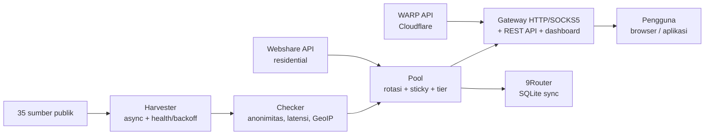

> Это перевод [основного README (на индонезийском языке)](../../README.md). Действующей является версия на индонезийском языке.

<div align="center">

# ⚡ Proxyz

**Сбор публичных прокси, ротирующий шлюз, WARP и резидентные прокси — быстро, безопасно, с открытым исходным кодом.**

[](https://github.com/Dvifnyz/Proxyz/releases)
[](https://github.com/Dvifnyz/Proxyz/actions/workflows/ci.yml)
[](../../LICENSE)
[](https://www.python.org/)
[](https://github.com/Dvifnyz/Proxyz/stargazers)
[](https://github.com/Dvifnyz/Proxyz/commits/main)
[](https://github.com/Dvifnyz/Proxyz/issues)
[](../../CONTRIBUTING.md)
[](#разработка)

[📖 Документация](../../docs/API.md) · [📋 Журнал изменений](../../CHANGELOG.md) · [🤝 Участие](../../CONTRIBUTING.md) · [🔒 Безопасность](../../SECURITY.md)

Читать этот README на других языках: [English](../../docs/translations/README.en.md) · [中文](../../docs/translations/README.zh-CN.md) · [한국어](../../docs/translations/README.ko.md) · [日本語](../../docs/translations/README.ja.md) · [Русский](../../docs/translations/README.ru.md) · [العربية](../../docs/translations/README.ar.md) · [Afrikaans](../../docs/translations/README.af.md) · [Español](../../docs/translations/README.es.md) · [Português](../../docs/translations/README.pt.md) · [Deutsch](../../docs/translations/README.de.md) · [Français](../../docs/translations/README.fr.md) · [हिन्दी](../../docs/translations/README.hi.md)

</div>

## Основные возможности

- 🌾 **Массовый сбор, единый конвейер** — 35 публичных источников (HTTP, SOCKS4, SOCKS5), около 70 тысяч кандидатов за считанные секунды.
- ✅ **Честная проверка** — анонимность (elite/anonymous/transparent), задержка, страна и провайдер (пакетный GeoIP), оценка 0–100. Мёртвые выбрасываются, а не прячутся.
- 🔄 **Ротирующий шлюз** — HTTP + SOCKS5, липкие сессии, маршрутизация по странам, авто-хилер, токен, ограничение скорости, журнал аудита.
- ☁️ **Бесплатный WARP** — профили WireGuard через официальный API Cloudflare.
- 🏠 **Резидентные прокси** — через официальный API Webshare (несколько аккаунтов), без ферм аккаунтов и без решателей капчи.
- 📊 **Наблюдаемость** — состояние источников, бенчмарк скорости, проверка утечек, отчёты, doctor, автоматический планировщик.
- 🔒 **Безопасность по дизайну** — TLS всегда включён, обновления через pip (без удалённых команд), шлюз слушает только localhost.

## Содержание

- [Установка](#установка)
- [Быстрый старт](#быстрый-старт)
- [Архитектура](#архитектура)
- [Возможности](#возможности)
- [Команды](#команды)
- [Шлюз и API](#шлюз-и-api)
- [Резидентные прокси](#резидентные-прокси)
- [Конфигурация](#конфигурация)
- [Структура проекта](#структура-проекта)
- [FAQ](#faq)
- [Устранение неполадок](#устранение-неполадок)
- [Дорожная карта](#дорожная-карта)
- [Разработка](#разработка)
- [Безопасность](#безопасность)
- [Лицензия и благодарности](#лицензия-и-благодарности)

## Установка

**Требования:** Python 3.9+.

### Через pip

```bash
pip install proxyz
```

### Через pipx (рекомендуется для CLI)

```bash
pipx install proxyz
```

### Из исходников

```bash
git clone https://github.com/Dvifnyz/Proxyz.git
cd Proxyz
pip install -e .
```

### Через Docker

```bash
docker build -t proxyz .
docker run -p 8888:8888 proxyz
```

Подробнее о Python API — в [docs/API.md](../../docs/API.md).

## Быстрый старт

```bash
python -m proxyz panen --jumlah 20     # panen + cek 20 proxy hidup
python -m proxyz gateway               # gateway di http://127.0.0.1:8888
curl -x http://127.0.0.1:8888 http://api.ipify.org
```

Без аргументов `python -m proxyz` открывает интерактивное меню.

Пример реального вывода:

```
$ python -m proxyz sources

  SUMBER                                                HASIL  GAGAL  STATUS
  https://raw.githubusercontent.com/zevtyardt/proxy-   128468      0  aktif
  https://raw.githubusercontent.com/B4RC0DE-TM/proxy     6370      0  aktif
  https://raw.githubusercontent.com/TheSpeedX/PROXY-     5354      0  aktif
```

```
$ python -m proxyz doctor

  🩺 Proxyz Doctor
  ✅ Python: 3.12.3
  ✅ Config: port 8888, healer 90 dtk
  ✅ Sumber panen: 35 URL (http, socks4, socks5)
  ✅ Sehat (2 peringatan, 0 error).
```

## Архитектура



Описание каждого компонента: [docs/ARSITEKTUR.md](../../docs/ARSITEKTUR.md).

## Возможности

### Сбор и проверка

- 35 источников (17 HTTP, 8 SOCKS4, 10 SOCKS5), свежие источники проверяются первыми.
- Оценка состояния каждого источника (`proxyz sources`); источник, трижды подряд завершившийся неудачей, отдыхает 1 час.
- Фильтры: страна (`--negara ID`), протокол, уровень скорости (`--tier cepat` — ≤350 мс, `sedang` — ≤800 мс).
- Чёрный список (`proxyz blacklist add 1.2.3.4:8080`) — прокси из чёрного списка никогда не проходят сбор и проверку.

### Шлюз

- Пересылка HTTP/HTTPS (CONNECT) + слушатель SOCKS5 (`--socks 1080`).
- Ротации по кругу, приоритет резидентным прокси, липкие сессии на 10 минут (`X-Session-ID`), маршрутизация по странам (`X-Country: ID`).
- Авто-хилер: настоящие HTTP-пробы каждые 90 секунд, удаление мёртвых, пополнение при истощении пула.
- Необязательный токен (`PROXYZ_TOKEN`), ограничение 60 запросов в минуту с одного IP, журнал аудита `output/gateway-audit.jsonl`.
- Веб-панель: таблица пула, кнопки проверки утечек и теста скорости.

### Наблюдаемость

- `proxyz bench` — рейтинг реальной скорости загрузки (1 МБ через Cloudflare).
- `proxyz test` / `/api/leak-test` — собственный IP против IP через шлюз.
- `proxyz laporan` — сводка по пулу (Markdown + `/api/report`).
- `proxyz auto` — периодический цикл «сбор → проверка → экспорт».
- `proxyz doctor` — диагностика установки.
- `proxyz update` — проверка релизов GitHub, безопасное обновление через pip.

## Команды

| Команда | Назначение |
|---|---|
| `proxyz panen [--jumlah 20] [--negara ID] [--protokol all] [--tier cepat] [--geo]` | Сбор + проверка живых прокси, экспорт в `output/` |
| `proxyz cek <file> [--jumlah 20]` | Проверка списка прокси из файла |
| `proxyz gateway [--port 8888] [--profil scraper\|cepat\|hemat] [--socks 1080]` | Ротирующий шлюз (HTTP + опциональный SOCKS5) |
| `proxyz warp [--jumlah 1]` | Создание профилей WARP WireGuard (`.conf`, режим 0600) |
| `proxyz residential [--api-key KEY \| --signup]` | Резидентные прокси Webshare (официальный API) |
| `proxyz sources` | Таблица состояния источников сбора |
| `proxyz bench [--jumlah 10]` | Рейтинг скорости загрузки каждого HTTP-прокси |
| `proxyz test [--port 8888]` | Проверка утечек: собственный IP против IP через шлюз |
| `proxyz laporan` | Сводка по пулу в `output/laporan.md` |
| `proxyz sync-9router [--db PATH] [--ganti]` | Синхронизация пула с базой SQLite 9Router |
| `proxyz blacklist add\|remove\|list [entri]` | Управление прокси, которые нельзя использовать |
| `proxyz auto [--interval 60] [--sekali]` | Периодический сбор + проверка + экспорт |
| `proxyz install-service [--port 8888]` | Создание файлов службы (systemd + Windows Task) |
| `proxyz update [--yes]` | Проверка свежих релизов, обновление через pip |
| `proxyz doctor [--no-gateway]` | Диагностика установки (конфиг, источники, пул, шлюз) |

## Шлюз и API

Шлюз слушает `127.0.0.1:8888` (только localhost — специально не открыт в LAN). Используйте в браузере или приложении `http://127.0.0.1:8888` как прокси либо SOCKS5 на порту, заданном через `--socks`.

| Конечная точка | Назначение |
|---|---|
| `GET /api/status` | Статистика пула и шлюза |
| `GET /api/proxies` | Список прокси в пуле |
| `GET /api/random` | Один случайный прокси |
| `GET /api/rotate` | Принудительная ротация на следующий прокси |
| `GET /api/refill` | Пополнение пула в фоне |
| `GET /api/leak-test` | Собственный IP против IP через шлюз (`zero_leak`) |
| `GET /api/bench?jumlah=5` | Рейтинг скорости пула |
| `GET /api/report` | Отчёт по пулу (JSON) |
| `GET /api/clash.yaml` | Живая подписка Clash из пула |
| `GET /metrics` | Метрики Prometheus |
| `GET /proxy.pac` | PAC-файл для браузера |
| `GET /dashboard` | Веб-панель (таблица пула, проверка утечек, бенчмарк) |

**Аутентификация (необязательно):** задайте переменную окружения `PROXYZ_TOKEN`, затем отправляйте `Authorization: Bearer <token>` (или заголовок `X-Proxyz-Token`).

## Резидентные прокси

Нужны домашние IP (резидентные)? Официальный путь такой:

```bash
python -m proxyz residential --signup   # buka browser + siapkan password;
                                        # isi captcha sendiri sekali,
                                        # tempel API key -> divalidasi live
python -m proxyz residential --api-key KUNCIMU   # tambah akun lain
```

Поддерживается несколько аккаунтов — все ключи объединяются в один пул. Или вставьте прокси вручную (`proto://user:pass@ip:port`) в `output/proxy_manual.txt`; шлюз будет их использовать, а резидентные получат приоритет в пуле.

> Proxyz **не** предоставляет автоматические решатели капчи, массовое создание аккаунтов или обход антибот-защиты. Аккаунты, созданные фермой, быстро банятся, а их IP умирают — именно это и сокращает жизнь инструмента.

## Конфигурация

Все настройки — в `config/proxyz.json` (плюс переменные окружения, если есть). Токен **не** пишите в этот файл — используйте переменную окружения `PROXYZ_TOKEN`.

```json
{"gateway_port": 8888, "healer_interval": 90, "min_healthy": 5,
 "healer_target": 10, "check_timeout": 5.0, "check_workers": 100,
 "check_target": 20, "max_latency_ms": 1200, "session_ttl": 600,
 "rate_limit_per_min": 60, "audit_log": true,
 "schedule_interval_min": 60, "schedule_target": 20}
```

Профили шлюза (`--profil`): `scraper` (агрессивная ротация, пул 30), `cepat` (только прокси ≤350 мс), `hemat` (маленький пул, сессии по 30 минут).

## Структура проекта

```
Proxyz/
├── proxyz/              # paket utama
│   ├── cli.py           # CLI + menu interaktif
│   ├── harvester.py     # panen 35 sumber + skor kesehatan
│   ├── checker.py       # cek hidup, anonimitas, GeoIP batch
│   ├── pool.py          # rotasi, sticky session, tier
│   ├── gateway.py       # gateway HTTP/SOCKS5 + REST + dashboard
│   ├── warp.py          # WARP via API Cloudflare
│   ├── residential.py   # Webshare API resmi + signup semi-otomatis
│   ├── router.py        # sinkronisasi 9Router (SQLite)
│   ├── bench.py         # uji kecepatan unduh
│   ├── scheduler.py     # mode auto berkala
│   ├── report.py        # laporan pool
│   ├── doctor.py        # diagnosa instalasi
│   ├── updater.py       # update aman via pip
│   └── ...              # blacklist, tiers, config, installer
├── config/              # sources.json, proxyz.json, blacklist.txt
├── docs/                # API, ARSITEKTUR, STUDI, translations (12 bahasa)
├── tests/               # 97 tes (pytest)
├── Dockerfile           # gateway di Docker
└── README.md
```

## FAQ

**Законен ли Proxyz?**
Да — инструмент использует только публичные источники прокси и официальные API (Webshare, Cloudflare). Ответственность пользователя: не отправлять конфиденциальные данные через незнакомые публичные прокси и соблюдать условия использования сервисов.

**Почему `panen` даёт 0 живых прокси?**
Большинство бесплатных прокси мертвы — это нормально. Попробуйте позже, смените сеть или используйте другую страну (`--negara`). Чтобы убедиться, что установка в порядке, запустите `proxyz doctor`.

**Почему для резидентных прокси нужна ручная регистрация?**
Потому что Webshare даёт 10 бесплатных IP на аккаунт, а аккаунты, созданные ботами (капча решается автоматически), быстро банятся — вместе с их IP. Зарегистрируйтесь один раз (30 секунд), и Proxyz будет пользоваться ключом всегда.

**Работает ли Proxyz в Windows?**
Да. Нужен Python 3.9+, все команды те же. Для автозапуска при входе используйте `proxyz install-service` (создаёт задание в Task Scheduler).

**Можно ли обращаться к шлюзу с телефона или другого компьютера?**
Нет — специально только `127.0.0.1`. Если нужен доступ из LAN, запускайте за собственным обратным прокси с активным токеном.

**Где хранится мой API-ключ Webshare?**
В локальном файле `config/webshare.json` (режим 0600), он никогда не попадает в коммиты. Если ключ утёк, удалите файл и создайте новый ключ в панели Webshare.

## Устранение неполадок

| Симптом | Причина и исправление |
|---|---|
| `pool kosong — panen dulu` | Сначала запустите `proxyz panen`, или шлюз сам соберёт прокси при запуске |
| `502` saat browsing via gateway | Все прокси в пуле мертвы — хилер пополнит пул; или запустите `proxyz panen` ещё раз |
| `401 token dibutuhkan` | Задайте `PROXYZ_TOKEN` в окружении и отправляйте `Authorization: Bearer <token>` |
| `429 rate limit` | Подождите около минуты или увеличьте `rate_limit_per_min` в конфиге |
| `proxyz update` 404 | Релизов на GitHub пока нет — updater автоматически откатывается к тегам |
| Gateway tidak bisa diakses | Убедитесь, что порт 8888 не занят другим процессом; проверьте `proxyz doctor` |
| `0 hidup` terus-menerus | Сеть блокирует прямые TCP-подключения к прокси (например, песочница) — попробуйте на обычном ноутбуке или ПК |

Всё ещё не работает? Запустите `proxyz doctor` и приложите вывод, когда открываете issue.

## Дорожная карта

- [ ] Поддержка IPv6 для checker и шлюза
- [ ] Источники сбора от сообщества (PR приветствуются)
- [ ] Режим `proxyz serve` — шлюз + auto в одном процессе
- [ ] Экспорт в Surge / Shadowrocket
- [ ] Панель v3 — графики задержки и история пула

Есть другие идеи? Откройте [issue с предложением](../../.github/ISSUE_TEMPLATE/feature_request.md).

## Разработка

```bash
git clone https://github.com/Dvifnyz/Proxyz.git
cd Proxyz
python -m venv .venv && source .venv/bin/activate
pip install -e ".[dev]"
pytest -q            # 97 tes
python -m proxyz doctor
```

Руководство по участию — в [CONTRIBUTING.md](../../CONTRIBUTING.md) (стиль коммитов, добавление источников, добавление команд).

## Безопасность

Не сообщайте об уязвимостях через публичные issue — читайте [SECURITY.md](../../SECURITY.md). Вкратце: шлюз слушает только localhost, токен никогда не записывается в файл конфигурации, API-ключ Webshare хранится локально в режиме 0600, а updater никогда не выполняет команды с сервера.

## Лицензия и благодарности

Лицензия [MIT](../../LICENSE).

Спасибо [itzluthfi](https://github.com/itzluthfi) — автору [petani-proxy](https://github.com/itzluthfi/petani-proxy), ставшего материалом для изучения и источником вдохновения для этого инструмента. Структура этого README опирается на [FastAPI](https://github.com/fastapi/fastapi) и [uv](https://github.com/astral-sh/uv).

[](https://star-history.com/#Dvifnyz/Proxyz&Date)
