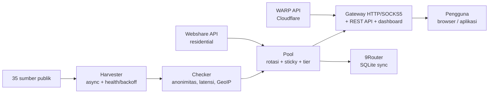

> 这是主 README（英语）的翻译版本。以[英语版本](../../README.md)为准。

<div align="center">

# ⚡ Proxyz

**采集公开代理、轮换网关、WARP 与住宅代理——快速、安全、开源。**

[](https://github.com/Dvifnyz/Proxyz/releases)
[](https://github.com/Dvifnyz/Proxyz/actions/workflows/ci.yml)
[](../../LICENSE)
[](https://www.python.org/)
[](https://github.com/Dvifnyz/Proxyz/stargazers)
[](https://github.com/Dvifnyz/Proxyz/commits/main)
[](https://github.com/Dvifnyz/Proxyz/issues)
[](../../CONTRIBUTING.md)
[](#开发)

[📖 文档](../../docs/API.md) · [📋 更新日志](../../CHANGELOG.md) · [🤝 参与贡献](../../CONTRIBUTING.md) · [🔒 安全](../../SECURITY.md)

用其他语言阅读本 README：[English](../../README.md) · [Bahasa Indonesia](README.id.md) · [中文](README.zh-CN.md) · [한국어](README.ko.md) · [日本語](README.ja.md) · [Русский](README.ru.md) · [العربية](README.ar.md) · [Afrikaans](README.af.md) · [Español](README.es.md) · [Português](README.pt.md) · [Deutsch](README.de.md) · [Français](README.fr.md) · [हिन्दी](README.hi.md)

</div>

## 亮点

- 🌾 **批量采集，单一流水线**——35 个公开来源（HTTP、SOCKS4、
  SOCKS5），数秒内获得约 7 万个候选代理。
- ✅ **诚实检测**——匿名度（elite/anonymous/transparent）、
  延迟、国家/ISP（批量 GeoIP），评分 0–100。失效的直接丢弃，
  绝不隐瞒。
- 🔄 **轮换网关**——HTTP + SOCKS5、粘性会话、按国家路由、
  自动修复、令牌、限速、审计日志。
- ☁️ **免费 WARP**——通过 Cloudflare 官方 API 生成 WireGuard 配置。
- 🏠 **住宅代理**——通过 Webshare 官方 API（支持多账号），
  无账号农场、无验证码破解。
- 📊 **可观测性**——来源健康度、速度测试、泄漏测试、报告、
  诊断、自动调度。
- 🔒 **安全设计**——TLS 保持开启，通过 pip 更新（不执行远程
  命令），网关仅绑定 localhost。

## 目录

- [安装](#安装)
- [快速上手](#快速上手)
- [架构](#架构)
- [功能](#功能)
- [命令](#命令)
- [网关与 API](#网关与-api)
- [住宅代理](#住宅代理)
- [配置](#配置)
- [项目结构](#项目结构)
- [常见问题](#常见问题)
- [故障排查](#故障排查)
- [路线图](#路线图)
- [开发](#开发)
- [安全](#安全)
- [许可证](#许可证)

## 安装

**要求：**Python 3.9+。

### 使用 pip 安装

```bash
pip install proxyz
```

### 使用 pipx 安装（推荐用于命令行工具）

```bash
pipx install proxyz
```

### 从源码安装

```bash
git clone https://github.com/Dvifnyz/Proxyz.git
cd Proxyz
pip install -e .
```

### 使用 Docker 安装

```bash
docker build -t proxyz .
docker run -p 8888:8888 proxyz
```

Python API 请参阅 [docs/API.md](../../docs/API.md)。

## 快速上手

```bash
python -m proxyz panen --jumlah 20     # panen + cek 20 proxy hidup
python -m proxyz gateway               # gateway di http://127.0.0.1:8888
curl -x http://127.0.0.1:8888 http://api.ipify.org
```

不带参数时，`python -m proxyz` 会打开交互式菜单。

真实输出示例：

```
$ python -m proxyz sources

  SUMBER                                                HASIL  GAGAL  STATUS
  https://raw.githubusercontent.com/zevtyardt/proxy-   128468      0  aktif
  https://raw.githubusercontent.com/B4RC0DE-TM/proxy     6370      0  aktif
  https://raw.githubusercontent.com/TheSpeedX/PROXY-     5354      0  aktif
```

```
$ python -m proxyz doctor

  🩺 Proxyz Doctor
  ✅ Python: 3.12.3
  ✅ Config: port 8888, healer 90 dtk
  ✅ Sumber panen: 35 URL (http, socks4, socks5)
  ✅ Sehat (2 peringatan, 0 error).
```

## 架构



各组件说明：[docs/ARSITEKTUR.md](../../docs/ARSITEKTUR.md)。

## 功能

### 采集与检测

- 35 个来源（17 个 HTTP、8 个 SOCKS4、10 个 SOCKS5），优先检测新鲜来源。
- 每个来源都有健康评分（`proxyz sources`）；连续失败
  3 次的来源会被暂停 1 小时。
- 筛选条件：国家（`--negara ID`）、协议、速度等级
  （`--tier cepat` ≤350 毫秒，`sedang` ≤800 毫秒）。
- 黑名单（`proxyz blacklist add 1.2.3.4:8080`）——列入黑名单的
  代理永远不会通过采集/检测。

### 网关

- 转发 HTTP/HTTPS（CONNECT）+ SOCKS5 监听（`--socks 1080`）。
- 轮询轮换、优先使用住宅代理、粘性会话
  10 分钟（`X-Session-ID`）、按国家路由（`X-Country: ID`）。
- 自动修复：每 90 秒进行真实 HTTP 探测，剔除失效代理，
  池子不足时自动补充。
- 可选令牌（`PROXYZ_TOKEN`），每 IP 每分钟限速 60 次，
  审计日志位于 `output/gateway-audit.jsonl`。
- 网页仪表盘：代理池表格、泄漏测试与速度测试按钮。

### 可观测性

- `proxyz bench`——真实下载速度排名（通过 Cloudflare 下载 1 MB）。
- `proxyz test` / `/api/leak-test`——真实 IP 与经网关的 IP 对比。
- `proxyz laporan`——代理池摘要（Markdown + `/api/report`）。
- `proxyz auto`——采集 → 检测 → 导出，周期性执行。
- `proxyz doctor`——安装诊断。
- `proxyz update`——检查 GitHub 发布，通过 pip 更新（安全）。

## 命令

| 命令 | 功能 |
|---|---|
| `proxyz panen [--jumlah 20] [--negara ID] [--protokol all] [--tier cepat] [--geo]` | 采集并检测可用代理，导出到 `output/` |
| `proxyz cek <file> [--jumlah 20]` | 从文件检测代理列表 |
| `proxyz gateway [--port 8888] [--profil scraper\|cepat\|hemat] [--socks 1080]` | 轮换网关（HTTP + 可选 SOCKS5） |
| `proxyz warp [--jumlah 1]` | 生成 WARP WireGuard 配置（`.conf`，权限 0600） |
| `proxyz residential [--api-key KEY \| --signup]` | Webshare 住宅代理（官方 API） |
| `proxyz sources` | 各采集来源的健康状况表 |
| `proxyz bench [--jumlah 10]` | 各 HTTP 代理的下载速度排名 |
| `proxyz test [--port 8888]` | 泄漏测试：真实 IP 与经网关的 IP 对比 |
| `proxyz laporan` | 代理池摘要，输出到 `output/laporan.md` |
| `proxyz sync-9router [--db PATH] [--ganti]` | 将代理池同步到 9Router SQLite 数据库 |
| `proxyz blacklist add\|remove\|list [entri]` | 管理禁止使用的代理 |
| `proxyz auto [--interval 60] [--sekali]` | 定期采集 + 检测 + 导出 |
| `proxyz install-service [--port 8888]` | 生成服务文件（systemd + Windows 任务计划） |
| `proxyz update [--yes]` | 检查最新发布，通过 pip 更新 |
| `proxyz doctor [--no-gateway]` | 诊断安装（配置、来源、代理池、网关） |

## 网关与 API

网关监听 `127.0.0.1:8888`（仅本地——有意不暴露到局域网）。
在浏览器/应用中将 `http://127.0.0.1:8888` 设为代理即可使用，
或通过 `--socks` 指定端口使用 SOCKS5。

| 接口 | 功能 |
|---|---|
| `GET /api/status` | 代理池与网关统计 |
| `GET /api/proxies` | 代理池中的代理列表 |
| `GET /api/random` | 随机获取一个代理 |
| `GET /api/rotate` | 强制轮换到下一个代理 |
| `GET /api/refill` | 在后台补充代理池 |
| `GET /api/leak-test` | 真实 IP 与经网关的 IP 对比（`zero_leak`） |
| `GET /api/bench?jumlah=5` | 代理池速度排名 |
| `GET /api/report` | 代理池报告（JSON） |
| `GET /api/clash.yaml` | 代理池实时 Clash 订阅 |
| `GET /metrics` | Prometheus 指标 |
| `GET /proxy.pac` | 浏览器 PAC 文件 |
| `GET /dashboard` | 网页仪表盘（代理池表格、泄漏测试、速度测试） |

**认证（可选）：**填写 `PROXYZ_TOKEN` 环境变量，然后发送
`Authorization: Bearer <token>`（或 `X-Proxyz-Token` 请求头）。

## 住宅代理

需要住宅 IP？官方途径如下：

```bash
python -m proxyz residential --signup   # buka browser + siapkan password;
                                        # isi captcha sendiri sekali,
                                        # tempel API key -> divalidasi live
python -m proxyz residential --api-key KUNCIMU   # tambah akun lain
```

支持多账号——所有密钥会合并到同一个池子。也可以将手动代理
（`proto://user:pass@ip:port`）粘贴到
`output/proxy_manual.txt`；网关会一并使用，住宅代理在池中
会被优先选用。

> Proxyz **不**提供自动验证码破解、批量账号注册或反机器人绕过。
> 农场账号很快就会被封禁，IP 也随之失效——这正是工具短命的原因。

## 配置

所有设置都在 `config/proxyz.json` 中（另有环境变量可覆盖）。
令牌**不要**写进这个文件——请使用 `PROXYZ_TOKEN` 环境变量。

```json
{"gateway_port": 8888, "healer_interval": 90, "min_healthy": 5,
 "healer_target": 10, "check_timeout": 5.0, "check_workers": 100,
 "check_target": 20, "max_latency_ms": 1200, "session_ttl": 600,
 "rate_limit_per_min": 60, "audit_log": true,
 "schedule_interval_min": 60, "schedule_target": 20}
```

网关配置（`--profil`）：`scraper`（激进轮换，池大小 30）、
`cepat`（仅限 ≤350 毫秒的代理）、`hemat`（小池子，会话 30 分钟）。

## 项目结构

```
Proxyz/
├── proxyz/              # paket utama
│   ├── cli.py           # CLI + menu interaktif
│   ├── harvester.py     # panen 35 sumber + skor kesehatan
│   ├── checker.py       # cek hidup, anonimitas, GeoIP batch
│   ├── pool.py          # rotasi, sticky session, tier
│   ├── gateway.py       # gateway HTTP/SOCKS5 + REST + dashboard
│   ├── warp.py          # WARP via API Cloudflare
│   ├── residential.py   # Webshare API resmi + signup semi-otomatis
│   ├── router.py        # sinkronisasi 9Router (SQLite)
│   ├── bench.py         # uji kecepatan unduh
│   ├── scheduler.py     # mode auto berkala
│   ├── report.py        # laporan pool
│   ├── doctor.py        # diagnosa instalasi
│   ├── updater.py       # update aman via pip
│   └── ...              # blacklist, tiers, config, installer
├── config/              # sources.json, proxyz.json, blacklist.txt
├── docs/                # API, ARSITEKTUR, translations (13 languages)
├── tests/               # 97 tes (pytest)
├── Dockerfile           # gateway di Docker
└── README.md
```

## 常见问题

**Proxyz 合法吗？**
合法——本工具仅使用公开代理来源和官方 API（Webshare、
Cloudflare）。仍属于用户自己的责任：不要通过不了解的公开代理
发送敏感数据，并遵守所用服务的服务条款。

**为什么 `panen` 一个可用代理都找不到？**
免费代理大多已失效——这很正常。稍后再试、换个网络，或换个
`--negara`。运行 `proxyz doctor` 确认安装是否正常。

**为什么住宅代理必须手动注册？**
因为 Webshare 每个账号提供 10 个免费 IP，而机器批量创建的账号
（自动破解验证码）很快就会被封禁——IP 也跟着失效。注册一次
（30 秒），密钥可供 Proxyz 永久使用。

**Proxyz 能在 Windows 上运行吗？**
可以。需要 Python 3.9+，所有命令都一样。如需登录时自动运行，
请使用 `proxyz install-service`（创建任务计划程序）。

**网关能从手机/其他电脑访问吗？**
不能——有意仅限 `127.0.0.1`。如需从局域网访问，请在自己的
反向代理后面运行，并启用令牌。

**我的 Webshare API 密钥存在哪里？**
存在本地 `config/webshare.json`（权限 0600），永不提交。
如果密钥泄露，删除该文件，然后在 Webshare 控制台创建新密钥。

## 故障排查

| 症状 | 原因与修复 |
|---|---|
| `pool kosong — panen dulu` | 先运行 `proxyz panen`，或让网关在启动时自行采集 |
| `502` saat browsing via gateway | 池中代理全部失效——自动修复会补充；也可以重新运行 `proxyz panen` |
| `401 token dibutuhkan` | 在环境变量中填写 `PROXYZ_TOKEN`，并发送 `Authorization: Bearer <token>` |
| `429 rate limit` | 等待约 1 分钟，或调高配置中的 `rate_limit_per_min` |
| `proxyz update` 404 | GitHub 上还没有 Release——更新器会自动回退到标签 |
| Gateway tidak bisa diakses | 确认没有其他进程占用 8888 端口；运行 `proxyz doctor` 检查 |
| `0 hidup` terus-menerus | 网络屏蔽了到代理的直接 TCP 连接（例如沙箱环境）——请在普通笔记本/电脑上尝试 |

还没解决？运行 `proxyz doctor`，并在提交 issue 时附上输出。

## 路线图

- [ ] 检测器与网关支持 IPv6
- [ ] 社区提供的采集来源（欢迎 PR）
- [ ] `proxyz serve` 模式——网关 + 自动任务合而为一
- [ ] 导出 Surge / Shadowrocket
- [ ] 仪表盘 v3——延迟图表与代理池历史

有其他想法？请提交[功能建议](../../.github/ISSUE_TEMPLATE/feature_request.md)。

## 开发

```bash
git clone https://github.com/Dvifnyz/Proxyz.git
cd Proxyz
python -m venv .venv && source .venv/bin/activate
pip install -e ".[dev]"
pytest -q            # 97 tes
python -m proxyz doctor
```

贡献指南请参阅 [CONTRIBUTING.md](../../CONTRIBUTING.md)
（提交规范、添加来源、添加命令）。

## 安全

请勿通过公开 issue 报告漏洞——请阅读
[SECURITY.md](../../SECURITY.md)。简而言之：网关仅绑定 localhost，
令牌永不写入配置文件，Webshare API 密钥以 0600 权限本地保存，
更新器永不执行来自服务器的命令。

## 许可证

许可证 [MIT](../../LICENSE)。

[](https://star-history.com/#Dvifnyz/Proxyz&Date)
